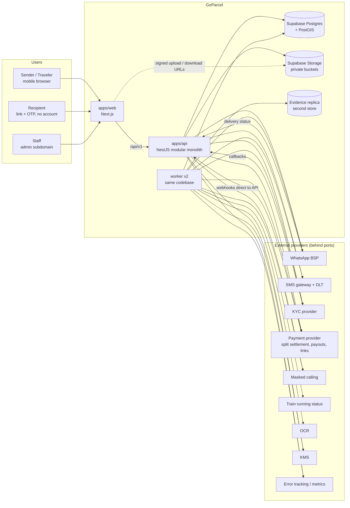

# GoParcel — Architecture and Technical Design

| Item | Value |
|---|---|
| Document | GoParcel Architecture and Technical Design |
| Version | 0.2 — Draft for product-owner review |
| Date | 22 November 2026 |
| Product owner | Shubham |
| Inputs | `docs/product/PRD/GOPARCEL_MASTER_PRD.md` v2.1 (including Appendix C.7, decisions PD-01..PD-20); audit `docs/architecture/audit/` (51 findings, AUD-001..AUD-051) |
| Previous version | v0.1, archived unchanged at `docs/architecture/archive/GOPARCEL_ARCHITECTURE_v0.1.md` |
| Development status | **No development is authorised by this document.** Development starts only when the product owner says "START DEVELOPMENT". |

This document says **how** GoParcel will be built. The PRD stays the single source of truth for **what** to build. If this document disagrees with the PRD, the PRD wins and this document must be fixed.

---

## 0. How to read this document

### 0.1 Status labels

| Label | Meaning |
|---|---|
| **[CONFIRMED]** | Already approved: ARCH-xx, D-xx, DEC-xxx, PD-xx or a PRD business rule. This document only applies it. |
| **[PROPOSED]** | A new architecture decision (`AD-xx`) that needs product-owner approval. |
| **[TBD]** | Still to be decided. The owner and what triggers the decision are named. |
| **[VERIFY]** | A claim about a library, vendor or platform that must be proven in the foundation spike (§14.1) before anything depends on it. |

### 0.2 What approval means (AUD-036)

- Approving this document approves the `AD-xx` decisions marked [PROPOSED], unless the product owner strikes any out.
- It does **not** answer any open question. It does not change any PRD decision.
- Product decisions are made only in PRD Appendix C. This document only refers to them.

### 0.3 Changes from v0.1

| Audit finding(s) | Change | Section |
|---|---|---|
| AUD-036 | Assumptions replaced by recorded product decisions PD-01..PD-20 | §1 |
| AUD-014, 015, 016, 043 | New layer model and an explicit allowed-dependency list. Booking orchestrates every multi-aggregate flow. In-transaction "transactional events" removed. State events stored per module. Holds moved to Payments. | §6 |
| AUD-006, 007, 017 | Complete canonical lock order. Every flow listed with the locks it takes. Full accept re-check. | §7.2, §7.3 |
| AUD-013, 046, 047 | Deadlines stored on the aggregates themselves. Outbox is the only write inside the business transaction. pg-boss is driven by the worker only, with migrations run in CD. Connectivity spike added. | §7.6, §7.7, §14.1 |
| AUD-005 | Two workers. The payment-window expiry checks the provider before expiring a booking. Alerts on queue age. | §7.7, §8.5, §14.2 |
| AUD-018 | Idempotency record written in the business transaction | §7.5 |
| AUD-001, 002, 049 | New funds-flow model, chart of accounts and posting rules. Contingent credits for BR-38. Withholding hook. | §8.4 |
| AUD-003, 004, 025 | Provider treated as source of truth. Out-of-order payment events handled. Refund state machine with an UNKNOWN state. Stable references on every money call. `payment_due_at` stored. | §8.5 |
| AUD-009 | Payable items and payout batches, clearing account, singleton run, reversal on failure (PD-09) | §8.6 |
| AUD-008, 020, 024 | Cancellation and outcome table. Cash commission posted in the pickup transaction. Terminal-state owners named (PD-17). | §8.7 |
| AUD-010, 011, 027, 042 | Codes stored encrypted plus HMAC. Two-way codes and offline queue (PD-11). Plausibility checks. Code regeneration. | §8.8 |
| AUD-026 | Recipient OTP (PD-12), code revealed only after a tap, no-store, no-referrer | §9.3 |
| AUD-012 | Account recovery, recycled numbers (PD-13), selfie re-match on payout-account change | §8.1 |
| AUD-021, 022, 023, 045 | City-level matching (PD-14), scheduled-period overlap rule, trip-level weight row, whole-trip capacity (PD-18), SRID and GiST index, cached dues balance | §8.2, §8.3, §11 |
| AUD-028, 029, 030, 031, 032, 037, 038, 040 | Evidence replication, OTP budget, admin on its own subdomain, CSRF, reconciliation design, threat model, provider-agnostic duplicate detection, key hierarchy, notification data access | §8.9, §8.11, §10, §8.5 |
| AUD-033, 034 | Core endpoint inventory and key fields for the money and custody tables | §9.6, §11.5 |
| AUD-035, 048 | Raw-SQL object registry, typed raw SQL for locks, failure-path tests | §11.4, §15 |
| AUD-039 | Cost model structure | §14.6 |
| PD-04 | Scope and build order cut for 1–2 engineers; essential admin console | §13.4, §16 |

---

## 1. Product decisions applied

v0.1 assumed answers to the open questions. These are now recorded product-owner decisions (PRD Appendix C.7):

| PD | Decision (short) | Where applied |
|---|---|---|
| PD-01 | DEC-051: online payment needs departure ≥ pay window + booking cutoff; cash bookings need only the booking cutoff | §7.3 |
| PD-02 | Users log in with phone OTP only; staff use OTP plus TOTP | §8.1 |
| PD-03, PD-12 | Recipient has no account: delivery link plus an OTP before the code is shown | §9.3 |
| PD-04 | 1–2 engineers; essential admin console; Stage A for about 2 weeks | §13.4, §16 |
| PD-05 | Missed-handover fallback with a 12 h final-destination window | §8.7 |
| PD-06 | RV-01..04 and BR-38 confirmed | §8.4, §8.7 |
| PD-07 | GoParcel's reserve pays compensation and cash-booking refunds via provider payouts to a validated sender account | §8.4 |
| PD-08 | Check the provider before expiring a booking; late payment is refunded | §8.5 |
| PD-09 | Daily payout run, one netted transfer per traveler, one line per delivery | §8.6 |
| PD-10 | Custody-value cap for travelers; pair-claim review; write-off rule | §7.3, §8.4, §8.10 |
| PD-11 | Either phone completes a handover; offline queue; no offline verification on the device | §8.8 |
| PD-13 | Recycled-number threshold 90 days; selfie re-match on payout-account change | §8.1 |
| PD-14 | Sender picks cities; the trip gives the exact stop | §8.2 |
| PD-15 | A request's quote is honoured until the request ends | §8.3 |
| PD-16 | Material trip edits system-cancel pending requests | §8.7 |
| PD-17 | Explicit booking end states; EXCEPTION → DELIVERED with a claim; traveler may withdraw while awaiting payment | §7.1, §8.7 |
| PD-18 | Capacity counts for the whole trip | §8.2, §11.3 |
| PD-19 | Cash: per-traveler opt-in plus a per-trip switch | §8.2 |

Still open and **not** decided here:
- **Numbers and vendors:** OQ-10, OQ-12, OQ-16, OQ-17 (numbers), OQ-19 (vendors).
- **Legal and tax:** OQ-20 (counsel and CA), OQ-18 (prohibited items).
- **Operations:** OQ-13 (cities), OQ-14 (support hours), OQ-15 (targets).
- **Upstream records:** OQ-01, OQ-03 (DEC-052/057 text), OQ-04 (meaning of "Courier", assumed to be custody and handover).

---

## 2. Architecture goals and constraints

| # | Goal / constraint | Source |
|---|---|---|
| G-1 | Correct state and money above everything else: no lost transitions, no double booking, refund or payout, every rupee traceable | BR-04..07, BR-16, BR-32, NFR-REL-01, NFR-DATA-01/02 |
| G-2 | Server-authoritative: the client never confirms payment, custody or delivery | BR-06, BR-09, BR-11 |
| G-3 | Low cost and low operational load for 1–2 engineers | PD-04, A-03, NFR-COST-01, ARCH-09 |
| G-4 | Modular monolith, ready to extract modules later | ARCH-03, ARCH-06, ARCH-08 |
| G-5 | Every external vendor replaceable behind a port | ARCH-07, NFR-EXT-01 |
| G-6 | Privacy by default: encrypted, masked, never in logs or URLs | NFR-SEC-02, NFR-PRIV-01/02, BR-27 |
| G-7 | Every staff action auditable and run through the same guards as user actions | BR-18, BR-19 |
| G-8 | Stage A makes real handovers and real payments impossible | PRD §12.1, §14.1 |

Not in the pilot: microservices, Kafka, Kubernetes, Redis, a separate broker, multi-region, GraphQL, a native app.

---

## 3. System context



---

## 4. Technology stack

| Concern | Choice | Status |
|---|---|---|
| Repository | Monorepo, pnpm workspaces + Turborepo | [CONFIRMED] ARCH-01 |
| Language | TypeScript (strict) everywhere | [PROPOSED] AD-01 |
| API | NestJS modular monolith, REST under `/api/v1`, OpenAPI via `@nestjs/swagger` | [CONFIRMED] ARCH-03, ARCH-05, ARCH-11 |
| Database | Supabase PostgreSQL with PostGIS; Prisma ORM; raw-SQL migrations for objects Prisma cannot express (§11.4) | [CONFIRMED] ARCH-04 |
| Object storage | Supabase Storage private buckets, plus a replica store for evidence (§8.9) | [PROPOSED] AD-02 |
| Jobs | pg-boss on Postgres, used **only by the worker** (§7.7); no Redis | [PROPOSED] AD-03 [VERIFY] |
| Web | Next.js (App Router), React; one codebase, served on two hostnames: app and admin (§9.4) | [PROPOSED] AD-04 |
| Validation and client | Zod schemas in `packages/contracts`; OpenAPI-generated client in `packages/api-client` | [PROPOSED] AD-05 |
| Auth | Own OTP and session implementation; Supabase Auth and the Supabase Data API are **not** used | [PROPOSED] AD-06 |
| Logging and errors | pino with redaction; Sentry-compatible error tracking; OpenTelemetry metrics | [PROPOSED] AD-07 |
| Testing and CI | Unit tests, Testcontainers PostGIS integration tests, concurrency and failure-path suites, Playwright; GitHub Actions | [PROPOSED] AD-08 |
| Hosting | Managed container platform in an India region near Supabase Mumbai; vendor chosen after the spike (§14.1) | [PROPOSED] AD-09, vendor [TBD] |
| Key management | Managed KMS from the hosting or cloud vendor (§10.2) | [PROPOSED] AD-16, vendor [TBD] with AD-09 |

**Why not Supabase Auth or the Data API (AD-06):** the PRD needs several things Supabase Auth doesn't give us directly:
- WhatsApp OTP first, with SMS fallback
- identical responses whether or not a number is registered
- detection of refresh-token reuse
- SMS-only recovery with a selfie re-match
- staff 2FA with role-based access

Keeping all of this in the Identity module keeps the rules in one place (ARCH-06). The PostgREST/Data API stays disabled, and the browser never reaches the database.

---

## 5. Repository layout

```
Go_Parcel/
├─ apps/
│  ├─ api/
│  │  ├─ src/main.ts           HTTP server (no pg-boss client)
│  │  ├─ src/worker.ts         worker: outbox relay, sweepers, jobs, provider polling
│  │  ├─ src/modules/<module>/ one folder per module (§6)
│  │  ├─ src/platform/         technical kernel (§6.4)
│  │  └─ prisma/               schema files per module, SQL migrations, raw-SQL registry, seed
│  └─ web/
│     ├─ app/(user)/           sender and traveler (app hostname)
│     ├─ app/r/[token]/        recipient page (app hostname)
│     ├─ app/(admin)/          staff console (admin hostname only; middleware enforces)
│     └─ features/
├─ packages/
│  ├─ api-client/              generated client
│  ├─ contracts/               Zod schemas, enums, state names, error codes, permission map
│  ├─ ui/                      design system, handover widgets
│  ├─ config-eslint/           lint rules incl. the dependency list in §6.3
│  └─ config-ts/
└─ docs/
   ├─ product/PRD/
   └─ architecture/            this document, audit/, archive/, adr/ (once decisions are approved)
```

---

## 6. Module design

### 6.1 Module map

The 18 domain modules in ARCH-10, plus **Privacy** (AD-10). Support cases live in Operations.

| Module | Owns | PRD features |
|---|---|---|
| **Identity** | User (identity, status, phone, `last_seen_at`, `phone_changed_at`), OtpChallenge, Session, StaffUser, StaffRoleGrant | AUTH-001..006, ADMIN-001 |
| **Users** | Profile, consents, Rating, ReliabilityMark | USER-001..003, RATE-001/002 |
| **KYC** | KycRecord, KycAttempt, KYC face reference, duplicate-identity signals | KYC-001..003 |
| **Travelers** | TravelerProfile (cash opt-in, completed count, custody-cap tier), Vehicle, car documents | KYC-005, PD-10, PD-19 |
| **Routes** | City, Station, MeetingPoint, Trip, TripStop, TripCapacity, TripWeight, TicketProof | TRIP-001..006, ROUTE-001/002 |
| **Shipments** | Shipment, Declaration, prohibited categories | SHIP-001..006 |
| **Pricing** | PriceTable, CityPairDistance, DistanceBand, Quote | PRICE-001..003 |
| **Matching** | No tables; read-only queries | MATCH-001..004 |
| **Booking** | Booking, CancellationReview; **orchestrates** accept, confirm, expiry, cancellations, pickup, delivery and outcomes | BOOK-001..007, WF-A..D |
| **Payments** | PaymentAttempt, ProviderEvent, Refund, Payout, PayableItem, Hold, Beneficiary (traveler and sender), CashConfirmation, DuesPaymentLink, ReconciliationItem | PAY-001..010, KYC-004, DISP-003 |
| **Ledger** | LedgerAccount, JournalEntry, Posting, PartyBalance, ContingentCredit | LEDGER-001 |
| **Courier** (custody and handover) | Delivery, HandoverCode, CustodyEvent, Evidence, EvidenceAccess, RecipientAccess | HAND-001..013 |
| **Disputes** | Dispute, Appeal, CustodyResolutionCase, CompensationDecision | DISP-001, 002, 004, 005 |
| **Fraud** | RiskRule, RiskFlag | FRAUD-001/002 |
| **Operations** | Ops queue views, SupportCase | ADMIN-002..005, SUP-001/002 |
| **Admin** | PendingApproval, master-data commands, reports, audit viewer | ADMIN-006..010 |
| **Privacy** | PrivacyRequest, LegalHold, Incident | PRIV-001..003, INC-001 |
| **Notifications** (consumer) | Notification, Template, MaskedCallSession, CallRecord | NOTIF-001..004 |
| **Tracking** (consumer) | TimelineEvent, analytics export | TRACK-001, NFR-OBS-03 |

Changes since v0.1:
- **Holds** move from Disputes to **Payments**. A hold exists only to block a payout, and Payments is the module that checks it. Disputes, Fraud and Operations place holds by calling Payments.
- **StateEvent** history (TRACK-002) is now written by **each module into its own `state_event` table**. Tracking builds only the user-facing timeline, from outbox events.

### 6.2 Inside a module

```
modules/booking/
├─ contracts/        PUBLIC: service interface, DTOs, event types, error codes
├─ application/      use cases; transaction boundaries; orchestration
├─ domain/           entities, state machines, guards, pure calculations
├─ infrastructure/   repositories (Prisma + typed raw SQL), adapters
├─ http/             thin controllers
└─ booking.module.ts exports only the contracts provider
```

Rules [CONFIRMED ARCH-06, NFR-MAINT-01]:
1. Other modules import only `modules/<x>/contracts`.
2. A module reads and writes only its own schema's tables. The only exceptions are read views a module publishes in its contract (§8.2).
3. Business rules live in `domain/` and `application/`.
4. The dependency list in §6.3 is the source of the lint rule (AD-11). A violation or a cycle fails CI.

### 6.3 Layers and allowed dependencies [PROPOSED AD-11]

A module may call a module in a **lower** layer, or a same-layer module **only where the table below lists it**. Upward calls are never allowed. A module can learn about something a higher module did only by subscribing to that module's integration events, and only when the publisher is on its allowed list. Consumer modules may subscribe to any event.

| Layer | Modules |
|---|---|
| L0 | Platform kernel (§6.4) |
| L1 | Identity, Ledger, Pricing |
| L2 | Users, KYC, Travelers |
| L3 | Routes, Shipments |
| L4 | Courier, Matching, Payments |
| L5 | Booking |
| L6 | Disputes, Fraud |
| L7 | Operations, Admin, Privacy |
| C (consumers) | Notifications, Tracking |

**Allowed synchronous dependencies (exhaustive):**

| Module | May call |
|---|---|
| Identity | Platform |
| Ledger | Platform |
| Pricing | Platform |
| Users | Identity |
| KYC | Identity, Users |
| Travelers | Identity, KYC, Ledger |
| Routes | Identity, KYC, Travelers |
| Shipments | Identity, Users, KYC, Ledger, Pricing |
| Courier | Routes, Shipments |
| Matching | Identity, KYC, Routes, Shipments, Pricing, Users, Travelers, Ledger |
| Payments | Identity, Users, KYC, Ledger |
| Booking | Identity, Users, KYC, Travelers, Routes, Shipments, Pricing, Matching, Courier, Payments, Ledger |
| Disputes | Booking, Courier, Payments, Ledger, Identity, Users |
| Fraud | Identity, KYC, Payments, Booking, Courier, Users |
| Operations | Disputes, Fraud, Booking, Routes, Shipments, Courier, KYC, Travelers, Identity, Payments, Users |
| Admin | Everything in L0–L6 (master data, config approvals, finance views) |
| Privacy | The `retention` contract of every module (each module implements `anonymiseSubject`, `purgeExpired`, `listHeldRecords`) |
| Notifications (C) | Read contracts of every module; Platform messaging |
| Tracking (C) | Read contracts of every module |

These rules hold the whole graph together:
- **Booking is the orchestrator.** Every flow that changes more than one of shipment, booking, trip capacity, delivery or payment state runs as a Booking use case, in one transaction. It calls lower modules' commands with the shared transaction context. There are **no in-transaction event handlers** (the v0.1 "transactional events" are removed; AUD-015).
- **Identity sends OTPs through `platform/messaging`**, not through Notifications. Notifications is a consumer: it renders and routes event messages.
- **Restriction cascades** use events. Identity emits `identity.account.restricted|suspended|reverify_required`. Handlers in Routes, Shipments and Booking withdraw, cancel or route to ops (§8.1). Payments reads Identity directly when checking payouts.
- **Config storage lives in the kernel** (`platform.config_value`). Admin owns only the approval workflow.

### 6.4 Platform kernel (`src/platform`)

| Component | Purpose |
|---|---|
| `db` | Prisma client, transaction context (AsyncLocalStorage), `lockSet()` helper using the canonical order (§7.2), deadlock retry wrapper |
| `outbox` | `emit(event)` writes to `platform.outbox` inside the business transaction; relay in the worker |
| `jobs` | Worker-only pg-boss wrapper: relay, sweepers, cron, retries, dead letters, singleton keys |
| `idempotency` | `Idempotency-Key` handling in the business transaction (§7.5) |
| `config` | Typed `CFG-*` registry, storage, snapshots (§12) |
| `crypto` | Field encryption (KMS envelope), HMAC blind indexes, code and token generation |
| `messaging` | Ports and adapters for WhatsApp, SMS and masked calling; used by Identity (OTP) and Notifications |
| `files` | Signed URLs, checksum verification, replica copy |
| `audit` | Append-only audit writer |
| `authz` | Guards: user, recipient, staff role, system |
| `rate-limit` | Postgres token bucket plus OTP budget (§10.4) |
| `errors` | problem+json, stable codes |
| `clock` | Injectable clock; database calls take time as a parameter |
| `stage` | Stage A/P guards (§14.4) |

---

## 7. Core runtime patterns

### 7.1 State machines [CONFIRMED BR-04, BR-18]

- Each aggregate has a transition table and guard functions in `domain/`.
- Transitions use conditional updates: `UPDATE … SET status=:to, version=version+1 WHERE id=:id AND status=:from`. Zero rows updated means the command fails with a typed error and nothing changes.
- Each transition inserts a row into the module's own `state_event` table (actor, from, to, cause, request ID) in the same transaction, and emits an outbox event.
- Staff commands use the same use cases, with a staff actor and a mandatory reason code.
- `CHECK` constraints restrict status values. Partial unique indexes enforce the invariants in §11.3.

**Booking states (PD-17).** States marked † are [PROPOSED AD-18]; the rest come from the PRD.

| From | To | Trigger |
|---|---|---|
| — | REQUESTED | sender requests |
| REQUESTED | REJECTED / EXPIRED / CANCELLED_BY_SENDER / CANCELLED_BY_SYSTEM | traveler rejects / expiry / sender withdraws / other accept, parcel withdrawn, trip changed (PD-16), cascade |
| REQUESTED | ACCEPTED_AWAITING_PAYMENT (online) / CONFIRMED (cash) | traveler accepts |
| ACCEPTED_AWAITING_PAYMENT | CONFIRMED | verified payment captured by `payment_due_at` (PD-08) |
| ACCEPTED_AWAITING_PAYMENT | PAYMENT_EXPIRED | due time passed and provider shows no capture |
| ACCEPTED_AWAITING_PAYMENT | CANCELLED_BY_SENDER / CANCELLED_BY_TRAVELER | either withdraws (PD-17; traveler gets a reliability mark) |
| CONFIRMED | CANCELLED_BY_SENDER / CANCELLED_BY_TRAVELER / CANCELLED_BY_SYSTEM | before pickup (§8.7) |
| CONFIRMED | CANCELLED_AT_PICKUP † | traveler declines for mismatch (RV-03); fault decided later on CancellationReview |
| CONFIRMED | IN_FULFILMENT | pickup verified |
| IN_FULFILMENT | COMPLETED | delivery DELIVERED and dispute window closed with no open dispute, or dispute resolved |
| IN_FULFILMENT | CLOSED_RETURNED † / CLOSED_LOST † / CLOSED_ABANDONED † | delivery reaches RETURNED / LOST / ABANDONED (PD-17) |

The reason for each cancellation (for example `SENDER_NO_SHOW`, `INSPECTION_REFUSED`, `TRIP_CANCELLED`, `DELAY_OUTSIDE_WINDOW`) is a separate `cancel_reason` column, so the number of states stays small.

**Delivery states:**
- `PENDING_PICKUP → IN_TRANSIT | CANCELLED`
- `IN_TRANSIT → DELIVERED | EXCEPTION`
- `EXCEPTION → IN_TRANSIT` (resume; DEC-052 provisional)
- `EXCEPTION → DELIVERED`, with a claim attached (PD-17)
- `EXCEPTION → RETURN_IN_TRANSIT | LOST | ABANDONED`
- `RETURN_IN_TRANSIT → RETURNED | ABANDONED`

**Overdue is not a state change.** An overdue delivery raises an alert and an ops item. It enters EXCEPTION only when someone records a cause (traveler report, ops command). This settles the v0.1 inconsistency (AUD-024).

**Shipment states (SHIP-006):**
- `DRAFT → OPEN → LOCKED → IN_DELIVERY → CLOSED`
- `OPEN → DRAFT | EXPIRED`; `DRAFT/OPEN → CANCELLED`; `LOCKED → OPEN`
- Booking moves the shipment to `CLOSED` in the same transaction in which the delivery reaches a terminal state (DELIVERED, RETURNED, LOST, ABANDONED).

**Payment attempt, refund and payout states:** §8.5 and §8.6.

### 7.2 Transactions, lock order and the orchestrated flows [PROPOSED AD-12]

All flows run at `READ COMMITTED`, with explicit row locks and conditional updates. Every multi-aggregate command uses `platform/db.lockSet()`. It takes the IDs to lock, locks them in the **canonical order** below (ascending ID within each type), and then lets the caller re-check the state it read before locking.

**Canonical lock order:**

1. `identity.user` — `FOR SHARE` when checking eligibility; `FOR UPDATE` only in status-change commands
2. `travelers.traveler_profile` — `FOR UPDATE`; serialises a traveler's accepts (custody cap, cash dues)
3. `shipments.shipment`
4. `booking.booking`
5. `routes.trip` — `FOR SHARE` in request, accept, pickup and confirm; `FOR UPDATE` in trip edit or cancel
6. `routes.trip_weight`, then `routes.trip_capacity` (by size class S, M, L)
7. `courier.delivery`
8. `payments.payment_attempt`
9. `payments.payable_item`, then `payments.hold`
10. `payments.payout`
11. `ledger.party_balance` (ascending account ID)

**Pattern for flows that start from a lower-ranked row** (for example a delivery ID or a trip ID):
1. Read the related IDs without locking.
2. Lock in canonical order.
3. Re-read and verify that the relationship hasn't changed. If it has, roll back and retry (at most 3 times).

**Deadlock (`40P01`) and serialization (`40001`) errors** are retried up to 3 times by one wrapper. A retry is safe because the outbox, the idempotency record and the state events are all inside the transaction.

**Locks by flow** (every flow is a Booking use case unless stated otherwise):

| Flow | Locks, in order | Notes |
|---|---|---|
| Request booking (BOOK-001) | user(sender, share) → shipment → trip(share) | Live request count checked under the shipment lock (max `CFG-MAX-CONCURRENT-REQUESTS`) |
| Withdraw parcel (SHIP-004) | shipment → bookings | REQUESTED bookings → CANCELLED_BY_SYSTEM |
| Accept (BOOK-002) | users(share) → traveler_profile → shipment → bookings → trip(share) → trip_weight → trip_capacity → [cash: delivery insert] | §7.3 |
| Payment confirmed (WF-B) | shipment → booking → trip(share) → delivery insert → payment_attempt | §8.5 |
| Payment-window expiry | shipment → booking → trip_weight → trip_capacity → payment_attempt | The provider status call happens **before** the transaction (§8.5) |
| Sender / traveler cancel, sender no-show (§8.7) | shipment → booking → trip_weight → trip_capacity → delivery → payment_attempt → [ledger] | Refunds are created as rows; provider calls happen after commit |
| Trip edit or cancel (TRIP-003/004) | shipments(all affected) → bookings → trip(update) → trip_weight → trip_capacity → deliveries → payment_attempts → [ledger] | If the set of affected bookings changed after locking, retry |
| Pickup (HAND-004) | shipment → booking → trip(share) → delivery → [ledger for cash commission] | Courier `verifyCode` runs inside |
| Mismatch decline | shipment → booking → trip_weight → trip_capacity → delivery | Creates a CancellationReview |
| Delivery (HAND-006) | shipment → booking → delivery → [ledger for COD commission] | Starts the dispute window |
| Exception outcome (§8.7) | shipment → booking → delivery → payable_item → [ledger] | |
| Dispute window close | booking → payable_item → hold | |
| Dispute raised (DISP-001) | booking → delivery → payable_item → hold insert | Disputes calls `Booking.lockForDispute` then `Payments.placeHold` |
| Payout run, per traveler (§8.6) | payable_items → holds → payout → party_balance | Singleton per traveler |
| Dues payment received | party_balance(sender / traveler) | Also releases contingent credits |
| Suspend or restrict (AUTH-005) | user(update) | The cascade runs afterwards, one booking per transaction |

### 7.3 The accept transaction (BOOK-002, WF-A)

```mermaid
sequenceDiagram
  participant T as Traveler (web)
  participant B as Booking.acceptBooking
  participant DB as Postgres (one transaction)
  T->>B: POST /api/v1/bookings/{id}/accept (Idempotency-Key)
  B->>DB: BEGIN; idempotency row insert (§7.5)
  B->>DB: lock users (traveler, sender) FOR SHARE → both ACTIVE; traveler KYC VERIFIED; sender not dues-blocked
  B->>DB: lock traveler_profile → cash opt-in + trip cash switch + dues < throttle (cash); custody cap (PD-10)
  B->>DB: lock shipment → OPEN
  B->>DB: lock bookings for shipment → this one REQUESTED and not expired
  B->>DB: lock trip FOR SHARE → PUBLISHED
  B->>DB: Matching.assertStillMatches(booking) on locked trip + stops (MATCH-001 rules 1–8)
  B->>DB: time guard (PD-01): online departure − now ≥ CFG-PAY-WINDOW + CFG-BOOKING-CUTOFF; cash departure − now ≥ CFG-BOOKING-CUTOFF
  B->>DB: quote = booking.quote (PD-15; no re-pricing)
  B->>DB: lock trip_weight, trip_capacity → reserve
  B->>DB: booking → ACCEPTED_AWAITING_PAYMENT (payment_due_at = now + CFG-PAY-WINDOW) | CONFIRMED
  B->>DB: siblings REQUESTED → CANCELLED_BY_SYSTEM; shipment → LOCKED
  alt cash
    B->>DB: Courier.createDelivery (codes, recipient token)
  end
  B->>DB: state events + outbox events; COMMIT
  B-->>T: 200 booking
```

- **Failure codes:** `JOURNEY_TOO_SOON`, `CAPACITY_UNAVAILABLE`, `ALREADY_BOOKED`, `ACCOUNT_SUSPENDED`, `NO_LONGER_MATCHES`, `CUSTODY_CAP_REACHED`, `REQUEST_EXPIRED`. Any of them rolls back the whole transaction, so nothing changes.
- **Custody cap (PD-10):** the sum of declared values on the traveler's CONFIRMED and IN_FULFILMENT bookings, plus this booking, must be ≤ the traveler's cap tier, `CFG-TRAVELER-CUSTODY-VALUE-CAP`, which rises with completed deliveries. The traveler_profile lock serialises concurrent accepts by the same traveler.
- **Request expiry:** a request expires at `request_expires_at = min(created + CFG-REQUEST-TTL, departure − CFG-BOOKING-CUTOFF)`. Accept checks it directly, so the guard doesn't depend on the sweeper running on time.

### 7.4 Custody

Custody flows are in §8.8. Pickup and delivery are Booking use cases using the lock order in §7.2. Courier verifies codes and records custody events and evidence inside Booking's transaction.

### 7.5 Idempotency [CONFIRMED BR-16]

- Every state-changing endpoint requires an `Idempotency-Key` (a UUID per user intent, kept across retries).
- The `platform.idempotency_record` row `(actor, key)` is **inserted inside the business transaction**, before any other write. A concurrent duplicate waits on the unique index. When the first transaction commits, the duplicate replays the stored response. If the first rolls back, the duplicate proceeds normally. No key can stay stuck "in progress" (AUD-018).
- Stored: 2xx responses and deterministic 4xx business errors (for example `JOURNEY_TOO_SOON`). 5xx responses and infrastructure errors are never stored, because the transaction rolled back.
- Same key with a different request hash → `409 IDEMPOTENCY_KEY_REUSED`. Records expire after 24 h.
- Provider events are deduplicated by `(provider, event_id)`, and payment effects are protected at business level as well (§8.5).

### 7.6 Integration events and the outbox [PROPOSED AD-13]

- There is one kind of event: the **integration event**. It is written to `platform.outbox` in the business transaction. The worker's relay turns each outbox row into a pg-boss job, and pg-boss handles retries with backoff, dead letters and the ops alert. That gives one retry and dead-letter policy (AUD-046).
- Handlers are idempotent: `platform.processed_event(event_id, handler)` is inserted in the handler's own transaction.
- Payloads carry IDs and non-personal facts. Handlers load the data they need through allowed contracts.
- Payment confirmation is an integration event: `payments.attempt.captured` is handled by Booking (§8.5).

### 7.7 Deadlines, sweepers and the worker [PROPOSED AD-03]

**Deadlines live on the aggregate**, as columns. pg-boss jobs are only an optimisation for timeliness; the columns are the source of truth (AUD-013).

| Column | Owner | Swept by |
|---|---|---|
| `booking.request_expires_at` | Booking | `booking.sweep-requests` (every 1 min) |
| `booking.payment_due_at` | Booking | `booking.sweep-payment-due` (every 1 min) — check-before-expire (§8.5) |
| `delivery.seat_reveal_at` | Courier | `courier.sweep-reveal` |
| `delivery.photo_due_at` | Courier | `courier.sweep-photos` (flag missing photos) |
| `delivery.expected_arrival_at` (+ grace) | Courier | `courier.sweep-overdue` (alerts only) |
| `delivery.handover_sync_due_at` | Courier | `courier.sweep-sync` (PD-11) |
| `delivery.collection_deadline_at` | Courier | `courier.sweep-missed` (PD-05; return when passed) |
| `payable_item.window_ends_at` | Payments | `payments.sweep-window` |
| `shipment.expires_at` | Shipments | `shipments.sweep-expiry` |
| `trip.first_departure_at` / `last_arrival_at` | Routes | `routes.sweep-progress` |
| `contingent_credit` | Ledger | (event-driven on dues paid) |

Other scheduled jobs:
- `payments.poll-pending` every `CFG-PAY-POLL-INTERVAL`
- `payments.payout-run` daily (PD-09)
- `payments.reconcile` daily
- `ledger.dues-age` daily
- `ledger.balance-proof` nightly
- `privacy.retention` daily
- `files.integrity-sweep` daily
- `files.replicate` continuous (via outbox)
- `platform.cleanup` daily

**Rules:**
- **Deadlines are processed in time order.** Each sweeper selects due rows `ORDER BY deadline LIMIT n FOR UPDATE SKIP LOCKED` and handles each row in its own transaction, re-checking state first.
- **Timers never complete fulfilment** (BR-11).
- **Two worker instances** run every queue. Sweepers use `SKIP LOCKED`, and per-traveler payout jobs use pg-boss singleton keys.
- **The API never uses pg-boss.** It writes only to the outbox. pg-boss is started in the worker with migrations off; its schema is installed by CD with the owner role [VERIFY].
- **Alerts** fire on outbox lag (the oldest unrelayed row), job queue age, dead-letter count and sweeper backlog (§14.5).

---

## 8. Domain design

### 8.1 Identity, sessions and recovery (AUTH-001..006)

- **OTP:** 6 digits from a CSPRNG, stored as HMAC-SHA256 with a pepper. Verification is one atomic `UPDATE … WHERE consumed_at IS NULL AND attempts < max AND expires_at > now RETURNING`. The same response body comes back for known and unknown numbers, padded to a constant minimum duration. OTPs go out through `platform/messaging`: WhatsApp first, with SMS fallback on a synchronous failure or a failed-delivery webhook.
- **OTP budget (AUD-029):** limits per number, per IP, per device, a per-number-prefix daily budget, and a global daily budget. When a budget is exhausted, OTP sending stops (circuit breaker), the generic message is shown, and ops is alerted.
- **Sessions (PD-02):**
  - The access JWT is short-lived (about 10 min), asymmetric-signed and **kept in memory** in the browser.
  - The refresh token is opaque and rotating, in an `HttpOnly; Secure; SameSite=Strict` cookie scoped to `/api/v1/auth/refresh`. It is stored hashed and grouped by family; reuse revokes the family and raises `REFRESH_TOKEN_REUSE`.
  - API calls check `session.revoked_at`, with ≤ 30 s staleness for users and none for staff.
- **Staff:** separate `staff_user` table, OTP plus TOTP, admin hostname only (§9.4), `CFG-STAFF-SESSION-IDLE`, two-approver role grants.
- **Recovery and recycled numbers (AUTH-004, PD-13; AUD-012):**
  - `user.last_seen_at` is updated at most once a day.
  - **Login from an inactive number:** if the number has been inactive longer than `CFG-RECYCLED-NUMBER-DAYS` (90), the OTP alone is not enough. The user is asked for a selfie liveness check matched against the stored KYC face reference (§8.11). If it doesn't match, there is no access to the old account; a support case is opened and ops may offer a fresh account.
  - **"I changed my number":** SMS OTP to the new number plus a selfie re-match. If successful, the phone changes, all sessions are revoked and `phone_changed_at` is set.
  - **Payout holds:** the payout run refuses to pay while `now < phone_changed_at + CFG-PAYOUT-HOLD-AFTER-PHONE-CHANGE` or `beneficiary_changed_at + CFG-PAYOUT-HOLD-AFTER-BENEFICIARY-CHANGE`. Payments reads Identity, so no cross-module hold write is needed.
  - **Payout-account change:** requires an SMS OTP **and** a selfie re-match (PD-13).
- **Restriction cascade (AUTH-005, KYC-003, PAY-009; AUD-017):** `Identity.restrict|suspend|requireReverify` locks the user row `FOR UPDATE` and emits an event. Handlers then:
  - Routes withdraws published trips.
  - Shipments withdraws OPEN parcels.
  - Booking system-cancels REQUESTED and ACCEPTED_AWAITING_PAYMENT bookings.
  - Booking routes CONFIRMED and IN_FULFILMENT bookings to Operations as custody-resolution items; they are **not** cancelled automatically.

  Because accept and request take the user row `FOR SHARE` (§7.2), an accept either commits before the suspension, so the cascade sees it, or fails afterwards with `ACCOUNT_SUSPENDED`.

### 8.2 Matching and search (MATCH-001/002, PD-14, PD-18, PD-19)

- **City-level search (PD-14):**
  - Every station, bus stand and meeting point has a `city_id`.
  - A parcel has `origin_city_id` and `destination_city_id`.
  - A trip matches when it has an eligible stop A in the origin city and an eligible stop B in the destination city, with `A.seq < B.seq`.
  - The result shows the concrete stops. The sender's request stores `pickup_stop_id` and `delivery_stop_id`, and the sender accepts them by requesting.
  - If a trip has several stops in one city, each pair is a separate result.
- **Filters (MATCH-001):**
  - trip PUBLISHED
  - halt ≥ `CFG-MIN-HALT-MINUTES` at both stops
  - arrival at B, using the latest **estimate** where one exists and the schedule otherwise, falls inside the delivery window
  - departure from A ≥ now + `CFG-BOOKING-CUTOFF`
  - free whole-trip capacity (PD-18): a slot of the size class and enough remaining trip weight
  - the mode allows the size class
  - the traveler is eligible and is not the sender
  - cash rules: traveler opt-in **and** the trip's cash switch (PD-19) **and** dues below the throttle
  - custody-cap headroom ≥ the declared value (PD-10)
  - traveler earning ≥ `CFG-MIN-TRAVELER-EARNING`
- **Read views:**
  - Routes publishes `routes.v_matchable_stop` (published trips, eligible stops, free capacity).
  - Travelers publishes `travelers.v_traveler_eligibility` (cash opt-in, custody headroom, completed count).
  - Ledger publishes `ledger.v_party_dues` (from the cached `ledger.party_balance`).
  - Users publishes `users.v_reputation` (rating, reliability).
  - Identity and KYC status come from `identity.v_user_status` and `kyc.v_kyc_status`.
  - Each view is owned by its module and is part of that module's contract. Matching joins only these published views.
- **Ranking (MATCH-002):** earliest arrival, then reliability, then rating, then earliest published.
- **`assertStillMatches`:** the same rules, re-run against locked rows at accept (§7.3).
- **Indexes:**
  - `station(city_id)`, `meeting_point(city_id)`
  - `trip_stop(station_id, sched_departure)`, `trip_stop(trip_id, seq)`
  - partial index on `trip(status='PUBLISHED', first_departure_at)`
- **Geospatial:** points are stored as `geography(Point, 4326)` with GiST indexes. They are used for meeting-point proximity and admin tools. Matching uses city IDs, not geometry.

### 8.3 Pricing (PRICE-001..003, PD-15)

- A pure function takes `(size_class, distance_band, payment_method)` and returns price, commission, GST and traveler earning, as integer paise rounded half-up. Cash prices round up to ₹10.
- **Distance band [PROPOSED AD-14]:** taken from an admin-maintained `pricing.city_pair_distance` table, which fits city-level matching (PD-14). The fallback is the straight-line distance between city centroids × `CFG-DISTANCE-FACTOR`, flagged in admin for review. **This changes PRICE-001's stated input (distance between stops) and needs product-owner approval.**
- **Quote:** persisted with inputs, config versions and `valid_until`. `CFG-QUOTE-TTL` limits only how long a quote can be used to **create** a request. Once a quote is attached to a request, it is honoured at accept until the request ends (PD-15). Accept never re-prices.
- **Snapshots:** the booking copies the quote's amounts and the config snapshot (commission %, GST rate, cancellation fee, refund %, compensation share) that apply to it (§12).

### 8.4 Funds flow, chart of accounts and posting rules [PROPOSED AD-15; CA review]

#### 8.4.1 Where money sits (PD-07, BR-31)

| Holder | What it holds | Who controls it |
|---|---|---|
| Provider escrow / split balance | Senders' online booking payments until delivery or refund (BR-31, D-11) | Payment provider; released only on GoParcel's instruction |
| Provider merchant balance | GoParcel's own money at the provider: settled commission and GST, dues collected by payment link, reserve top-ups used for payouts | GoParcel |
| Bank: operating | GoParcel operating money | GoParcel |
| Bank: compensation reserve | Funded reserve (OQ-17); topped up to the provider merchant balance when payouts need it | GoParcel |

#### 8.4.2 Every money movement

| # | Movement | Source → destination | Provider operation |
|---|---|---|---|
| M1 | Online payment | Sender → provider escrow | `createOrder`, checkout, webhook |
| M2 | Refund of an online payment (full or partial, late, duplicate) | Escrow → sender's original method | `refund(ref)` |
| M3 | Release of traveler earning (payout) | Escrow → traveler beneficiary | `releaseSplit / transfer(ref)` |
| M4 | Release of commission + GST to GoParcel | Escrow → merchant balance | Settlement of the commission portion |
| M5 | Dues payment (traveler or sender) | Payer → merchant balance | `createPaymentLink(ref, amount ≤ owed)` |
| M6 | Dues-funded credits paid to a traveler (cash compensation share, COD earnings after dues) | Merchant balance → traveler beneficiary | `payoutToBeneficiary(ref)` |
| M7 | Compensation to a sender (≤ declared value, ≤ ₹5,000) | Merchant balance (topped up from reserve) → sender beneficiary | `payoutToBeneficiary(ref)` |
| M8 | Refund on a cash booking (traveler fault) | Merchant balance → sender beneficiary | `payoutToBeneficiary(ref)` |
| M9 | Overpaid dues refund | Merchant balance → payer | `refund(ref)` on the link payment |
| M10 | Provider fees | Deducted by provider | From settlement reports |
| M11 | Reserve top-up | Bank reserve → merchant balance | Bank transfer (manual, finance; recorded by command) |

**Sender beneficiary:** when a sender needs a refund on a cash booking or compensation, they add a UPI ID or bank account, which is validated with `validateBeneficiary`. Without one, no payout is made, and the claim stays "awaiting account" (PD-07, OQ-11).

**Vendor criteria (hard):**
- split settlement or escrow
- payouts from the merchant balance to arbitrary validated beneficiaries
- payment links
- refunds and payouts accept a merchant reference that makes them idempotent, or can be fetched by it
- settlement and payout reports carrying those references
- beneficiary validation
- webhooks with signatures

Counsel must confirm the model before the pilot (PD-07, OQ-20).

#### 8.4.3 Chart of accounts

| Account | Type | Per party? |
|---|---|---|
| `provider_escrow` | Asset | — |
| `provider_merchant_balance` | Asset | — |
| `bank_operating`, `bank_reserve` | Asset | — |
| `traveler_dues_receivable` | Asset | per traveler |
| `sender_dues_receivable` | Asset | per sender |
| `customer_funds_held` | Liability | per booking (sub-ledger) |
| `traveler_earnings_pending` | Liability | per traveler |
| `traveler_earnings_payable` | Liability | per traveler |
| `sender_payable` (compensation, cash refunds) | Liability | per sender |
| `refunds_in_transit` | Liability | — |
| `payout_clearing` | Liability | — |
| `gst_payable` | Liability | — |
| `tds_payable` | Liability | — (zero until CA confirms; AUD-049) |
| `suspense` | Liability | — (unmatched provider money) |
| `commission_revenue`, `cancellation_fee_revenue`, `missed_handover_fee_revenue` | Revenue | — |
| `gateway_fees`, `compensation_expense`, `bad_debt_expense` | Expense | — |
| `compensation_recovery` | Contra-expense | — |
| `owner_funding` | Equity | — |

#### 8.4.4 Posting rules

`P` = price, `C` = commission, `G` = GST on commission, `E = P − C − G` = traveler earning. Every journal balances to zero and carries a cause, an actor and provider references.

| Event | Debit | Credit | When |
|---|---|---|---|
| E1 Online payment captured | provider_escrow P | customer_funds_held P | Payment attempt → SUCCEEDED |
| E2 Online delivery verified | customer_funds_held P | traveler_earnings_pending E; commission_revenue C; gst_payable G | Delivery → DELIVERED |
| E3 Dispute window closed, no hold | traveler_earnings_pending E | traveler_earnings_payable E | Payable item → ELIGIBLE |
| E4 Commission settled to GoParcel (from settlement report) | provider_merchant_balance (C+G−fee); gateway_fees fee | provider_escrow (C+G) | Reconciliation |
| E5 Payout initiated | traveler_earnings_payable X | traveler_dues_receivable D; tds_payable W; payout_clearing N (N = X − D − W ≥ 0) | Payout → INITIATED |
| E6a Payout paid to traveler (N = N_e + N_m by funding source) | payout_clearing N | provider_escrow N_e; provider_merchant_balance N_m | Payout → PAID |
| E6b Dues portion of escrow-funded items released to GoParcel (D_e) | provider_merchant_balance D_e | provider_escrow D_e | Same transaction as E6a |
| E7 Payout failed | Exact reversal of E5 | — | Payout → FAILED; items back to ELIGIBLE |
| E8 Cash commission on pickup (cash at pickup) | traveler_dues_receivable (C+G) | commission_revenue C; gst_payable G | In the **pickup transaction** (§8.8) |
| E9 Cash commission on COD delivery | traveler_dues_receivable (C+G) | commission_revenue C; gst_payable G | In the **delivery transaction** |
| E10 Full refund before delivery (online) | customer_funds_held P | refunds_in_transit P | Refund REQUESTED |
| E11 Refund succeeded at provider | refunds_in_transit R | provider_escrow R | Refund SUCCEEDED |
| E12 Sender late cancel / no-show (online): refund R, retained K = P − R, traveler share S | customer_funds_held P | refunds_in_transit R; traveler_earnings_payable S; cancellation_fee_revenue (K − S) | Cancellation transaction |
| E13 Sender fee on cash booking (fee F, traveler share S) | sender_dues_receivable F | cancellation_fee_revenue F | Cancellation; plus a **ContingentCredit(S, traveler, linked dues)** row (BR-38) |
| E14 Sender dues paid (amount A) | provider_merchant_balance A | sender_dues_receivable A | Link payment captured |
| E15 Contingent credit funded | cancellation_fee_revenue S | traveler_earnings_payable S | Same transaction as E14, in proportion to dues paid |
| E16 Traveler dues paid (A ≤ owed) | provider_merchant_balance A | traveler_dues_receivable A | Link payment captured; overpayment → M9 |
| E17 Compensation decided (traveler fault, X) | compensation_expense X; traveler_dues_receivable X | sender_payable X; compensation_recovery X | Dispute decision (DISP-002) |
| E18 Sender payout (compensation or cash refund) initiated | sender_payable Y | payout_clearing Y | Payout INITIATED |
| E19 Sender payout paid | payout_clearing Y | provider_merchant_balance Y | PAID (reversal on FAILED) |
| E20 Cash booking refund, traveler fault (cash P collected) | commission_revenue C; gst_payable G; traveler_dues_receivable (P − C − G) | sender_payable P | Cancellation or dispute decision |
| E21 Write-off of unrecoverable traveler dues (PD-10) | bad_debt_expense | traveler_dues_receivable | Finance command, two approvers |
| E22 Reserve top-up | provider_merchant_balance | bank_reserve | Finance command |
| E23 Missed-handover fee (sender, F; traveler share S on payment) | sender_dues_receivable F | missed_handover_fee_revenue F | As E13 with ContingentCredit; funded as E15 |
| E24 Unmatched provider money | provider_escrow or provider_merchant_balance | suspense | Reconciliation; cleared by finance command |

GST on cancellation and missed-handover fees, GST on gateway fees, the timing of revenue recognition (delivery versus window close) and TDS are **[TBD, CA]**. The posting table is the artefact the CA reviews (T-6).

#### 8.4.5 Ledger integrity

- `journal_entry` and `posting` are append-only: an `UPDATE`/`DELETE` trigger rejects changes, and the API role has `INSERT` and `SELECT` only. A deferred constraint trigger enforces that each journal sums to zero.
- `ledger.party_balance(account_id, balance_paise, version)` is updated in the same transaction as each posting, locked last (§7.2). The nightly `ledger.balance-proof` job checks it against `SUM(postings)`; any difference is a P1 alert. Matching and dues thresholds read the cached balance (AUD-045).
- **ContingentCredit** has `(id, traveler_id, amount, source_dues_account, source_event, funded_amount, status OPEN|FUNDED|VOID)`. When dues are paid, OPEN contingent credits linked to those dues are funded oldest first (E15). If the dues are written off, they are voided.
- **No spendable balance (D-21).** Dues payment links are created under the party_balance lock for at most the amount owed. A concurrent overpayment is refunded automatically (M9).

### 8.5 Payments (PAY-001..005, PAY-008..010)

**Port `PaymentProvider`:**
- `createOrder(ref, amount, expiresAt)`
- `fetchPayment(orderRef)`
- `refund(ref, paymentId, amount)` and `fetchRefund(ref)`
- `releaseSplit(ref, …)` and `fetchTransfer(ref)`
- `payoutToBeneficiary(ref, beneficiary, amount)` and `fetchPayout(ref)`
- `createPaymentLink(ref, amount, expiresAt)`
- `validateBeneficiary(details)`
- `fetchSettlementReport(date)` and `fetchPayoutReport(date)`
- `verifyWebhook(raw, headers)`

Every money call carries a stable GoParcel reference, such as `order:<attemptId>`, `refund:<refundId>`, `payout:<payoutId>` or `link:<linkId>` (AUD-004). Adapters: `sandbox` (Stage A and tests) and the vendor [TBD OQ-19].

**Payment attempt states:**
- `CREATED → PENDING → SUCCEEDED | FAILED | EXPIRED`
- plus `FAILED → SUCCEEDED` and `EXPIRED → SUCCEEDED`

**The provider is the source of truth (AUD-003).** On every webhook or poll, Payments fetches the payment's current status from the provider by order reference and applies it with a conditional transition. Webhook payloads only tell Payments which order to look at.
- One booking can have only one attempt in PENDING (partial unique index).
- The provider order expiry is set to `payment_due_at`.

**When an attempt reaches SUCCEEDED** (the transaction that wins the conditional update):
- Payments posts E1 and emits `payments.attempt.captured` with the `captured_at` time from the provider.
- Booking handles the event (lock order in §7.2):
  - **Booking ACCEPTED_AWAITING_PAYMENT and `captured_at ≤ payment_due_at`:** booking → CONFIRMED and `Courier.createDelivery` (PD-08).
  - **Anything else:** Booking calls `Payments.createAutomaticRefund(attempt, reason)`, which creates exactly one refund. This covers every other booking state, captures after the due time, and a booking that is already CONFIRMED by another attempt. A partial unique index `refund(payment_attempt_id) WHERE kind='AUTOMATIC'` makes duplicates impossible.

**Check before expiring (PD-08, AUD-005).** `booking.sweep-payment-due` handles each due booking as follows:
1. Outside any transaction, fetch the provider status of the booking's attempts.
2. If a capture happened by the due time, apply it, which confirms the booking.
3. If the provider is unreachable, defer and retry. The booking stays ACCEPTED_AWAITING_PAYMENT and capacity stays reserved, for up to `CFG-PAY-EXPIRY-MAX-DEFER` (proposed 15 min). After that it expires, and any later capture is refunded automatically.
4. If the provider shows no capture, run the expiry transaction (lock order in §7.2), which re-checks that the booking is still awaiting payment.

**Payment-window extension (SUP-002, AUD-025).** Support may extend `payment_due_at` once, by up to `CFG-PAY-WINDOW-MAX-EXTENSION`, but only if `departure − new_due ≥ CFG-BOOKING-CUTOFF` (DEC-051 is still protected). The provider order expiry is updated to match.

**Refund states:**
- `REQUESTED → SUBMITTED → SUCCEEDED | FAILED`
- plus `SUBMITTED → UNKNOWN`, which happens on a timeout or a 5xx from the provider

A refund in UNKNOWN is resolved **only** by `fetchRefund(ref)`. It is never resubmitted blindly. FAILED refunds are retried up to `CFG-REFUND-RETRIES` with the same reference, then go to finance. Provider calls happen after the refund row commits, through the outbox.

**Webhooks (§9.5):**
- Verify the signature, then insert `provider_event` and an outbox row **in one transaction**, then return 200.
- If the database is unavailable, return 503 so the provider retries.
- `/api/v1/webhooks/*` is routed straight to the API, not through Next.js.

**Cash confirmation (PAY-003/004).** `CashConfirmation (delivery, stage)` is unique per delivery and stage. It is a non-financial fact recorded when the traveler taps "cash received". The ledger debit (E8 or E9) is posted **in the pickup or delivery transaction** (AUD-020). If pickup doesn't happen, no debit exists. If a cash dispute is upheld, a reversal journal is posted.

**Dues (PAY-009/010).**
- Throttle and block use the cached party balance plus the age of the oldest unpaid dues.
- `ledger.dues-age` applies the 30-day hard block through `Identity.restrict` (system actor).
- Payment links are capped at the amount owed.

**Reconciliation (PAY-008, AUD-031).** The daily job matches provider reports to journals by provider reference.

| Item type | Example | Default action |
|---|---|---|
| ORPHAN_CAPTURE | Provider has a capture GoParcel never recorded | Fetch and apply; refund if no booking |
| MISSING_AT_PROVIDER | Journal says captured, provider has nothing | Hold booking payout; finance |
| AMOUNT_MISMATCH | Amounts differ | Hold; finance |
| SETTLEMENT_PENDING | Within tolerance `CFG-SETTLEMENT-TOLERANCE-DAYS` | Re-check next run |
| FEE_VARIANCE | Fee differs from expected | Post to gateway_fees; flag if above threshold |
| PAYOUT_STATUS_MISMATCH | Payout PAID vs provider FAILED (or vice versa) | Apply provider truth; reverse if needed |

Each item places a reconciliation hold on the affected payable items (Payments owns holds).

**After a point-in-time database restore**, a recovery procedure must:
1. Re-fetch provider events and statuses since the restore point.
2. Re-apply them with the normal idempotent handlers.
3. Run reconciliation before reopening payouts (§14.7).

### 8.6 Payouts (PAY-006, PD-09; AUD-009)

- **PayableItem** is created per credit: an online earning when the delivery is verified, a compensation share (E12/E15), a dues-funded earning, or a sender payout. Each item records the party, amount, funding source (`ESCROW` or `MERCHANT`), `window_ends_at`, its state and `payout_id`. Item states are `PENDING_WINDOW → ELIGIBLE → IN_PAYOUT → PAID`, plus `ON_HOLD`.
- **Hold** (owned by Payments) has a type (`DISPUTE`, `RISK`, `RECONCILIATION`, `MANUAL`), a target (a booking's payable items or a party) and `released_at`. While any hold is active, the matching items cannot become ELIGIBLE or IN_PAYOUT (BR-17).
- **Daily run.** For each traveler, pg-boss runs one job with singleton key `payout:<travelerId>`. In one transaction it:
  1. locks ELIGIBLE items, then holds, then the payout row, then party balances (§7.2)
  2. re-checks holds, the beneficiary and the phone/beneficiary-change cooling periods (§8.1) **under lock**
  3. computes `N = Σ items − dues − withholding` (never below 0)
  4. creates a `payout` (state INITIATED, reference `payout:<id>`)
  5. links the items (`IN_PAYOUT`; a partial unique index allows one non-failed payout per item)
  6. posts E5

  After commit, the provider call goes through the outbox, using `releaseSplit` for escrow-funded items and `payoutToBeneficiary` for merchant-funded items.
- **Payout states:**
  - `INITIATED → PAID` posts E6.
  - `INITIATED → FAILED` posts E7 and sets the items back to ELIGIBLE.
  - `INITIATED → UNKNOWN` happens on a timeout and is resolved by `fetchPayout(ref)`.
  - Repeated failure asks the traveler to re-verify their beneficiary.
- **D-18 timing:** each delivery's item becomes ELIGIBLE 48 h after delivery (`CFG-DISPUTE-WINDOW`) and is paid in the next daily run, within 72 h.
- **Sender payouts** (compensation or cash refunds) use the same machinery: items for party = sender, funding source MERCHANT, no dues netting.

### 8.7 Cancellations, missed handovers and outcomes (AUD-008, AUD-024)

All rows below are Booking use cases using the lock order in §7.2. Amounts come from the booking's config snapshot. Values not yet set by the product owner (OQ-10, OQ-16) are configuration keys. Masked-call teardown, notifications and re-matching (MATCH-004) are outbox events.

| Trigger | Allowed from | Booking → | Delivery / shipment / capacity | Money (§8.4) | Reliability mark |
|---|---|---|---|---|---|
| Sender withdraws request | REQUESTED | CANCELLED_BY_SENDER | — / OPEN / — | none | — |
| Sender cancels before payment | ACCEPTED_AWAITING_PAYMENT | CANCELLED_BY_SENDER | — / OPEN / release | none; any later capture → automatic refund | — |
| Traveler withdraws before payment (PD-17) | ACCEPTED_AWAITING_PAYMENT | CANCELLED_BY_TRAVELER | — / OPEN / release | none; later capture refunded | Traveler |
| Sender cancels early (> `CFG-SENDER-LATE-CANCEL-HOURS` before pickup) | CONFIRMED | CANCELLED_BY_SENDER | CANCELLED / OPEN / release | Online: refund P − `CFG-SENDER-CANCEL-FEE` (E10/E12 with S = 0); Cash: fee as sender dues (E13, S = 0) | — |
| Sender cancels late, no-show (HAND-009), refuses inspection (BR-28) | CONFIRMED | CANCELLED_BY_SENDER (`LATE`, `SENDER_NO_SHOW`, `INSPECTION_REFUSED`) | CANCELLED / OPEN / release | Online: E12 with `CFG-SENDER-LATE-REFUND-PCT` and `CFG-TRAVELER-COMP-SHARE`; Cash: E13 + ContingentCredit (BR-38) | — |
| Traveler cancels or no-show (BOOK-006) | CONFIRMED | CANCELLED_BY_TRAVELER | CANCELLED / OPEN / release | Online: full refund (E10); Cash: none | Traveler (not if delay outside control, TRIP-005) |
| Delay breaks window, sender cancels (TRIP-005) | CONFIRMED | CANCELLED_BY_SENDER (`DELAY_OUTSIDE_WINDOW`) | CANCELLED / OPEN / release | Full refund | None if the traveler's reason is accepted |
| Trip cancelled (TRIP-004) | REQUESTED; ACCEPTED_AWAITING_PAYMENT; CONFIRMED | CANCELLED_BY_SYSTEM (`TRIP_CANCELLED`) for requests; CANCELLED_BY_TRAVELER for live bookings | As above per booking | Per traveler-cancel row | Traveler for live bookings |
| Material trip edit (PD-16) | REQUESTED | CANCELLED_BY_SYSTEM (`TRIP_CHANGED`) | — | none | — |
| Mismatch decline at pickup (RV-03) | CONFIRMED | CANCELLED_AT_PICKUP | CANCELLED / OPEN / release | **Nothing posted** until CancellationReview is decided: "sender fault" → late-cancel row; "no fault" → full refund (online) or nothing (cash) | Per decision |
| Missed delivery, recipient (HAND-008, PD-05) | IN_FULFILMENT | stays | EXCEPTION; `collection_deadline_at` = choice window, then 12 h; delivery stop may change to a later stop or a final-destination point | Missed fee as sender dues (E23 + ContingentCredit for the traveler share) | — (traveler-caused: no fee, traveler mark) |
| Collected later | IN_FULFILMENT | stays | EXCEPTION → IN_TRANSIT → DELIVERED (DEC-052 provisional) | Normal delivery postings | — |
| Not collected / COD refused (PAY-004) | IN_FULFILMENT | stays | EXCEPTION → RETURN_IN_TRANSIT (new return code; HAND-010) | COD refused: price + return cost as sender dues; traveler outbound earning as ContingentCredit | — |
| Returned | IN_FULFILMENT | CLOSED_RETURNED | RETURNED / CLOSED | What happens to the outbound price on an online booking is **[TBD, product owner; T-15]**; the return leg is paid by the sender (HAND-010) | — |
| Lost (DISP-002) | IN_FULFILMENT | CLOSED_LOST | LOST / CLOSED | Fault table → compensation E17 (cash booking: E20). Whether the online price held in `customer_funds_held` is also refunded or paid to the traveler is **[TBD, product owner; T-15]** | Traveler if at fault |
| Abandoned (HAND-011) | IN_FULFILMENT | CLOSED_ABANDONED | ABANDONED / CLOSED | Per counsel-approved terms (TBD) | — |
| Damaged, delivered with claim (PD-17) | IN_FULFILMENT | COMPLETED after the dispute decision | EXCEPTION → DELIVERED | E2 at delivery; dispute holds the payable item; E17 if traveler fault | Per decision |
| Delivered, window closed | IN_FULFILMENT | COMPLETED | — / — (already CLOSED at delivery) | E3 | — |

**CancellationReview** has `(booking_id, raised_by, reason, evidence_ids, status OPEN|DECIDED, decision SENDER_FAULT|NO_FAULT, decided_by)`. It appears in the ops queue with SLA `CFG-DISPUTE-SLA-DAYS`.

### 8.8 Handover and custody (HAND-001..013, PD-11; AUD-010, 011, 027, 042)

**Codes.** Each delivery has one pair of 6-digit codes per stage (pickup, delivery, return):
- **counterparty code:** shown to the sender, or to the recipient for delivery, and entered by the traveler
- **traveler code:** shown to the traveler and entered by the counterparty

Both are stored **AES-GCM encrypted (for display) plus HMAC (for verification)**, never in plain text (§9.3 data rule). A code is decrypted only for its authorised viewer, through `Courier.getCodeForDisplay(deliveryId, stage, viewer)`; each call is logged. Attempts are counted per stage across both codes; at `CFG-HANDOVER-CODE-MAX-ATTEMPTS` entry locks.

**Verification (either phone; PD-11).** `Booking.recordPickup` or `recordDelivery` accepts either:
- the traveler submitting the counterparty code, or
- the sender (or recipient, through the recipient token) submitting the traveler code.

Booking checks that the submitting actor is the booked party, verifies the code with `Courier.verifyCode` inside the transaction, and makes the transition (§7.2). Custody transfers on verification, not on photo upload (BR-29).

**Offline queue (PD-11).**
1. If the phone has no network, the web app stores the code entry in memory with the device timestamp. The screen says "Saved — will verify when you're back online". It never says the code is correct, because no verification happens on the device.
2. On reconnect, the entry is submitted with `claimed_at`. The server verifies it with the same attempt limits.
3. If it's correct, custody is recorded at **server** time `verified_at`, with `claimed_at` stored for evidence. If `verified_at − claimed_at > CFG-HANDOVER-SYNC-MINUTES`, the delivery is flagged for review.
4. If a delivery is still PENDING_PICKUP when `handover_sync_due_at` passes (departure from the pickup stop + `CFG-HANDOVER-SYNC-MINUTES`) and nobody has reported a no-show, ops is alerted.
5. If a queued code turns out wrong, the parties are notified and ops follows up.

There is no verification on the device itself, because the traveler could brute-force a 6-digit code offline.

**Lockout recovery (AUD-042).**
- The counterparty can regenerate the stage's codes after re-authenticating with OTP. This is audited, and a fresh attempt budget applies.
- Ops has `regenerateCodes` with a reason code.
- Repeated lockouts raise a risk flag.

**Plausibility (AUD-027).**
- A delivery verified earlier than `expected_arrival_at − CFG-DELIVERY-EARLY-TOLERANCE` (for train trips, the expected time comes from running status) is accepted but flagged `EARLY_DELIVERY` for review, and holds the payable item until reviewed.
- Evidence times are server receipt times.
- Browser location is never treated as evidence.
- Recipient messages say "never share your code by phone".

**Seat reveal and approach (HAND-001/002).**
- `seat_reveal_at` = stop time − `CFG-SEAT-REVEAL-LEAD`.
- Coach and seat are read from Routes via `getSeatForCounterparty` (logged).
- Location (D-14) is relayed to the counterparty only, **not stored**, and stops at handover.

**Missed handover and return (HAND-008..010).** See §8.7. The return gets its own code pair and stage.

**Overdue (HAND-013).** Alerts only; never a state change.

### 8.9 Evidence (HAND-003, HAND-007; AUD-028)

1. The browser captures with `getUserMedia` (D-16), compresses to `CFG-PHOTO-MAX-KB` and computes SHA-256.
2. `POST /deliveries/{id}/evidence` checks authorisation and stage, creates `Evidence(PENDING)` and returns a signed upload URL (`evidence/{deliveryId}/{evidenceId}`).
3. `POST …/evidence/{id}/complete`: the server reads the object, verifies the checksum and size, records `uploaded_at` (server time) and sets STORED. An outbox event triggers `files.replicate`, which copies the object to the **replica store** (a second bucket in a different provider or region; vendor [TBD] with AD-09).
4. The packing gap check uses server times.
5. Reads go through authorisation, then a signed URL valid ≤ 5 min. Staff reads need a reason and are written to `evidence_access` (BR-15).
6. `files.integrity-sweep` re-hashes a rolling sample daily and every object under dispute or legal hold. A mismatch is recorded as an integrity failure, and the replica copy is used.
7. Export (T-9): originals, metadata and a manifest signed with a KMS key. The format is decided before the pilot.

Photos are user-supplied evidence. The in-page camera rule is a client-side control, and the threat model (§10.7) treats it that way.

### 8.10 Disputes, compensation and fraud (DISP-001..005, FRAUD-001/002, PD-10)

- **Raising a dispute:** Disputes calls `Booking.lockForDispute`, then `Payments.placeHold(DISPUTE)`, in one transaction (§7.2).
- **Decision:** `CompensationDecision` records outcome, amount, reason codes and decider. Payments and Ledger then post E17 or E20 and create the sender payable item.
- **Exposure rules (PD-10):** a custody cap at accept (§7.3), plus Fraud rules. A second claim between the same sender–traveler pair within `CFG-PAIR-CLAIM-WINDOW-DAYS` triggers a review, as do claims above a per-traveler total.
- **Failed recovery:** if a traveler's dues from recovery are unpaid at the hard block plus `CFG-WRITEOFF-AFTER-DAYS`, finance writes them off (E21), the traveler stays suspended, and recovery continues offline.
- **Appeal (DISP-004):** one appeal, decided by a different senior admin (DEC-057, provisional). A reversal posts compensating journals; nothing is edited.
- **Fraud:** rules are outbox-event handlers plus nightly queries. High-severity flags call `Identity.restrict` and `Payments.placeHold(RISK)`.

### 8.11 KYC (KYC-001..005; AUD-012, AUD-037)

- Port `KycProvider`: session (DigiLocker / offline e-KYC / document), liveness, face match, **face re-match against a stored reference**, result, callback.
- **Stored:** legal name, DOB, document type, last 4 digits, provider reference, face score, outcome, plus a **face reference for re-match**. The reference is either a provider template ID or an encrypted selfie image, whichever the vendor supports; its retention is subject to counsel [TBD]. The full Aadhaar number is never stored or logged.
- **Duplicate identity (provider-agnostic):** a dedup signal from one of three sources: a unique identity token from the provider (if offered), an HMAC of the normalised document number where the provider returns it (counsel to confirm this is acceptable for Aadhaar), or name + DOB + face-similarity checks. A match goes to IN_REVIEW with a risk flag. Cross-document duplicates (driving licence vs Aadhaar) are caught by the name/DOB/face signal.
- Stage A uses a stub adapter.

### 8.12 Notifications and masked calling (NOTIF-001..004; AUD-040)

- Notifications consumes outbox events. To compose messages it uses:
  - read contracts for non-sensitive data
  - `getContactForNotification(subject)` for decrypted phone numbers

  Every decryption is logged with the notification ID. **Messages never contain handover codes.** Codes are shown only in the app or on the recipient page after the OTP (PD-12), so a forwarded message cannot be used to collect a parcel.
- **Channels:** WhatsApp (opt-in) → SMS fallback; on-screen notifications too. Retries follow `CFG-NOTIF-RETRIES`, then channel switch for critical events, then dead letter with an ops alert.
- **Masked calling:** a session opens on booking CONFIRMED (sender ↔ traveler, recipient ↔ traveler) and closes `CFG-MASKED-CALL-WINDOW-HOURS` after the delivery is terminal.
- **Templates:** English and Hindi, with DLT IDs in config.

### 8.13 Train running status (HAND-002, INT-06)

The worker polls per `(train, date)` for trains with a confirmed booking, starting about 3 h before departure. Results are cached and update `trip_stop.est_arrival`. If the provider is down, ETA is hidden and users rely on traveler taps.

---

## 9. API design

### 9.1 Conventions

- REST `/api/v1`, with OpenAPI served in non-production environments only.
- Commands are explicit actions. Errors use problem+json with codes from `packages/contracts`.
- List endpoints use cursor pagination.
- No personal data in URLs. The recipient token is the one path secret: it is stored hashed, and URLs carrying it are redacted in logs.

### 9.2 API surfaces

| Surface | Host / path | Auth |
|---|---|---|
| User | `app.<domain>/api/v1/...` | Access token (memory) + refresh cookie |
| Recipient | `app.<domain>/api/v1/recipient/{token}/...` | Token + recipient OTP session (§9.3) |
| Staff | `admin.<domain>/api/v1/admin/...` | Staff session (admin host only) + role |
| Provider callbacks | `api.<domain>/api/v1/webhooks/{provider}` | Signature (+ IP allow-list where offered) |
| Health | `/healthz`, `/readyz` | None |

### 9.3 Recipient access (BR-14, PD-03, PD-12; AUD-026)

1. Courier creates a 256-bit token at confirmation and stores only its SHA-256 hash, scoped to one delivery.
2. When the link is first opened on a device, the page asks for an OTP. The OTP goes to the recipient's phone stored on the shipment. Verifying it sets a recipient session cookie (HttpOnly, scoped to `/api/v1/recipient/{token}`, lifetime until `CFG-RECIPIENT-LINK-TTL`).
3. The page is not server-rendered with sensitive data. The delivery code and traveler code are fetched only after a tap, from an endpoint that returns `Cache-Control: no-store`.
4. `/r/*` pages send `Referrer-Policy: no-referrer`, a strict CSP and no third-party scripts.
5. Link-preview crawlers see only a generic page.
6. Token resolution and OTP requests are rate-limited.

### 9.4 Web ↔ API and the admin host (AUD-030)

- `app.<domain>` and `admin.<domain>` are served by the same Next.js codebase. Middleware serves admin routes **only** on the admin host. Each host has its own cookies, with no parent-domain cookies.
- The admin host has a stricter CSP. User-supplied text in the admin console is rendered as text only, never as HTML.
- Each host proxies `/api/v1/*` to the API, so cookies are first-party. Webhooks go to `api.<domain>` directly.
- **CSRF:** the access token travels in the `Authorization` header, so cookie-only requests can't authenticate a mutation. The refresh cookie is `SameSite=Strict` and path-scoped. The recipient session cookie is `SameSite=Strict`.

### 9.5 Provider webhooks

Covered in §8.5: one transaction stores the event and the outbox row; 503 if the database is unavailable; the provider is the source of truth.

### 9.6 Core endpoint inventory (pilot)

All mutations require `Idempotency-Key`. "Own" means the use case checks resource ownership. Full per-module tables (with rate limits and error codes) are added before each module is built (P1, AUD-033).

| Method + path | Actor | Use case | Key errors |
|---|---|---|---|
| POST /auth/otp | anyone | AUTH-001 | RATE_LIMITED |
| POST /auth/otp/verify | anyone | AUTH-002 | OTP_INVALID, OTP_EXPIRED |
| POST /auth/refresh, POST /auth/logout(-all) | user | AUTH-003 | — |
| POST /auth/phone-change, POST /auth/recovery/selfie | user / anyone | AUTH-004 | SELFIE_MISMATCH |
| GET/PATCH /me, /me/preferences | user | USER-001/002 | — |
| POST /kyc/sessions, GET /kyc/status | user | KYC-001 | KYC_UNAVAILABLE |
| POST /me/beneficiaries | user | KYC-004 (+ selfie, SMS OTP) | BENEFICIARY_INVALID |
| POST /trips, PATCH /trips/{id}, POST /trips/{id}/publish, POST /trips/{id}/cancel, POST /trips/{id}/delay | traveler (own) | TRIP-001..005 | TICKET_REQUIRED, TRIP_TOO_SOON, VEHICLE_INSURANCE_EXPIRED |
| POST /trips/{id}/ticket (upload) | traveler (own) | TRIP-002 | — |
| POST /shipments, PATCH /shipments/{id}, POST /shipments/{id}/publish, POST /shipments/{id}/withdraw | sender (own) | SHIP-001..004 | DECLARED_VALUE_ABOVE_CAP, DUES_BLOCKED |
| GET /shipments/{id}/matches | sender (own) | MATCH-001 | — |
| GET /quotes?… | user | PRICE-001 | — |
| POST /bookings (shipment, trip, stops, quote) | sender (own) | BOOK-001 | MAX_REQUESTS_REACHED, NO_LONGER_MATCHES |
| POST /bookings/{id}/accept, /reject | traveler (own) | BOOK-002 | §7.3 codes |
| POST /bookings/{id}/cancel | sender or traveler (own) | §8.7 | CANCEL_NOT_ALLOWED |
| POST /bookings/{id}/payments | sender (own) | PAY-001 | PAYMENT_WINDOW_CLOSED |
| GET /bookings/{id}, GET /bookings?role= | party (own) | — | — |
| GET /deliveries/{id}, GET /deliveries/{id}/codes/{stage} | party (own) | HAND-001/004 | — |
| POST /deliveries/{id}/cash-received | traveler (own) | PAY-003/004 | — |
| POST /deliveries/{id}/pickup, /deliver, /return-handover (code + claimed_at) | traveler or counterparty (own) | HAND-004/006/010, PD-11 | CODE_INVALID, CODE_LOCKED |
| POST /deliveries/{id}/decline-pickup | traveler (own) | HAND-004 | — |
| POST /deliveries/{id}/sender-no-show, /recipient-missed, /approach | traveler (own) | HAND-002/008/009 | — |
| POST /deliveries/{id}/codes/regenerate | counterparty (own, OTP) | AUD-042 | — |
| POST /deliveries/{id}/evidence, POST …/evidence/{eid}/complete | party (own) | HAND-003 | CHECKSUM_MISMATCH |
| POST /disputes, POST /disputes/{id}/appeal | party (own) / recipient | DISP-001/004 | DISPUTE_WINDOW_CLOSED |
| GET /me/earnings, GET /me/dues, POST /me/dues/payment-link | user | PAY-006/009/010 | — |
| GET/POST /recipient/{token}/otp, GET /recipient/{token}, GET /recipient/{token}/codes, POST /recipient/{token}/deliver, POST /recipient/{token}/report | recipient | HAND-006, PD-12 | — |
| POST /support/cases | user | SUP-001 | — |
| /admin/* (queues, commands per §13.4) | staff (role) | ADMIN-001..010 | FORBIDDEN |
| POST /webhooks/{provider} | provider | PAY-002, NOTIF-002, KYC | 401 / 503 |

---

## 10. Security and privacy

### 10.1 Authorisation

- Guards resolve the actor (user, recipient, staff role, system). Use cases check ownership.
- Staff permissions follow PRD §3.5 and are encoded once in `packages/contracts`.
- Actions marked ✋ (two approvers) use `PendingApproval`: one staff member proposes, a different one approves.
- Tests for the authorisation matrix are generated from the permission map.

### 10.2 Encryption and key management (AD-16; AUD-038)

- **Transport:** TLS 1.2+ and HSTS. **At rest:** Supabase encryption.
- **Field level:** AES-256-GCM envelope encryption for phone numbers, PNR, coach/seat, document numbers, vehicle registration, recipient name and phone, beneficiary details, handover codes and KYC face reference images.
- **Key hierarchy:**
  - A KMS key-encryption key (KEK) per environment.
  - Data keys are wrapped by the KEK and cached in memory for at most 1 h. Ciphertext carries a key version.
  - Blind-index HMAC keys and the OTP pepper are separate secrets.
  - Only the API and worker runtime identities can call KMS decrypt.
  - Database administrators and Supabase dashboard users never hold KMS access.
- **Rotation:** a new data-key version for new writes; a background job re-encrypts; the KEK rotates yearly.
- **Break-glass:** two-person procedure, logged.
- Admin APIs return masked values; a reveal needs a reason and is audited.

### 10.3 Logging and analytics privacy

- pino redaction covers headers, cookies, phone numbers, PNR, tokens, codes and document fields. A test checks the redaction.
- Analytics events use HMAC-pseudonymised IDs and carry no free text.

### 10.4 Rate limiting and abuse (AUD-029)

- **Edge/WAF limits** from the hosting provider are the primary flood control.
- **Application limits** use a Postgres token bucket (one upsert statement per check) for OTP, code entry, recipient token resolution and writes.
- **OTP budgets** per §8.1.
- If rate-limit writes show up in database metrics, that is the documented trigger for adding Redis.

### 10.5 Audit log

- `audit_log` is append-only (trigger and grants) and written in the staff command's transaction.
- **Supabase dashboard and SQL access:** limited to named people with 2FA, logged, and reviewed monthly.

### 10.6 Supabase hardening

- Data API disabled. No anon or authenticated keys used anywhere.
- Least-privilege runtime roles: `api_rw` and `worker_rw`. The `owner` role is used only by CD for migrations, including the pg-boss schema.
- Private buckets. PITR enabled. Restore drill before the pilot (§14.7).

### 10.7 Threat model (AUD-032)

A full STRIDE document per trust boundary is produced **before Stage P**. Trust boundaries: browser, recipient link, admin host, webhooks, worker, Supabase dashboard, provider consoles. This table is its starting point:

| Threat (STRIDE) | Mitigation in this design |
|---|---|
| Account takeover via recycled number (S) | 90-day threshold, selfie re-match, payout cooling periods (§8.1) |
| Payout redirection (T/E) | SMS OTP + selfie for payout-account change, cooling period, name match (KYC-004) |
| Fake traveler or trip (S) | KYC, ticket name match, car documents, custody cap for new travelers (PD-10) |
| False delivery / code phishing (S/R) | Codes encrypted and attempt-limited, plausibility flags and holds, recipient OTP, "never share your code" messages (§8.8, §9.3) |
| Forwarded recipient link (I) | Recipient OTP, no-store, no-referrer (§9.3) |
| Payment manipulation (T) | Provider is the source of truth, amount and order match, reconciliation (§8.5) |
| Double refund or payout (T) | Stable references, UNKNOWN state, unique indexes, singleton payout runs (§8.5, §8.6) |
| Collusive compensation claims (E) | Custody cap, pair-claim review, holds, write-off reporting (§8.10) |
| Multiple identities (S) | Provider-agnostic duplicate signals (§8.11) |
| Contraband (T/R) | Declaration, photos, right to inspect, KYC; photos are user-supplied evidence (§8.9) |
| Insider misuse (I/E) | RBAC, reasons, two-person approvals, KMS separation, dashboard access logging (§10.2, §10.5) |
| OTP pumping cost attack (D) | Budgets and circuit breaker (§8.1) |
| Admin XSS / CSRF (T/E) | Separate admin host, CSP, header tokens (§9.4) |

---

## 11. Data architecture

### 11.1 Schemas and ownership [PROPOSED AD-17]

- **One database, one Postgres schema per module:**
  - Domain modules: `identity`, `users`, `kyc`, `travelers`, `routes`, `shipments`, `pricing`, `booking`, `payments`, `ledger`, `courier`, `disputes`, `fraud`, `ops`, `admin`, `privacy`
  - Consumers: `notifications`, `tracking`
  - Kernel: `platform`
  - Owned by pg-boss: `pgboss`
- Prisma multi-schema support must be proven in the spike [VERIFY]. If it isn't available, fall back to one schema with module table prefixes; the rules don't change.
- **Foreign keys:** free within a module. Across modules, only from a module to one it may call (§6.3).
- **IDs:** UUIDv7. Humans see short booking codes such as `GP-7K3Q9`.
- **Money:** integer paise (`integer` for single amounts, `bigint` for balances and sums).
- **Time:** `timestamptz` in UTC, shown in IST.
- **Geography:** `geography(Point, 4326)` with GiST indexes.

### 11.2 Entity placement

Entities are as listed in §6.1. Additions since v0.1:
- `<module>.state_event` (per module)
- `platform.outbox`, `platform.processed_event`, `platform.idempotency_record`, `platform.rate_limit_bucket`, `platform.config_value`, `platform.config_change`
- `payments.payable_item`, `payments.hold`, `payments.dues_payment_link`
- `ledger.party_balance`, `ledger.contingent_credit`
- `booking.cancellation_review`
- `pricing.city_pair_distance`
- `routes.trip_weight`

### 11.3 Database-enforced invariants

| Invariant | Enforcement |
|---|---|
| One live booking per shipment (BOOK-007) | Partial unique index on `booking(shipment_id)` for ACCEPTED_AWAITING_PAYMENT, CONFIRMED, IN_FULFILMENT |
| One request per shipment–trip pair | Partial unique index for non-terminal states |
| Max live requests per shipment | Checked under the shipment row lock (§7.2) |
| Capacity within limits (PD-18) | `CHECK (slots_used BETWEEN 0 AND slots_total)` per class; `CHECK (weight_used_g BETWEEN 0 AND weight_cap_g)` on `trip_weight` (one row per trip) |
| One delivery per booking (BR-05) | `UNIQUE (delivery.booking_id)` |
| One active OTP challenge per phone | Partial unique index |
| No overlapping trips per traveler | Exclusion constraint (`btree_gist`) on `(traveler_id, tstzrange(sched_first_departure, sched_last_arrival))` for PUBLISHED and IN_PROGRESS. It uses **scheduled** times only; delay estimates live in other columns and are never blocked (AUD-021) |
| One PENDING payment attempt per booking | Partial unique index |
| One automatic refund per attempt | Partial unique index `refund(payment_attempt_id) WHERE kind='AUTOMATIC'` |
| One cash confirmation per delivery and stage | `UNIQUE (delivery_id, stage)` |
| One non-failed payout per payable item | Partial unique index on `payable_item(id)` via `payout_item` link where the payout is not FAILED |
| Ledger and audit immutability; balanced journals | Triggers, grants, deferred constraint trigger |
| Party balance equals postings | Same-transaction update + nightly proof |
| Unique provider events | `UNIQUE (provider, event_id)` |
| One verified identity per dedup signal | Partial unique index on the dedup key where VERIFIED (when a deterministic key exists) |
| Declared value cap | `CHECK` (absolute ₹5,000) + application check against config |

### 11.4 Migrations and Prisma limits (AUD-035)

- Prisma Migrate with committed SQL migrations, expand → migrate → contract.
- **Raw-SQL registry:** `prisma/raw-objects.yaml` lists every object Prisma doesn't model: partial indexes, exclusion constraints, `CHECK`s, triggers, deferred triggers, grants, PostGIS columns and GiST indexes. A CI test asserts that each listed object exists after migrating a fresh database.
- **Drift check:** run against the registry. Prisma drift output for registered objects is ignored by rule, and the exact behaviour is proven in the spike [VERIFY].
- **Locks and conditional updates:** implemented as typed raw-SQL functions in each module's infrastructure (Prisma has no `FOR UPDATE` API), with integration tests covering every one.
- **Seeds:** pilot cities, stations, meeting points, city-pair distances, categories.

### 11.5 Key fields for the money and custody tables (AUD-034)

The full schema document per module is a P1 deliverable before each module is built. These fields are fixed now:

| Table | Key fields beyond id / timestamps / version |
|---|---|
| `booking.booking` | shipment_id, trip_id, pickup_stop_id, delivery_stop_id, quote snapshot (price, commission, gst, earning), config_snapshot (jsonb), payment_method, status, cancel_reason, request_expires_at, payment_due_at, payment_due_extended (bool), return_of_delivery_id (HAND-010) |
| `booking.cancellation_review` | booking_id, raised_by, reason, evidence_ids, status, decision, decided_by, decided_at |
| `payments.payment_attempt` | booking_id, provider_order_ref, provider_payment_id, amount, status, captured_at (provider time), expires_at |
| `payments.refund` | payment_attempt_id, kind (AUTOMATIC / CANCELLATION / MANUAL), amount, reason, ref, status, provider_refund_id |
| `payments.payable_item` | party_id, party_type, source (EARNING / COMP_SHARE / DUES_FUNDED / SENDER_PAYOUT), funding (ESCROW / MERCHANT), booking_id, amount, window_ends_at, status, payout_id |
| `payments.payout` | party_id, gross, dues_netted, withholding, net, ref, status, provider_ref |
| `payments.hold` | type, target_type, target_id, reason, placed_by, released_at, released_by |
| `payments.beneficiary` | party_id, party_type, kind (UPI / BANK), encrypted details, masked, provider_ref, verified_at |
| `ledger.journal_entry` / `posting` | cause_type, cause_id, actor, provider_ref; posting: account_id, amount_paise (signed) |
| `ledger.contingent_credit` | traveler_id, amount, source_dues_account, funded_amount, status |
| `courier.delivery` | booking_id, status, pickup_stop_id, delivery_stop_id (may change on missed handover), expected_arrival_at, seat_reveal_at, photo_due_at, handover_sync_due_at, collection_deadline_at, recipient_token_hash, dispute_window_ends_at |
| `courier.handover_code` | delivery_id, stage, side (COUNTERPARTY / TRAVELER), code_enc, code_hmac, attempts, locked_at, regenerated_count |
| `courier.custody_event` | delivery_id, type, actor, verified_at (server), claimed_at (device, nullable), flags |

### 11.6 Retention and deletion

- `privacy.retention` calls each module's retention contract, skipping anything under legal hold.
- **Account deletion** anonymises personal fields: ciphertext is nulled and blind indexes are removed. Financial, ledger, tax and held records are kept.
- **Recipient personal data** is added to the PRIV-003 retention table, with the period [TBD, counsel].
- **Live location is never persisted.**

---

## 12. Configuration

- **Typed registry** of every `CFG-*` key: Zod schema, unit, owner, PRD status. Stored in `platform.config_value` with history in `platform.config_change`.
- **Pilot change process (PD-04):** values change through a reviewed pull request that updates a versioned seed. The product owner is the second approver, which meets the two-approver rule (ADMIN-007) without building a config UI. A config UI with in-app approvals is deferred.
- Each process caches values for about 30 s, refreshed by a `config.changed` outbox event.
- **Snapshots:** money-affecting values are copied onto the quote, the booking and the journals.
- **Stage P startup check:** the API refuses to start if any required key is unset, for example `PRICE_TABLE`, `CFG-MIN-COMMISSION`, `CFG-SIZE-DIMENSIONS`, `CFG-TRAVELER-CUSTODY-VALUE-CAP`, `CFG-SENDER-CANCEL-FEE`, `CFG-SENDER-LATE-REFUND-PCT`, `CFG-TRAVELER-COMP-SHARE`, `CFG-MISSED-HANDOVER-FEE`.
- **New keys from this document** need values before the pilot: `CFG-DISTANCE-FACTOR`, `CFG-PAY-EXPIRY-MAX-DEFER`, `CFG-SETTLEMENT-TOLERANCE-DAYS`, `CFG-DELIVERY-EARLY-TOLERANCE`, `CFG-PAIR-CLAIM-WINDOW-DAYS`, `CFG-WRITEOFF-AFTER-DAYS`.

---

## 13. Web application

### 13.1 Platform

- Mobile-first Next.js. Server rendering for non-sensitive pages; handover screens are client components with large touch targets (PRD §5.1).
- Generated client plus TanStack Query. One `Idempotency-Key` per user intent, kept across retries.
- Shared Zod schemas; the server is authoritative.

### 13.2 Handover screens

- The code display can switch between "show my code" and "enter their code" (PD-11).
- Offline entry queue in memory, with a clear "pending verification" state.
- In-page camera with a compression and checksum pipeline; retry for `CFG-UPLOAD-RETRY-MINUTES`.
- Car trips: no taps required while moving (D-19).

### 13.3 Cross-cutting

- English and Hindi through i18n from day one. WCAG 2.1 AA, checked with axe in Playwright.
- The PRD §5.7 states (loading, empty, error, offline, session expiry) are shared components.

### 13.4 Admin console for the pilot (PD-04)

| Included (essential) | Deferred (done another way in the pilot) |
|---|---|
| KYC and ticket review queues (ADMIN-004) | Config UI → reviewed PR + seed (§12) |
| Dispute, cancellation-review, custody-resolution and fraud-flag queues | Audit viewer → read-only SQL views for the senior admin (ADMIN-008) |
| Delivery monitor: today, overdue, sync-overdue, exceptions (ADMIN-002/005) | Reports → CSV exports of SQL views (ADMIN-009) |
| User search with masked reveal, restrict / suspend / reinstate (ADMIN-003) | Master-data editing UI → seed migrations (ADMIN-010) |
| Finance: holds, payout failures, reconciliation items, write-offs, reserve top-up command (ADMIN-006) | Rich dashboards |
| Support cases and controlled interventions (SUP-001/002) | — |
| Pending approvals (two-person actions) | — |

---

## 14. Deployment and operations

### 14.1 Foundation spike (before any module code; AUD-013, AUD-035)

The spike is time-boxed to about 3 days. It must prove, or replace, each item marked [VERIFY]:

1. **Supabase connectivity from the chosen host:**
   - IPv4/IPv6 path for direct or session connections
   - transaction-pooler behaviour with Prisma
   - connection limits for the chosen compute size

   It produces a connection budget: API instances × pool + workers × (Prisma + pg-boss pools) + migrations ≤ limits.
2. **pg-boss:** runs from the worker on a session or direct connection; schema installed by the owner role in CD; worker starts with migrations disabled; singleton keys and `SKIP LOCKED` sweepers behave as described.
3. **Prisma:** multi-schema support; drift behaviour with the raw-SQL registry; typed raw-SQL lock functions inside interactive transactions.
4. **Storage:** signed upload URLs; replica copy; whether Storage objects are covered by backups (assume not).
5. **KMS:** wrap and unwrap latency from the host.

### 14.2 Environments and topology

| Env | Purpose | Database | Providers |
|---|---|---|---|
| local | Development | Docker Postgres + PostGIS | Fakes |
| ci | Tests | Testcontainers | Fakes |
| staging | Stage A (about 2 weeks; PD-04), pre-release | Supabase staging | Sandboxes |
| production | Pilot | Supabase production, Mumbai | Live |

Pilot topology:
- **API:** 2 small instances.
- **Worker:** 2 instances (AUD-005).
- **Web:** the same platform.
- **Database:** Supabase with PITR.
- **Evidence replica:** a second store.

Scaling path (ARCH-08): bigger instances → more API instances → split worker queues → extract modules only with evidence.

### 14.3 CI/CD

The pipeline runs in this order:
1. Lint, including the dependency rule
2. Typecheck
3. Unit tests
4. Integration, concurrency and failure-path suites
5. Migration check and raw-SQL registry test
6. Build
7. Deploy to staging, applying migrations and the pg-boss schema with the owner role
8. End-to-end smoke tests
9. Manual approval
10. Production

Dependency and secret scanning run in CI. Releases are tagged.

### 14.4 Stage A guards (G-8)

- `APP_STAGE=alpha` binds only sandbox or fake adapters, and startup fails if live credentials are present.
- Recipient messages go only to allow-listed staff numbers.
- A "SIMULATION" banner shows on screen.
- An end-to-end test proves that no real payment or message can be sent.

### 14.5 Observability

- **Logs:** structured, with request ID and pseudonymous actor.
- **Metrics:** latency and errors per route; outbox lag; queue age and depth; dead letters; sweeper backlog; provider errors per adapter; webhook failures; OTP budget usage; notification failure rate; overdue and sync-overdue deliveries; reconciliation items; payout failures; ledger balance-proof result; database connections and CPU.
- **Alerts (minimum):** outbox lag above 2 min; any queue age above 5 min; payment webhook failures; both OTP channels failing; OTP budget tripped; balance-proof mismatch; reconciliation run failed; payout run failed; database saturation.

### 14.6 Cost model (AUD-039)

| Fixed monthly | Per booking |
|---|---|
| Supabase plan + compute + PITR (+ IPv4 add-on if the spike needs it) | Payment gateway fee (online share) |
| Container platform: 2 API + 2 workers + web | WhatsApp templates (about 8–12 per booking) and SMS fallbacks |
| Evidence replica storage | Masked-call minutes |
| Error tracking, KMS | KYC check (per new user, amortised) |
| Domain, email | Payout fees |

Prices come from the vendor quotes (OQ-19) and must not be guessed. The per-booking total feeds `CFG-MIN-COMMISSION` (OQ-12) and the contribution-margin KPI.

### 14.7 Backup and recovery

- **Database:** PITR, RPO ≤ 1 h.
- **Restore runbook:**
  1. Restore to the chosen point.
  2. Run the provider replay (§8.5).
  3. Run reconciliation.
  4. Keep payouts paused until there are no unexplained items.
- **Evidence:** replica, with the integrity sweep for verification.
- **Deploy failures:** roll back the image; migrations are backward-compatible.
- **Drill:** a restore drill and a worker-outage drill (payment due during the outage) both pass before the pilot.

---

## 15. Testing strategy

| Layer | What |
|---|---|
| Domain unit | Every transition and guard; pricing and rounding; every posting rule in §8.4.4; dues thresholds; custody cap |
| Integration | Repositories, raw-SQL registry, outbox and relay, idempotency (including concurrent duplicates and rollback), webhook ingestion |
| Concurrency | Concurrent accepts (same parcel; same trip capacity; same traveler under the custody cap); accept vs trip cancel; accept vs withdraw; pickup vs sender cancel; payment capture vs expiry; double code submission (both sides at once); double OTP verify; dues payment vs payout run; dispute raised vs payout run |
| Failure path (AUD-048) | Provider timeout → UNKNOWN → fetch for refunds and payouts; FAILED-then-SUCCEEDED payment; duplicate and out-of-order webhooks; webhook with the database down (503); worker outage with payments due (check-before-expire); deadlock retry; PITR restore + provider replay drill; offline queued verification |
| Ledger property tests | Random event sequences → balanced journals; party balance = Σ postings; payout never negative; contingent credits never exceed dues paid |
| Contract | Each adapter against recorded sandbox responses |
| End-to-end | PRD §5 journeys in alpha mode, including recipient OTP and two-way codes |
| Security | Authorisation matrix from the permission map; log redaction; recipient scope; admin host isolation; CSRF |
| Load | NFR-PERF-01/02 at pilot sizing, before the pilot |

The injectable clock is passed into SQL as a parameter, so database `now()` and app time cannot drift apart in tests. Every PRD Section 4 acceptance criterion maps to at least one test.

---

## 16. Build sequence for 1–2 engineers (PD-04)

Proposed order (no dates; timeline not stated):

1. **Foundation spike** (§14.1), then the kernel: db, lockSet, outbox and relay, sweepers, idempotency, config, crypto/KMS, audit, errors, stage guard, CI.
2. **Identity and Users:** OTP, sessions, staff login, recovery skeleton.
3. **Routes master data, Pricing, KYC stub, Travelers.**
4. **Trips and Shipments:** ticket upload and review queue.
5. **Matching and Booking:** request, accept and expiry, with the concurrency suite.
6. **Payments (sandbox) and Ledger:** posting rules, refunds, webhooks, reconciliation skeleton.
7. **Courier:** codes, two-way verification, offline queue, evidence and replica, recipient page with OTP.
8. **Cancellations and outcomes** (§8.7), Notifications, Tracking.
9. **Payouts, holds, disputes and compensation, Fraud rules.**
10. **Essential admin console** (§13.4).
11. **Stage A** (about 2 weeks) → fixes → real adapters → threat model, pen test, restore and outage drills → pilot readiness gate.

---

## 17. Architecture decision log

Confirmed decisions applied here, not changed: ARCH-01..12, D-xx, DEC-051, PD-01..PD-20, BR-01..38.

| ID | Decision | Status |
|---|---|---|
| AD-01 | TypeScript strict everywhere | PROPOSED |
| AD-02 | Supabase Storage private buckets + evidence replica; signed URLs only | PROPOSED |
| AD-03 | pg-boss used only by the worker; deadlines stored on aggregates and swept; no Redis | PROPOSED [VERIFY] |
| AD-04 | Next.js; one codebase on app and admin hostnames | PROPOSED |
| AD-05 | Shared Zod contracts; OpenAPI-generated client | PROPOSED |
| AD-06 | Own OTP and sessions; Supabase Auth and Data API not used | PROPOSED |
| AD-07 | pino, Sentry-compatible tracking, OpenTelemetry metrics | PROPOSED |
| AD-08 | Test stack incl. concurrency, failure-path and property suites; GitHub Actions | PROPOSED |
| AD-09 | Managed container platform in India near Supabase Mumbai; chosen after the spike | PROPOSED |
| AD-10 | Privacy module (19th) for retention, legal hold and incidents; support cases in Operations | PROPOSED (extends ARCH-10) |
| AD-11 | Layer model and exhaustive allowed-dependency list (§6.3), enforced in CI; Booking orchestrates multi-aggregate flows; holds owned by Payments | PROPOSED |
| AD-12 | Canonical lock order and per-flow lock table (§7.2); deadlock retry wrapper | PROPOSED (resolves DR-07) |
| AD-13 | One event kind: outbox integration events; no in-transaction event handlers | PROPOSED |
| AD-14 | Distance band from a city-pair table; centroid × factor fallback | PROPOSED (**changes PRICE-001 input; needs product-owner approval**) |
| AD-15 | Funds-flow model, chart of accounts, posting rules, party balance and contingent credits (§8.4) | PROPOSED (**CA review**; model subject to counsel per PD-07) |
| AD-16 | KMS envelope field encryption, key hierarchy, separate HMAC keys | PROPOSED |
| AD-17 | One Postgres schema per module; constrained cross-module FKs; UUIDv7; raw-SQL registry | PROPOSED [VERIFY multi-schema] |
| AD-18 | Additional booking states CANCELLED_AT_PICKUP, CLOSED_RETURNED, CLOSED_LOST, CLOSED_ABANDONED, plus `cancel_reason` | PROPOSED (implements PD-17) |
| AD-19 | Provider-as-source-of-truth payment handling, refund and payout UNKNOWN states, stable references | PROPOSED |
| AD-20 | Payable items + payout batches with clearing account and singleton runs | PROPOSED (implements PD-09) |
| AD-21 | Two-way encrypted handover codes, offline queue verified by the server, plausibility flags | PROPOSED (implements PD-11) |
| AD-22 | Admin served on its own hostname; access token in memory; strict cookies | PROPOSED |

Each AD becomes a short ADR in `docs/architecture/adr/` once approved.

---

## 18. Open technical items

| # | Item | Blocks | Owner / trigger |
|---|---|---|---|
| T-1 | Payment vendor meeting the hard criteria in §8.4.2; counsel sign-off on the funds-flow model | Payments, pilot | OQ-19, OQ-20, PD-07 |
| T-2 | WhatsApp BSP, SMS + DLT, masked calling, KYC (incl. face re-match by reference), train status, OCR vendors | Adapters | OQ-19 |
| T-3 | Hosting and KMS vendor (AD-09, AD-16) | Spike | After spike |
| T-4 | Analytics sink | NFR-OBS-03 | Pilot prep |
| T-5 | AD-14 approval (distance source) | Pricing | Product owner |
| T-6 | CA review of §8.4 (GST on fees, revenue timing, TDS) | Ledger | OQ-20 |
| T-7 | Spike results for every [VERIFY] | Build step 1 | Foundation |
| T-8 | Station and city master data source | ROUTE-001 | Ops |
| T-9 | Evidence export format and signing | HAND-007 | Before pilot |
| T-10 | DEC-052 / DEC-057 final text | Resume and appeal flows | OQ-03 |
| T-11 | Values for new config keys (§12) and OQ-10/12/16/17 numbers | Stage P startup check | Product owner |
| T-12 | Counsel: KYC face-reference retention, Aadhaar hashing, recipient data retention, abandoned-parcel process | KYC, Privacy, HAND-011 | OQ-20 |
| T-13 | Full STRIDE threat model document (§10.7) | Stage P | Before pilot |
| T-14 | Per-module endpoint and schema documents (§9.6, §11.5) | Each module | Before each module (P1) |
| T-15 | Product question: on an online booking that ends RETURNED or LOST, is the price held for the sender refunded, paid to the traveler, or split by fault? (PRD is silent) | Outcome postings (§8.7) | Product owner, before step 8 |

---

**End of GoParcel Architecture and Technical Design v0.2 (Draft, 22 Nov 2026).**
