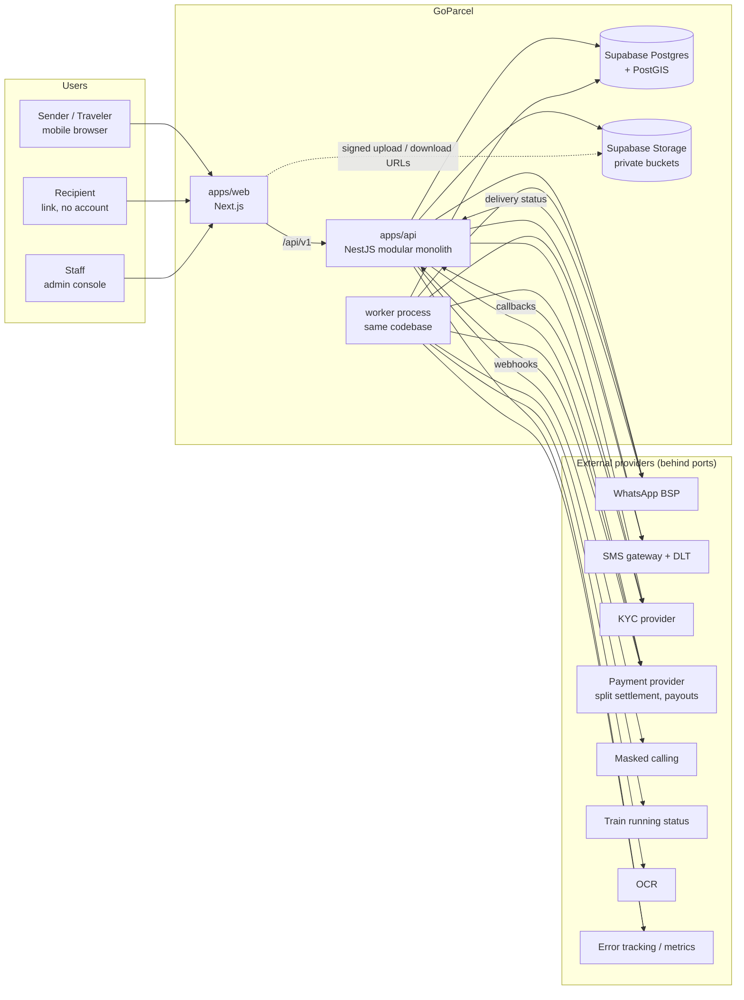
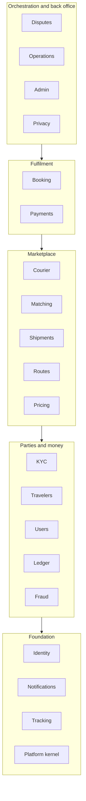
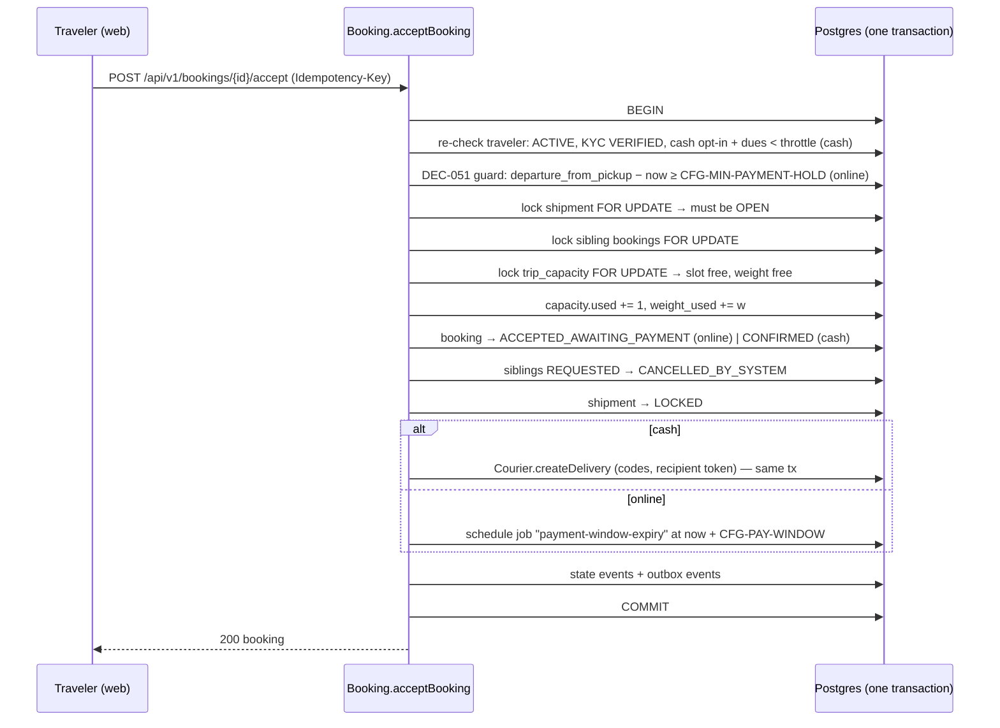

# GoParcel — Architecture and Technical Design

> **ARCHIVED.** This is v0.1, kept unchanged because the audit in `../audit/` refers to its sections. The current version is `../GOPARCEL_ARCHITECTURE.md`.

| Item | Value |
|---|---|
| Document | GoParcel Architecture and Technical Design |
| Version | 0.1 — Draft for product-owner review |
| Date | 22 November 2026 |
| Product owner | Shubham |
| Inputs | `docs/product/PRD/GOPARCEL_MASTER_PRD.md` v2.0 (reviewed), `GOPARCEL_DECISION_REGISTER.md`, `GOPARCEL_OPEN_QUESTIONS.md` |
| Development status | **No development is authorised by this document.** Development starts only when the product owner says "START DEVELOPMENT". |

This document says **how** GoParcel will be built. The PRD stays the single source of truth for **what** to build. Where this document disagrees with the PRD, the PRD wins and this document must be fixed.

---

## 0. How to read this document

### 0.1 Status labels

The PRD labels are reused, plus one more:

| Label | Meaning |
|---|---|
| **[CONFIRMED]** | Already approved: ARCH-xx, D-xx, DEC-xxx or a PRD business rule. This document only applies it. |
| **[PROPOSED]** | A new architecture decision made in this document (ID `AD-xx`). Needs product-owner approval. |
| **[ASSUMED]** | Depends on an open question. Built on the PRD's recommended answer (§1). |
| **[TBD]** | Still to decide; owner and trigger named. |

### 0.2 New architecture decisions

Every new decision has an ID `AD-xx` and is listed in §17. Approving this document approves all `AD-xx` marked [PROPOSED], unless the product owner strikes any out.

---

## 1. Assumptions for the blocking open questions

The PRD (Appendix F.8) says architecture should start once OQ-02, OQ-05, OQ-06, OQ-07, OQ-09 and OQ-21 are answered. They are still open. This draft goes ahead using each question's recommended answer. The table shows what changes if the answer comes back different.

| OQ | Assumed answer | Where it shows up | Impact if the answer differs |
|---|---|---|---|
| OQ-02 | "Minimum payment hold" = minimum time before departure: `CFG-MIN-PAYMENT-HOLD ≥ CFG-PAY-WINDOW + CFG-BOOKING-CUTOFF`. For cash bookings only the booking cutoff applies. | Booking accept guard (§7.3) | Small: one guard function and one config key |
| OQ-05 | Phone OTP only. No passwords, no email login. | Identity (§9.1) | Medium: adds a credential store, reset flow and a new attack surface |
| OQ-06 | Recipient is a scoped actor with no account: link token + delivery code. | Recipient access (§9.3) | Medium: would add a recipient account type and change notifications |
| OQ-07 | Small team (2–4 engineers), minimal budget, pilot within months. | Everything: one deployable, managed services, no Redis or brokers | Larger team: would allow a separate admin app and earlier extraction. The design does not need to change. |
| OQ-09 | D-15 approved with a 24 h final-destination window. | Delivery state machine, HAND-008 (§7.4) | Small: config value; if rejected, EXCEPTION → RETURN only |
| OQ-21 | RV-01..RV-04 approved: send-to-self allowed; BR-38 enforced; mismatch decline = no-fee cancel plus ops review; payouts include all payable credits. | Shipments, Ledger, Courier, Payouts | Small to medium: changes to ledger posting rules |

Other assumptions:
- **OQ-04 [ASSUMED]:** the "Courier" module means custody and handover (PRD §4.0).
- **OQ-01 [ASSUMED]:** F1–F9, ADRs and the full DEC register do not exist, so the PRD plus this document are the baseline.

---

## 2. Architecture goals and constraints

| # | Goal / constraint | Source |
|---|---|---|
| G-1 | Correct state and money above everything else: no lost transitions, no double booking, every rupee traceable | BR-04..07, BR-16, BR-32, NFR-REL-01, NFR-DATA-01/02 |
| G-2 | Server-authoritative: the client never confirms payment, custody or delivery | BR-06, BR-09, BR-11 |
| G-3 | Low cost and low operational load for a small team | A-03, NFR-COST-01, ARCH-09 |
| G-4 | Modular monolith, ready to extract modules later | ARCH-03, ARCH-06, ARCH-08 |
| G-5 | Every external vendor replaceable behind a port | ARCH-07, NFR-EXT-01 |
| G-6 | Privacy by default: personal data encrypted, masked, never in logs or URLs | NFR-SEC-02, NFR-PRIV-01/02, BR-27 |
| G-7 | Every staff action auditable and run through the same guards as user actions | BR-18, BR-19 |
| G-8 | Stage A must make real handovers and real payments impossible | PRD §12.1, §14.1 |

Non-goals for the pilot: microservices, Kafka, Kubernetes, Redis, a separate message broker, multi-region, GraphQL, a native mobile app.

---

## 3. System context



---

## 4. Technology stack

| Concern | Choice | Status |
|---|---|---|
| Repository | Monorepo, pnpm workspaces + Turborepo | [CONFIRMED] ARCH-01 |
| Language | TypeScript (strict) everywhere | [PROPOSED] AD-01 |
| API | NestJS modular monolith, REST under `/api/v1`, OpenAPI via `@nestjs/swagger` | [CONFIRMED] ARCH-03, ARCH-05, ARCH-11 |
| Database | Supabase-hosted PostgreSQL with PostGIS; Prisma ORM and migrations | [CONFIRMED] ARCH-04 |
| Object storage | Supabase Storage, private buckets only | [PROPOSED] AD-02 (INT-08 recommendation) |
| Background jobs and outbox | **pg-boss** (Postgres-backed queue using `SKIP LOCKED`); no Redis | [PROPOSED] AD-03 |
| Web | **Next.js (App Router), React, TypeScript**; mobile-first; one app for users, recipients and admin | [PROPOSED] AD-04 |
| Validation | Zod schemas shared between web and API for request DTOs and config | [PROPOSED] AD-05 |
| API client | TypeScript client generated from OpenAPI into `packages/api-client` | [PROPOSED] AD-05 |
| Auth | Own OTP + session implementation in the Identity module. **Supabase Auth is not used.** | [PROPOSED] AD-06 |
| Logging | pino structured JSON logs with request ID and redaction | [PROPOSED] AD-07 |
| Errors and tracing | Sentry-compatible error tracking, OpenTelemetry metrics | [PROPOSED] AD-07, vendor [TBD] |
| Testing | Vitest/Jest unit tests; integration tests against real Postgres + PostGIS in containers (Testcontainers); Playwright end-to-end tests | [PROPOSED] AD-08 |
| CI | GitHub Actions | [PROPOSED] AD-08 |
| Hosting (API, worker, web) | Container host in an India region close to the Supabase region (Mumbai, `ap-south-1`) | [PROPOSED] AD-09; vendor [TBD] |

**Why not Supabase Auth or the Supabase Data API (AD-06):** the PRD needs WhatsApp-first OTP with SMS fallback, identical responses for known and unknown numbers, refresh-token reuse detection, SMS-only recovery with a selfie re-match, and staff 2FA with RBAC. Building this in the Identity module keeps all business rules in one place (ARCH-06). The Supabase PostgREST/Data API stays **disabled**. Only the API's database role can reach the tables. The browser never talks to the database directly.

---

## 5. Repository layout

```
Go_Parcel/
├─ apps/
│  ├─ api/                     NestJS app: HTTP entry point and worker entry point
│  │  ├─ src/main.ts           HTTP server
│  │  ├─ src/worker.ts         job/outbox worker (same modules, no HTTP)
│  │  ├─ src/modules/<domain>/ one folder per domain module (§6)
│  │  ├─ src/platform/         shared kernel (§6.4)
│  │  └─ prisma/               schema files (one per module), migrations, seed
│  └─ web/                     Next.js app
│     ├─ app/(user)/           sender and traveler screens
│     ├─ app/r/[token]/        recipient delivery page
│     ├─ app/admin/            staff console
│     └─ features/             UI feature folders mirroring domain modules
├─ packages/
│  ├─ api-client/              generated OpenAPI client and types
│  ├─ contracts/               shared Zod schemas, enums, error codes, state names
│  ├─ ui/                      design-system components (large-touch handover widgets)
│  ├─ config-eslint/           lint rules including module-boundary rules
│  └─ config-ts/               shared tsconfig
├─ docs/
│  ├─ product/PRD/             PRD set
│  └─ architecture/            this document; ADRs in adr/ once decisions are approved
├─ turbo.json
└─ pnpm-workspace.yaml
```

The API and the worker are **two processes built from one image**. The worker runs scheduled jobs, outbox dispatch and provider polling, so slow provider calls never compete with user requests.

---

## 6. Module design

### 6.1 Module map

The 18 confirmed domains (ARCH-10) plus two the PRD uses that ARCH-10 does not list:

| Module | Owns (tables / aggregates) | Key PRD features |
|---|---|---|
| **Identity** | User (core identity, status), OtpChallenge, Session, StaffUser, StaffRoleGrant | AUTH-001..006, ADMIN-001 |
| **Users** | Profile, preferences and consents, Rating, ReliabilityMark | USER-001..003, RATE-001/002 |
| **KYC** | KycRecord, KycAttempt, duplicate-identity index | KYC-001..003 |
| **Travelers** | Vehicle, car documents, traveler capability state (cash opt-in) | KYC-005, §3.1 capabilities |
| **Routes** | Station, City, MeetingPoint, Trip, TripStop, TripCapacity, TicketProof | TRIP-001..006, ROUTE-001/002 |
| **Shipments** | Shipment, Declaration, prohibited-category list | SHIP-001..006 |
| **Matching** | No tables (read-only queries, §8.2) | MATCH-001..004 |
| **Pricing** | PriceTable, DistanceBand, Quote | PRICE-001..003 |
| **Booking** | Booking, BookingRequest group | BOOK-001..007 |
| **Payments** | PaymentAttempt, ProviderEvent, Refund, Payout, Beneficiary, CashConfirmation, ReconciliationItem | PAY-001..010, KYC-004 |
| **Ledger** | LedgerAccount, JournalEntry, Posting | LEDGER-001 |
| **Courier** (custody and handover) | Delivery, HandoverCode, CustodyEvent, Evidence, RecipientAccess | HAND-001..013 |
| **Tracking** | TimelineEvent (user-facing), StateEvent (internal history) | TRACK-001/002 |
| **Notifications** | Notification, Template, MaskedCallSession, CallRecord | NOTIF-001..004 |
| **Disputes** | Dispute, Appeal, Hold, CustodyResolutionCase | DISP-001..005 |
| **Fraud** | RiskRule, RiskFlag | FRAUD-001/002 |
| **Operations** | Ops queues (views), SupportCase | ADMIN-002..005, SUP-001/002 |
| **Admin** | ConfigValue + approvals, master-data commands, reports, AuditLog viewer | ADMIN-006..010 |
| *Privacy* (not in ARCH-10) | PrivacyRequest, LegalHold, Incident | PRIV-001..003, INC-001 |

**AD-10 [PROPOSED]:** Support cases live in **Operations**. Privacy requests, legal holds and incidents get a small **Privacy** module, because retention and legal-hold rules cut across every module and need one owner. This adds a 19th module to ARCH-10 and needs approval.

### 6.2 Inside a module

Every module has the same internal layout:

```
modules/booking/
├─ contracts/        PUBLIC: service interface, DTOs, event types, error codes
├─ application/      use cases (commands and queries), transaction boundaries
├─ domain/           entities, state machine, invariants, pure calculations
├─ infrastructure/   Prisma repositories, provider adapters
├─ http/             controllers (thin: auth, validation, map to use case)
└─ booking.module.ts NestJS wiring; exports only the contracts provider
```

Rules [CONFIRMED ARCH-06, NFR-MAINT-01; enforcement PROPOSED AD-11]:
1. Other modules may import **only** from `modules/<x>/contracts`. Everything else is private.
2. A module reads and writes **only its own tables**. Other modules' data goes through their contracts, or through read views those modules publish (§8.2).
3. Business rules live in `domain/` and `application/`, never in controllers or the web app.
4. The rules are enforced in CI with `eslint-plugin-boundaries` (or dependency-cruiser). A boundary violation or an import cycle fails the build.

### 6.3 Module dependencies

Synchronous calls go **one way only**: a module may call modules below it, never above. When a lower module needs to react to something a higher module does, it uses events or a port the lower module defines (dependency inversion).



Key one-way relationships:

| Caller → callee | Why |
|---|---|
| Booking → Shipments, Routes, Pricing, Courier, Ledger, KYC/Users (eligibility) | Booking orchestrates the accept, confirm and pickup transactions |
| Booking → Payments | Create payment order, request refund |
| Payments → Ledger | Post entries for cash, refunds and payouts |
| Courier → Ledger is **not** allowed | Cash confirmation belongs to Payments; Courier raises a transactional event |
| Disputes → Payments, Ledger, Courier (evidence read) | Decisions trigger refunds, compensation and recovery |
| Payments ⇠ Disputes (inverted) | Payments defines the port `PayoutHoldChecker`; Disputes implements it. This avoids a cycle. |
| Matching → Routes, Shipments, Pricing, Users, Ledger (dues) | Read-only |
| Everyone → Tracking, Notifications | Only through integration events (outbox), never direct calls |

### 6.4 Platform kernel (`src/platform`)

Shared technical services with no business rules:

| Component | Purpose |
|---|---|
| `db` | Prisma client, transaction context (AsyncLocalStorage, for example `@nestjs-cls/transactional`), lock-order helper |
| `outbox` | Writes integration events in the business transaction; worker dispatch (§7.6) |
| `jobs` | pg-boss wrapper: scheduled deadlines, cron sweeps, retries, dead letters |
| `idempotency` | `Idempotency-Key` interceptor and store (§7.5) |
| `config` | Typed registry of every `CFG-*` key (§12) |
| `crypto` | Field encryption, blind indexes, code and token generation, hashing (§10.2) |
| `files` | Signed upload and download URLs, checksum verification |
| `audit` | Append-only audit writer for staff commands (§10.5) |
| `authz` | Guards for user, recipient-token, staff-role and service identities |
| `rate-limit` | Postgres-backed fixed-window counters (§10.4) |
| `errors` | Problem+JSON error format with stable codes from `packages/contracts` |
| `clock` | Injectable clock, so every timer rule is testable |
| `stage` | Stage A/P guards (§14.3) |

---

## 7. Core runtime patterns

### 7.1 Server-authoritative state machines [CONFIRMED BR-04, BR-18]

Each stateful aggregate has its own explicit state machine in `domain/`. These are shipment, trip, booking, payment attempt, delivery, payout, KYC, dispute, account and support case.

- A transition table lists `(from, command) → to`, plus guard functions.
- Every transition is written as a **conditional update**: `UPDATE … SET status = :to, version = version + 1 WHERE id = :id AND status = :from`. Zero rows updated means the state was stale, and the command fails with a typed error. No change is made.
- Every successful transition writes a `StateEvent` (actor, from, to, cause, request ID) in the same transaction (TRACK-002), and emits integration events through the outbox.
- Staff commands call the **same use cases** with a staff actor and a mandatory reason code. There is no admin-only path that writes status directly (BR-18).
- Database `CHECK` constraints limit `status` columns to valid values. Partial unique indexes enforce key invariants (§11.3).
- Every transition has a unit test, as required by NFR-MAINT-02.

### 7.2 Transactions and lock order [resolves PRD v1.0 DR-07 — PROPOSED AD-12]

Cross-module transactional use cases run in **one database transaction**. The transaction travels through contract calls via the transaction context, so modules never pass Prisma clients to each other.

**Global lock order.** Any transaction that locks more than one of these rows takes them in this order, using `SELECT … FOR UPDATE`:

1. `shipment` (by id)
2. `booking` rows for that shipment (ascending id)
3. `trip_capacity` row(s) (ascending trip id, then size class)
4. `delivery`
5. `payout` / ledger account rows (ascending account id)

A helper in `platform/db` acquires locks only in this order and is used by every multi-row command. An integration test suite runs accept, cancel, payment confirmation and withdrawal concurrently to catch deadlocks (pilot readiness gate item 4).

Isolation level: `READ COMMITTED` plus explicit row locks and conditional updates. `SERIALIZABLE` is not used by default; it would mean adding retry handling across the codebase.

### 7.3 The accept transaction (BOOK-002, WF-A)



Failure codes `JOURNEY_TOO_SOON`, `CAPACITY_UNAVAILABLE`, `ALREADY_BOOKED` and `ACCOUNT_SUSPENDED` roll back the whole transaction, so nothing changes.

The database is the last line of defence, through the partial unique index "one live booking per shipment" and `CHECK (slots_used <= slots_total)`.

### 7.4 Delivery and custody transitions (HAND-004/006/008)

- **Pickup:** Courier verifies the pickup code. Codes are hashed, attempts are counted in the same row, and entry locks at `CFG-HANDOVER-CODE-MAX-ATTEMPTS`. Courier then checks the actor is the booked traveler and moves the delivery `PENDING_PICKUP → IN_TRANSIT`. A **transactional event** `CustodyTransferred` is handled in the same transaction by Booking (`→ IN_FULFILMENT`), which then calls Shipments (`→ IN_DELIVERY`).
- **Cash confirmation** (PAY-003/004) is a Payments command run before code entry. It records `CashConfirmation` and posts commission + GST as a ledger debit to the traveler.
- **Photos never gate custody** (BR-29). A missing photo after `CFG-UPLOAD-RETRY-MINUTES` creates a review flag through a scheduled check job.
- **Exceptions:** `IN_TRANSIT → EXCEPTION` (missed delivery, refusal, damage, overdue). Allowed exits are resume (DEC-052, provisional), return, lost or abandoned. Return uses its own `return` handover code.
- **Timers never complete fulfilment** (BR-11). Overdue jobs only raise alerts and ops queue items.

### 7.5 Idempotency [CONFIRMED BR-16, BOOK-007]

- Every state-changing endpoint requires an `Idempotency-Key` header (a UUID generated by the client per user intent).
- The `idempotency_record` table stores key, actor, route, request hash, status (`IN_PROGRESS` / `DONE`) and the stored response. It has a unique constraint on `(actor, key)`.
- Same key and same request hash returns the stored response. Same key with a different hash returns `409 IDEMPOTENCY_KEY_REUSED`. A key still `IN_PROGRESS` returns `409 REQUEST_IN_PROGRESS`.
- Records expire after 24 h through a cleanup job.
- Provider events are deduplicated separately by `(provider, event_id)` (§9.5).

### 7.6 Events: transactional and integration [PROPOSED AD-13]

| Kind | Delivery | Used for | Failure |
|---|---|---|---|
| **Transactional event** | In-process, synchronous, **inside the same DB transaction** | Keeping linked state machines consistent across modules (custody → booking → shipment; booking confirmed → delivery created) | Handler error rolls back the whole command |
| **Integration event** | Written to the `outbox` table in the same transaction; delivered at least once by the worker via pg-boss | Notifications, tracking timeline, analytics, risk rules, payout eligibility, ops alerts | Retries with backoff, then dead letter + ops alert; never affects the committed business change (NOTIF-001 rule) |

Integration event handlers must be idempotent. Each handler records `(event_id, handler)` as processed.

Event names follow `<module>.<aggregate>.<past-tense>`, for example `booking.booking.confirmed`. Payloads hold IDs and non-personal facts only; handlers load what they need through contracts.

### 7.7 Scheduled work (timers)

Deadlines use pg-boss jobs with `startAfter`, created in the same transaction as the state that needs them. Examples: request expiry, payment window, seat reveal, dispute-window close, photo retry check, overdue alerts.

A **cron sweeper** per deadline type (every 1–5 min) also catches any job that was missed. Handlers re-check state, so a job that fires late or twice does nothing harmful.

| Job | Trigger | Effect |
|---|---|---|
| `booking.request-expiry` | request created | REQUESTED → EXPIRED |
| `booking.payment-window` | online accept | ACCEPTED_AWAITING_PAYMENT → PAYMENT_EXPIRED, release capacity, shipment → OPEN |
| `payments.poll-pending` | cron `CFG-PAY-POLL-INTERVAL` | query provider for PENDING attempts |
| `courier.seat-reveal` | confirmed | reveal coach/seat `CFG-SEAT-REVEAL-LEAD` before stop |
| `courier.photo-check` | custody transfer | flag delivery if a photo is missing after the retry window |
| `courier.overdue` | expected arrival + grace | alert ops, sender, traveler (never completes) |
| `payments.dispute-window-close` | delivered | payout PENDING_WINDOW → ELIGIBLE if no hold |
| `payments.payout-run` | cron (for example hourly) | initiate eligible payouts, net of dues |
| `payments.reconcile` | daily | provider reports vs ledger → reconciliation items |
| `ledger.dues-age` | daily | apply the 30-day hard-block rule |
| `shipments.expiry` | window end | OPEN → EXPIRED |
| `routes.trip-progress` | departure / arrival | PUBLISHED → IN_PROGRESS / EXPIRED; overdue escalation |
| `privacy.retention` | daily | delete or anonymise per PRIV-003 unless legal hold |
| `platform.cleanup` | daily | idempotency records, expired OTP challenges, processed outbox rows |

---

## 8. Domain-specific design

### 8.1 Identity and sessions (AUTH-001..006)

- **OTP:** 6 digits from a cryptographic RNG, stored as HMAC-SHA256 with a server pepper, with expiry and attempt count on the row. Verification is one atomic `UPDATE … WHERE consumed_at IS NULL AND attempts < max AND expires_at > now() RETURNING`, so two concurrent correct submissions cannot both succeed.
- **Same response for every number:** the request-OTP handler does the same work and returns the same body whether or not the number is registered, padded to a constant minimum duration.
- **Sessions:** a short-lived access JWT (about 10 min, signed with an asymmetric key) in memory or a cookie, plus a rotating opaque refresh token in an `HttpOnly; Secure; SameSite=Lax` cookie. Refresh tokens are stored hashed and grouped by `family_id`. Reusing a rotated token revokes the whole family and raises risk flag `REFRESH_TOKEN_REUSE`.
- **Revocation:** API calls check `session.revoked_at` through a small cached lookup (≤ 30 s staleness, or no cache for staff), so suspension and logout take effect quickly.
- **Staff:** separate `staff_user` table, TOTP 2FA, `CFG-STAFF-SESSION-IDLE`, role grants (support, ops, finance, senior admin) that need two approvers.
- **Phone storage:** encrypted, plus a blind index (HMAC) for lookup (§10.2).

### 8.2 Matching and search (MATCH-001/002, NFR-PERF-02)

Matching is a **read-only SQL query** over read views that Routes and Shipments publish as part of their contracts. For example, `routes.v_matchable_trip_stop` exposes only published trips, stops that are eligible for handover, free capacity, and the traveler's eligibility flags.

Query outline:
1. Join trip stops twice (origin stop A, destination stop B) on the same trip with `A.seq < B.seq`.
2. Filter: trip PUBLISHED; neither stop below `CFG-MIN-HALT-MINUTES`; B's arrival inside the delivery window; A's departure ≥ now + `CFG-BOOKING-CUTOFF`; capacity for the size class and weight; mode allows the size; traveler eligible and not the sender; cash rules.
3. Order by MATCH-002: earliest arrival, then reliability, then rating, then earliest published.

Indexes: `trip_stop(station_id, scheduled_departure)`, `trip_stop(trip_id, seq)`, `trip(status, first_departure)`, and partial indexes on published trips.

At pilot scale (≤ 500 trips per city pair) a well-indexed query meets p95 ≤ 1.5 s without a search engine or cache.

**Station matching** uses master-list station IDs, not geometry (D-09). PostGIS is used for distance bands, meeting-point proximity and admin tools.

### 8.3 Pricing (PRICE-001..003)

- A pure function in `pricing/domain` takes size class, distance band and payment method, and returns price, commission, GST and traveler earning. All amounts are integer paise, rounded half-up. Cash prices round up to ₹10.
- **Distance band [TBD, AD-14 PROPOSED]:** straight-line PostGIS distance between station points (`ST_DistanceSphere`) underestimates rail and road distance. Proposal: an admin-maintained `city_pair_distance` table holds the band for pilot pairs; straight-line distance × a configured factor is the fallback. This needs product-owner approval because it changes PRICE-001's stated input.
- A **Quote** is persisted with its inputs, the config versions used and `valid_until`. The booking request keeps its quote, so a later price-table change does not affect it (PRICE-003).
- Bookings below `CFG-MIN-TRAVELER-EARNING` are filtered out in Matching.

### 8.4 Payments (PAY-001..010)

- **Provider port** `PaymentProvider`: `createOrder`, `fetchPaymentStatus`, `refund`, `validateBeneficiary`, `createTransfer` / `releaseSplit`, `fetchSettlementReport`, `verifyWebhook`. Adapters: `sandbox` (Stage A and tests) and the chosen vendor [TBD OQ-19]. The vendor must support **escrow or split settlement and payouts**, so funds never sit in GoParcel's bank account (D-11, BR-31). This is a hard vendor-selection criterion.
- **Webhooks** (§9.5) are verified, stored and acknowledged quickly, then processed asynchronously.
- **Confirmation** happens only when Payments emits `payments.attempt.succeeded` after amount and order checks. Booking handles it: within the window → CONFIRMED and delivery created; after PAYMENT_EXPIRED → automatic refund.
- **Payouts:** the payout run selects payable credits for each traveler (eligible online earnings plus other credits, per RV-04). It checks `PayoutHoldChecker` (Disputes) and a verified beneficiary, computes `net = credits − dues` (never below 0), posts ledger entries, then calls the provider. Payout state machine as in PRD §6.3. Provider calls use an idempotency key `payout:<id>`.
- **Reconciliation:** the daily job compares provider settlement and payout reports with ledger journals. Any mismatch → `ReconciliationItem` plus a reconciliation hold on the related booking.

### 8.5 Ledger (LEDGER-001) [PROPOSED AD-15]

**Double-entry.** Every money event is one `journal_entry` with two or more `posting` rows whose signed amounts sum to zero.

| Account (per party where noted) | Type |
|---|---|
| `traveler:{id}:earnings` | liability (owed to traveler) |
| `traveler:{id}:dues` | asset (owed by traveler) |
| `sender:{id}:dues` | asset |
| `platform:commission` | revenue |
| `platform:gst_payable` | liability |
| `platform:compensation_reserve` | asset |
| `platform:refunds_payable` | liability |
| `provider:escrow` | asset (funds held by provider) |
| `platform:cash_with_travelers` | clearing |

Example, cash booking with a ₹200 price confirmed at pickup:
- Dr `traveler:dues` 3,540 paise
- Cr `platform:commission` 3,000
- Cr `platform:gst_payable` 540

Integrity:
- `posting` and `journal_entry` are **append-only**. A trigger rejects `UPDATE` and `DELETE`, and the API's DB role has only `INSERT` and `SELECT` on them (NFR-DATA-02).
- A deferred constraint trigger checks each journal sums to zero at commit.
- Every journal records a cause (`booking`, `dispute`, `payout`, `adjustment`, `dues_payment`) and an actor.
- Balances are always computed with `SUM(postings)`. If a cached balance table is added for performance, a nightly job proves it equals the sum.
- **BR-38** (from RV-02) is enforced in Ledger's posting rules. Compensation funded by sender dues is posted only on `ledger.dues.paid`.
- **No spendable balance** (D-21). There is no endpoint that spends credit. Dues payments are capped at the amount owed.

The chart of accounts and GST treatment need review by a CA before the pilot (PRD §10.2).

### 8.6 Courier evidence (HAND-003, HAND-007)

1. The web app captures a photo with `getUserMedia` (no file picker, D-16), compresses it to ≤ `CFG-PHOTO-MAX-KB` and computes SHA-256 with WebCrypto.
2. `POST /deliveries/{id}/evidence` (stage, checksum, device timestamp) → the API checks authorisation and stage, creates an `Evidence` row in `PENDING`, and returns a **signed upload URL** for the private bucket. The object key is `evidence/{deliveryId}/{evidenceId}`.
3. The browser uploads directly to Storage, then calls `…/evidence/{id}/complete`. The API reads the object, verifies the checksum and size, records `uploaded_at` (server time), and marks it `STORED`.
4. Packing photos: a server-side gap check between the contents and sealed photos (`CFG-PACKING-MAX-GAP-MINUTES`) raises a review flag.
5. Reads: authorisation → short-lived signed URL (≤ 5 min). Staff access needs an investigation reason and writes an `evidence_access` log row (BR-15).
6. Retries: captured photos stay in memory on the handover screen and retry for `CFG-UPLOAD-RETRY-MINUTES`.

Ticket uploads (TRIP-001) use the same flow in a separate bucket, but file upload is allowed there.

### 8.7 Notifications and masked calling (NOTIF-001..004)

- `NotificationRouter` maps an event to recipients, template and channel order: WhatsApp if opted in, otherwise SMS, with on-screen notifications as well.
- Ports: `WhatsAppProvider`, `SmsProvider`, `MaskedCallProvider`. Template IDs and DLT template IDs are stored in config per language (English, Hindi).
- **OTP is sent synchronously** inside the request (the user is waiting), with SMS fallback on a synchronous WhatsApp failure. Asynchronous WhatsApp failures (delivery-status webhook) trigger an SMS resend through the outbox.
- All other notifications go through the outbox. Retries follow `CFG-NOTIF-RETRIES`; critical events then switch channel, then dead-letter with an ops alert.
- **Masked calling:** a session is created on booking confirmation (sender ↔ traveler; recipient ↔ traveler) and torn down `CFG-MASKED-CALL-WINDOW-HOURS` after the delivery is terminal. Only the session ID and virtual number are shown to users.

### 8.8 Train running status (HAND-002, INT-06)

The worker polls the provider for trains with a confirmed booking starting about 3 h before departure. The interval increases near handover stops. Results are cached per `(train, date)`, so N bookings on one train cost one call. If the provider is down, ETA is hidden and users rely on traveler taps (PRD fallback). Vendor and terms are [TBD OQ-19].

### 8.9 KYC (KYC-001..005)

- Port `KycProvider`: start a session (DigiLocker / offline e-KYC / document), liveness, face match, fetch result, plus a callback handler.
- Stored: legal name, DOB, document type, last 4 digits, provider reference, face score, outcome. **The full Aadhaar number is never stored or logged.** The adapter drops it at the boundary, and a log-redaction test covers it.
- Duplicate identity: a blind index over `(doc_type, normalised doc number)` computed at the adapter boundary and stored only as an HMAC. A unique-per-VERIFIED check sends a second account to IN_REVIEW with a risk flag.
- Stage A: a `stub` adapter with manual approval.

### 8.10 Fraud (FRAUD-001/002)

Rules run as integration-event handlers (for example `auth.refresh.reused`, `courier.packing.gap-detected`, `payments.cash.disputed`) plus nightly batch queries for counting rules. A flag at or above high severity calls Identity's `restrictAccount` command with a system actor and reason code. No machine learning in the pilot.

---

## 9. API design

### 9.1 Conventions

- REST over HTTPS, JSON, base path `/api/v1` [CONFIRMED ARCH-05]. A breaking change means `/api/v2`; additive changes stay in v1.
- OpenAPI generated from NestJS decorators, served at `/api/v1/docs` in non-production environments only [CONFIRMED ARCH-11].
- Commands are explicit resource actions, for example `POST /bookings/{id}/accept`, `POST /deliveries/{id}/pickup/verify`, `POST /trips/{id}/cancel`. There is no generic `PATCH status`.
- Errors use RFC 9457 problem+json with a stable `code` from `packages/contracts`, for example `JOURNEY_TOO_SOON`, `CAPACITY_UNAVAILABLE`, `TICKET_REQUIRED`, `DECLARED_VALUE_ABOVE_CAP`, `ACCOUNT_SUSPENDED`, `MAX_REQUESTS_REACHED`. The web app maps codes to plain-language messages and shows the code for support (PRD §5.7).
- List endpoints use cursor-based pagination.
- Personal data never appears in URLs or query strings (NFR-PRIV-02). The recipient token is the one path-scoped secret: it is hashed in storage, and URLs carrying it are redacted from logs.

### 9.2 API surfaces

| Surface | Path prefix | Auth |
|---|---|---|
| User (sender and traveler) | `/api/v1/...` | User session |
| Recipient | `/api/v1/recipient/{token}/...` | Recipient token (scoped to one delivery) + rate limit |
| Staff | `/api/v1/admin/...` | Staff session + 2FA + role guard |
| Provider callbacks | `/api/v1/webhooks/{provider}/...` | Signature verification (+ IP allow-list where offered) |
| Health | `/healthz`, `/readyz` | None (no data) |

### 9.3 Recipient access (BR-14, HAND-006) [ASSUMED OQ-06]

- On confirmation, Courier creates a 256-bit random token. Only its SHA-256 hash is stored, scoped to that one delivery.
- The link is `https://<domain>/r/{token}`. The page calls the recipient API, which resolves the token hash to exactly one delivery and returns only the PRD-listed fields.
- The token expires `CFG-RECIPIENT-LINK-TTL` after the delivery is terminal. Token-resolution failures are rate-limited per IP.
- Recipient actions: view, masked call, report a problem (creates a dispute with `raised_by = recipient`). Recipients cannot see other deliveries or any account data.

### 9.4 Web ↔ API connection

The Next.js app proxies `/api/v1/*` to the API (a rewrite at the same origin), so session cookies are first-party and no CORS is needed. Server components may call the API server-to-server, forwarding the user's cookie. The admin console uses the same API with staff cookies under `/admin`.

### 9.5 Provider webhooks

1. Read the raw body and verify the signature. Failure → `401`, metric, no processing.
2. Insert `provider_event (provider, event_id UNIQUE, type, payload, received_at)`. A duplicate → `200` with no further work.
3. Enqueue processing and return `200` quickly.
4. The worker processes the event idempotently. Any amount or order mismatch → reconciliation item; the booking is not confirmed.

---

## 10. Security and privacy

### 10.1 Authorisation

- Guards resolve the actor: `user`, `recipient`, `staff(role)` or `system`.
- Use cases check **resource ownership** (for example, only the booked traveler can enter a code) on top of role checks.
- Staff permissions follow PRD §3.5 exactly. They are encoded as a `permission → roles` map in `packages/contracts`, so the API and admin UI share it.
- Actions marked ✋ (two approvers) use a `pending_approval` record: one staff member proposes, a different one approves, and the command runs only on approval.

### 10.2 Encryption and secrets

- **Transport:** TLS 1.2+ and HSTS (NFR-SEC-01).
- **At rest:** Supabase Postgres and Storage encryption.
- **Field-level encryption [PROPOSED AD-16]:** AES-256-GCM envelope encryption in `platform/crypto`, applied in repositories to phone numbers, PNR, coach/seat, document numbers, vehicle registration, recipient name and phone, and beneficiary details. Ciphertext carries a key-version prefix so keys can be rotated. Data keys come from a managed secret store or KMS and never sit in the repo (NFR-SEC-04).
- **Blind indexes** (HMAC-SHA256 with a separate key) on phone and document references for equality lookups.
- **Codes and tokens:** OTPs and handover codes are stored as HMACs with a pepper; recipient tokens as SHA-256. Plain values exist only in memory and in the outgoing message.
- **Masking:** admin APIs return masked values by default. `POST /admin/reveal` with a reason returns one field and writes an audit record.

### 10.3 Logging and analytics privacy

- pino redaction paths cover headers, cookies, phone, PNR, tokens, codes and document fields. A test asserts that sample payloads produce redacted logs.
- Analytics events (NFR-OBS-03) use pseudonymous IDs: an HMAC of the user ID with an analytics key. There are no names, phone numbers or free text.

### 10.4 Rate limiting

There is no Redis (NFR-COST-01), so limits use Postgres fixed-window counters (`rate_limit(bucket, window_start, count)` with an upsert) for OTP requests, OTP verification, handover-code entry, recipient token resolution and write endpoints.

An edge or WAF limit from the hosting provider is a coarse first layer. If counter writes ever become a hotspot, that is the measured need that would justify Redis.

### 10.5 Audit log

- `audit_log` is append-only, with the same trigger and privileges as the ledger.
- It records actor, role, action, entity, before and after (masked), reason code, note, request ID and time.
- It is written in the same transaction as the staff command (BR-19).

### 10.6 Supabase hardening

- The Data API/PostgREST is disabled, or all tables are in schemas it does not expose. Anon and authenticated keys are not used anywhere.
- The API connects with a dedicated least-privilege role. Migrations run with a separate owner role used only in CI and CD.
- Storage buckets are private, and access is only through signed URLs from the API.
- Point-in-time recovery is enabled to meet RPO ≤ 1 h (NFR-BACKUP-01). A restore drill must pass before the pilot.

### 10.7 Threats

PRD §10.4 mitigations map onto §7–§10 of this document. Before the pilot, the penetration test covers OTP and session handling, accept concurrency, payment webhooks, recipient links, evidence URLs and the admin console (pilot readiness gate item 5).

---

## 11. Data architecture

### 11.1 Schemas and ownership [PROPOSED AD-17]

- **One Postgres database, one Postgres schema per module** (`identity`, `users`, `kyc`, `routes`, `shipments`, `pricing`, `booking`, `payments`, `ledger`, `courier`, `tracking`, `notifications`, `disputes`, `fraud`, `ops`, `admin`, `privacy`, `platform`). This makes ownership visible and keeps later extraction mechanical.
- Prisma schema split into one file per module. Use Prisma's multi-schema support. **Verify it is supported in the pinned Prisma version during setup; if not, fall back to one schema with module table prefixes.**
- **Foreign keys** are used freely inside a module. Across modules, FKs are allowed only from a higher layer to a lower one (§6.3), for example `booking.shipment_id → shipments.shipment.id`. This keeps integrity now and gives a clear list of FKs to drop at extraction.
- **IDs:** UUIDv7 (time-ordered) primary keys generated in the application. Humans see short booking codes, for example `GP-7K3Q9`.
- **Money:** integer paise in `integer` columns for single amounts (the cap is far below the limit) and `bigint` for sums. No floating point anywhere (NFR-DATA-01).
- **Time:** `timestamptz` everywhere, stored in UTC, shown in IST.

### 11.2 Entity placement

The entities in PRD §9.1 go to the owning modules listed in §6.1. Additions in this document:

| Entity | Module | Purpose |
|---|---|---|
| `StateEvent` | Tracking | Internal history of every transition (TRACK-002) |
| `TimelineEvent` | Tracking | User-facing timeline (TRACK-001) |
| `Outbox`, `ProcessedEvent` | Platform | Integration event delivery |
| `IdempotencyRecord` | Platform | §7.5 |
| `RateLimitCounter` | Platform | §10.4 |
| `ProviderEvent` | Payments / Notifications / KYC | Raw verified webhook payloads |
| `PendingApproval` | Admin | Two-person approvals |
| `EvidenceAccess` | Courier | Evidence access log (BR-15) |
| `CityPairDistance` | Pricing | §8.3 (if AD-14 approved) |
| `ConfigValue`, `ConfigChange` | Admin | §12 |
| `LegalHold` | Privacy | Overrides retention deletion |

### 11.3 Database-enforced invariants

| Invariant | Enforcement |
|---|---|
| At most one live booking per shipment (BOOK-007) | Partial unique index on `booking(shipment_id) WHERE status IN ('ACCEPTED_AWAITING_PAYMENT','CONFIRMED','IN_FULFILMENT')` |
| One request per shipment–trip pair | Partial unique index on `(shipment_id, trip_id)` for non-terminal statuses |
| Capacity never negative or over the limit | `CHECK (slots_used BETWEEN 0 AND slots_total)`, `CHECK (weight_used_g BETWEEN 0 AND weight_cap_g)` |
| Exactly one delivery per booking (BR-05) | `UNIQUE (delivery.booking_id)` |
| One active OTP challenge per phone | Partial unique index on `phone_hash WHERE consumed_at IS NULL AND invalidated_at IS NULL` |
| No overlapping published trips per traveler | Exclusion constraint using `tstzrange` on `(traveler_id, period)` for active statuses (needs the `btree_gist` extension) |
| Declared value cap | `CHECK` against a constant, plus an application check against config (the config can only lower it) |
| Ledger and audit immutability | Triggers + role privileges |
| Journal balanced | Deferred constraint trigger |
| Unique provider events | `UNIQUE (provider, event_id)` |
| One verified KYC per identity document | Partial unique index on the document blind index `WHERE status = 'VERIFIED'` |

### 11.4 Migrations

- Prisma Migrate, with SQL migrations committed. Raw SQL is added in migration files for triggers, partial indexes, exclusion constraints, PostGIS and grants.
- Migrations must be backwards-compatible with the running version (expand → migrate → contract), so deploys need no downtime.
- CI applies all migrations to a fresh PostGIS container and runs `prisma migrate diff` to catch schema drift.
- Seed scripts load pilot master data (stations, meeting points, distance bands, categories), loaded by ops via ROUTE-001.

### 11.5 Retention and deletion

The `privacy.retention` job applies PRIV-003 per entity type, skipping anything linked to a `LegalHold`. Account deletion (AUTH-006) anonymises personal fields: encrypted values are nulled and blind indexes removed. Financial, ledger, tax and held records are kept.

---

## 12. Configuration (Appendix A keys)

- `platform/config` holds a **typed registry**: every `CFG-*` key with a Zod schema, unit, default for non-production environments, owner and the PRD status label.
- Values live in `admin.config_value`, with full history in `admin.config_change`. Changes need two approvers (ADMIN-007).
- Each process caches values in memory with a short TTL (about 30 s), refreshed by a `config.changed` outbox event.
- **Snapshotting:** money-affecting values (commission %, GST rate, fees, refund %) are copied onto the record that uses them (Quote, Booking, journal entries). A later config change never re-prices past events.
- Startup check: the API refuses to start in Stage P if any key needed for the pilot is still `TBD` or unset. Examples: `PRICE_TABLE`, `CFG-MIN-COMMISSION`, `CFG-SIZE-DIMENSIONS`.
- Secrets (provider keys) are **not** config values. They live in the secret store as environment variables.

---

## 13. Web application

- **Mobile-first Next.js (AD-04)**, with server rendering for fast first paint on mid-range Android (NFR-PERF-03). Handover screens are client components that work one-handed with large touch targets (PRD §5.1).
- **Areas:** `(user)` with Send/Travel tabs, `/r/[token]` recipient page (no login, minimal JavaScript), `/admin` staff console.
- **Data fetching:** generated API client plus TanStack Query. Mutations always send an `Idempotency-Key` generated once per user intent and kept across retries.
- **Forms:** shared Zod schemas from `packages/contracts`, so client and server validation match. The server is still authoritative.
- **Camera:** in-page `getUserMedia` capture component with compression and a checksum (§8.6). It falls back with a clear message if the camera is unavailable. No gallery picker for evidence.
- **Location (D-14):** browser geolocation only in the final window and only while the page is open. It is sent to the API, relayed only to the counterparty, and stopped at handover.
- **i18n:** English and Hindi message catalogues [PROPOSED in PRD]. All user-facing strings go through i18n from day one.
- **Accessibility:** WCAG 2.1 AA; automated axe checks in Playwright.
- **States:** shared components for loading, empty, error (with error code), offline and session-expiry states, as listed in PRD §5.7.

---

## 14. Deployment and operations

### 14.1 Environments

| Env | Purpose | Database | Providers |
|---|---|---|---|
| local | Development | Docker Postgres + PostGIS | Sandbox / fake adapters |
| ci | Tests | Testcontainers PostGIS | Fakes |
| staging | Stage A staff alpha; pre-release checks | Supabase project (staging) | Provider sandboxes / test mode |
| production | Controlled pilot | Supabase project (prod), Mumbai region | Live providers |

### 14.2 Runtime topology (pilot)

- **API:** 2 small instances behind the host's load balancer, for availability (NFR-AVAIL-01).
- **Worker:** 1 instance. pg-boss locking makes a second instance safe if needed.
- **Web:** Next.js on the same container host, or a managed Next.js host in an India-adjacent region [TBD AD-09].
- **Database connections:** the API uses Supabase's pooled connection in transaction mode, with Prisma configured for pooler compatibility. The worker uses a direct or session connection, which pg-boss and advisory-lock behaviour need.
- **Scaling path** (ARCH-08, NFR-SCALE-01): scale instance size → add API instances → split worker queues → extract a module only with measured evidence.

### 14.3 Stage A safety guards (G-8)

- Environment variable `APP_STAGE=alpha|pilot|launch`.
- In `alpha`, the adapter registry **only** binds sandbox or fake adapters. Startup fails if any live provider credential is present.
- Handover and cash screens show a persistent "SIMULATION" banner. Recipient links are sent only to allow-listed staff numbers.
- An end-to-end test asserts that in `alpha` no real payment or real message can be sent (PRD §14.1 last criterion).

### 14.4 CI/CD

Pipeline order:
1. Install, then lint (including module boundaries)
2. Typecheck
3. Unit tests
4. Integration tests (PostGIS container: state machines, concurrency suite, ledger)
5. Migration check
6. Build images
7. End-to-end smoke tests on staging
8. Manual approval for production

Also in CI: dependency and secret scanning, and SBOM generation. Releases are tagged; error tracking is tagged with the release (NFR-OBS-02).

### 14.5 Observability (NFR-OBS-01..03)

- **Logs:** structured, with `request_id`, `actor_type` and pseudonymous `actor_id`. Personal data is redacted.
- **Metrics:** request latency and errors per route, job queue depth and age, dead letters, provider error rate and latency per adapter, webhook failures, notification failure rate, overdue deliveries, reconciliation mismatches.
- **Alerts** (minimum set): payment webhook failures, OTP send failures on both channels, dead-letter growth, overdue deliveries, failed reconciliation run, failed payout run, database CPU and connection saturation.
- **Product analytics:** outbox-fed events for every funnel step in PRD §11 KPIs. The analytics vendor is [TBD]; a database-only fallback is acceptable for the pilot.

### 14.6 Provider resilience

Each adapter call gets a timeout, bounded retries for idempotent operations only, and a simple circuit breaker (open after N consecutive failures, half-open after a cooldown). Fallbacks follow PRD §8: SMS for WhatsApp, "Calling unavailable" for masked calling, hidden ETA for train status, queue and manual review for KYC.

---

## 15. Testing strategy (NFR-MAINT-02, pilot readiness gate item 4)

| Layer | What | Tooling |
|---|---|---|
| Domain unit | Every state transition and guard; pricing, commission and GST rounding; ledger posting rules; dues thresholds | Vitest/Jest, injectable clock |
| Integration | Repositories, migrations and constraints; outbox; idempotency; webhook processing | Testcontainers PostGIS |
| Concurrency | Concurrent accepts (same parcel; same capacity); accept vs withdraw; payment success vs window expiry; double code submission; double OTP verification | Parallel transactions in integration tests, run in CI |
| Ledger property tests | Random sequences of money events → journals balance; recomputed balances match; payout never negative | fast-check |
| Contract | Each provider adapter against recorded sandbox responses; webhook signature fixtures | Adapter test kits |
| End-to-end | Sender, traveler, recipient and admin journeys (PRD §5) on staging, in alpha mode | Playwright |
| Security | Authorisation matrix tests generated from the §3.5 permission map; log-redaction tests; recipient-link scope tests | Integration tests |
| Load | NFR-PERF-01/02 at pilot sizing (500 bookings/day, 500 trips per pair) | k6 or similar, before pilot |

Every acceptance criterion in PRD Section 4 should map to at least one automated test. The traceability table (PRD Appendix E) gets a "test" column once development starts.

---

## 16. Build sequence (once "START DEVELOPMENT" is given)

This is a proposed order, not a schedule (team size OQ-07 is unknown):

1. **Foundation:** monorepo, CI, platform kernel (db, transactions, outbox, jobs, idempotency, config, crypto, audit, errors), environments, Stage guard.
2. **Identity and Users:** OTP, sessions, staff auth, profile, consents.
3. **Routes master data, Pricing, KYC stub, Travelers:** stations, meeting points, price function.
4. **Trips and Shipments:** with ticket upload and manual review queue.
5. **Matching and Booking:** including the concurrency test suite.
6. **Payments (sandbox) and Ledger:** checkout, webhooks, cash confirmation, double-entry ledger.
7. **Courier:** codes, evidence, custody, exceptions, recipient page.
8. **Notifications and Tracking:** templates, outbox handlers, timeline, masked-calling adapter.
9. **Disputes, holds, payouts, reconciliation, Fraud rules.**
10. **Admin console:** queues, commands, config approvals, finance views, audit viewer.
11. **Stage A run** with staff → fixes → real provider adapters → penetration test → pilot readiness gate.

---

## 17. Architecture decision log

Confirmed decisions that this document only applies: ARCH-01..12, BR-01..37, D-xx (see the decision register).

New decisions in this document:

| ID | Decision | Status |
|---|---|---|
| AD-01 | TypeScript strict across API, web and packages | PROPOSED |
| AD-02 | Supabase Storage private buckets for evidence and tickets; signed URLs only | PROPOSED |
| AD-03 | pg-boss on Postgres for jobs, timers and outbox dispatch; no Redis or broker | PROPOSED |
| AD-04 | Next.js (App Router) for `apps/web`; one app with user, recipient and admin areas | PROPOSED |
| AD-05 | Shared Zod schemas in `packages/contracts`; OpenAPI-generated client in `packages/api-client` | PROPOSED |
| AD-06 | Own OTP and session implementation; Supabase Auth and Data API not used | PROPOSED |
| AD-07 | pino structured logging with redaction; Sentry-compatible error tracking; OpenTelemetry metrics | PROPOSED |
| AD-08 | Test stack: unit, Testcontainers integration, concurrency suite, Playwright end-to-end; GitHub Actions | PROPOSED |
| AD-09 | API, worker and web on a container host in an India region next to Supabase Mumbai; vendor TBD | PROPOSED |
| AD-10 | Support cases in Operations; new Privacy module for privacy requests, legal holds and incidents | PROPOSED (extends ARCH-10) |
| AD-11 | Module boundaries enforced in CI with lint rules; contracts-only imports; no cycles | PROPOSED |
| AD-12 | Global lock order shipment → bookings → trip_capacity → delivery → payout/ledger; `READ COMMITTED` + row locks + conditional updates | PROPOSED (resolves DR-07) |
| AD-13 | Two event kinds: in-transaction transactional events and outbox integration events | PROPOSED |
| AD-14 | Distance band from an admin city-pair table, with straight-line × factor fallback | PROPOSED (changes PRICE-001 input; needs PO approval) |
| AD-15 | Double-entry ledger with an append-only DB-enforced journal and chart of accounts in §8.5 | PROPOSED (CA review) |
| AD-16 | App-level AES-256-GCM envelope field encryption with key versioning and HMAC blind indexes | PROPOSED |
| AD-17 | One Postgres schema per module; cross-module FKs only from higher to lower layers; UUIDv7 IDs | PROPOSED |

Once approved, each AD becomes a short ADR file in `docs/architecture/adr/`.

---

## 18. Open technical items

| # | Item | Blocks | Owner / trigger |
|---|---|---|---|
| T-1 | Payment vendor with split settlement, payouts and beneficiary validation; confirm that payouts can carry dues-funded credits (PAY-006) | Payments adapter, pilot | OQ-19, counsel |
| T-2 | WhatsApp BSP, SMS + DLT, masked-calling, KYC, train-status and OCR vendors | Adapters | OQ-19 |
| T-3 | Hosting vendor for API, worker and web (AD-09) | Deployment | Product owner, on cost |
| T-4 | Analytics sink (vendor or database-only) | NFR-OBS-03 | Pilot prep |
| T-5 | Distance-band method (AD-14) | Pricing | Product owner |
| T-6 | Ledger chart of accounts and GST/TDS treatment | Ledger, invoices | CA (OQ-20) |
| T-7 | Prisma multi-schema support in the pinned version | AD-17 | Foundation step |
| T-8 | Station master-data source | ROUTE-001 | Ops |
| T-9 | Evidence export key and format (PRD v1.0 UD-36) | HAND-007 export | Before pilot |
| T-10 | DEC-052 / DEC-057 final text (resume and appeal) | Delivery and dispute state machines | OQ-03 |

---

**End of GoParcel Architecture and Technical Design v0.1 (Draft, 22 Nov 2026).**
