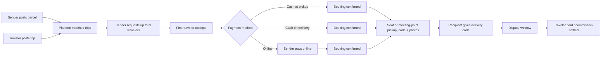
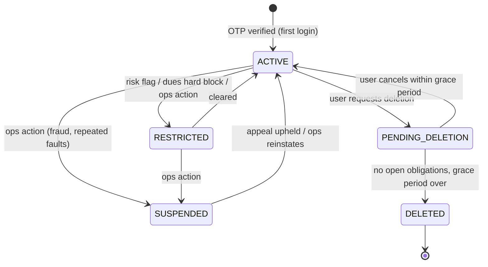
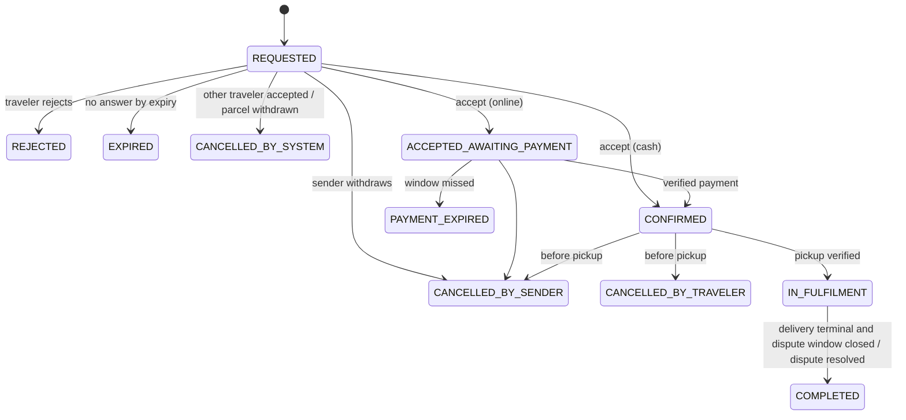
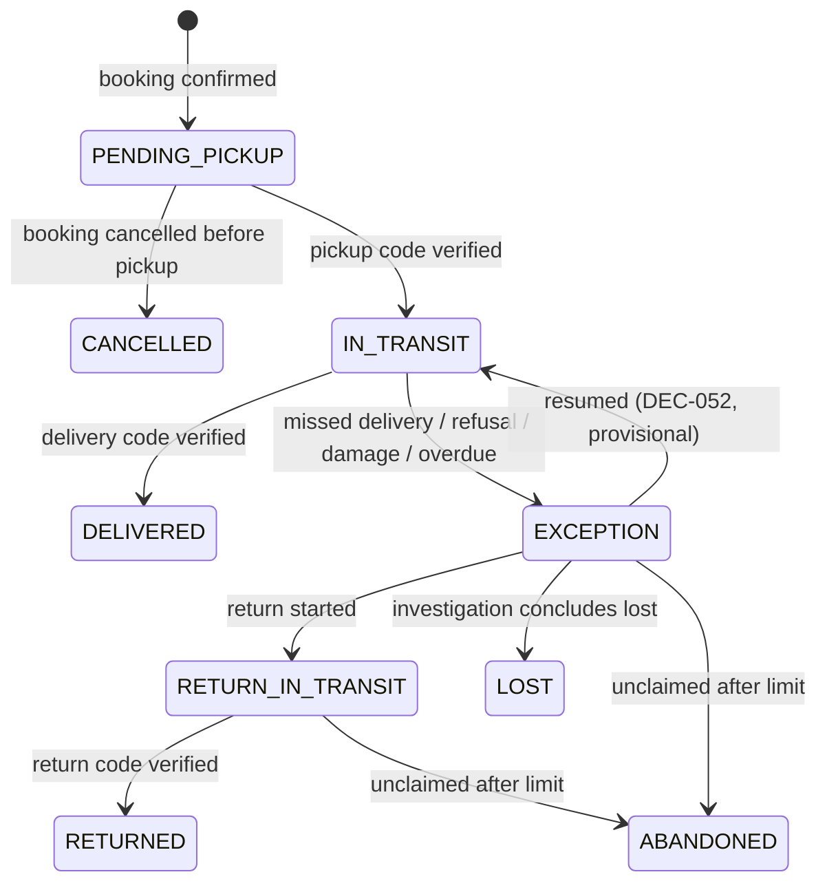
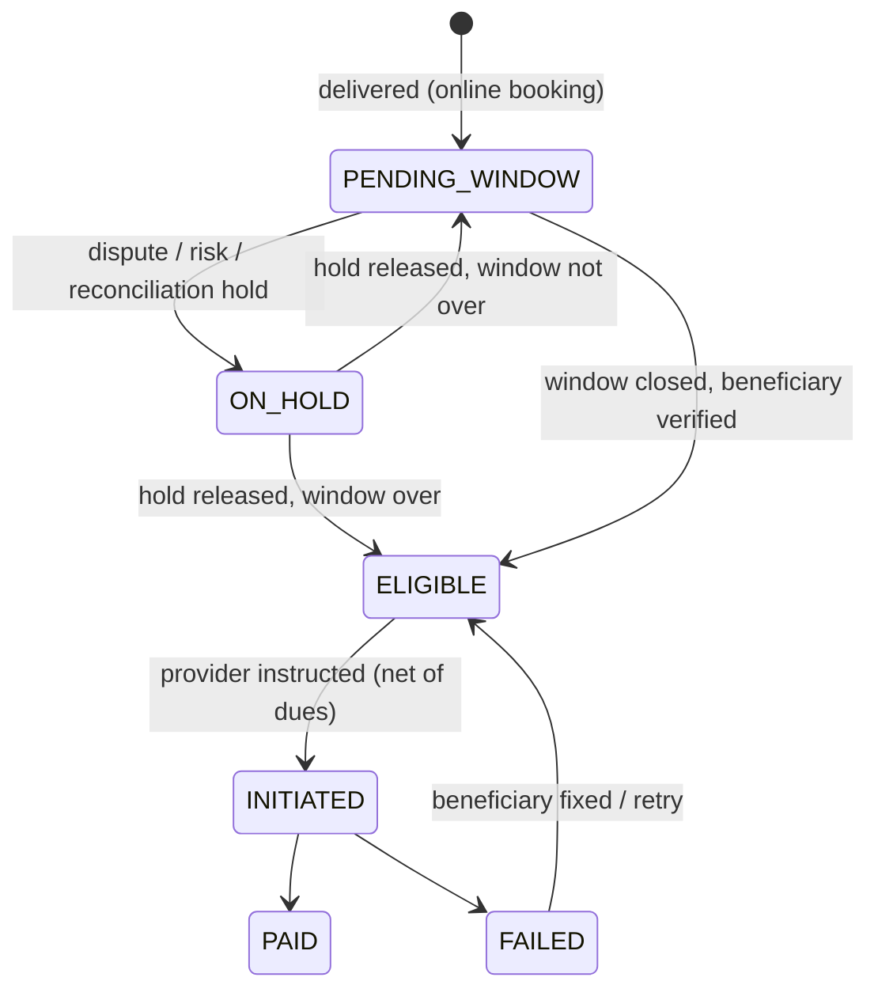
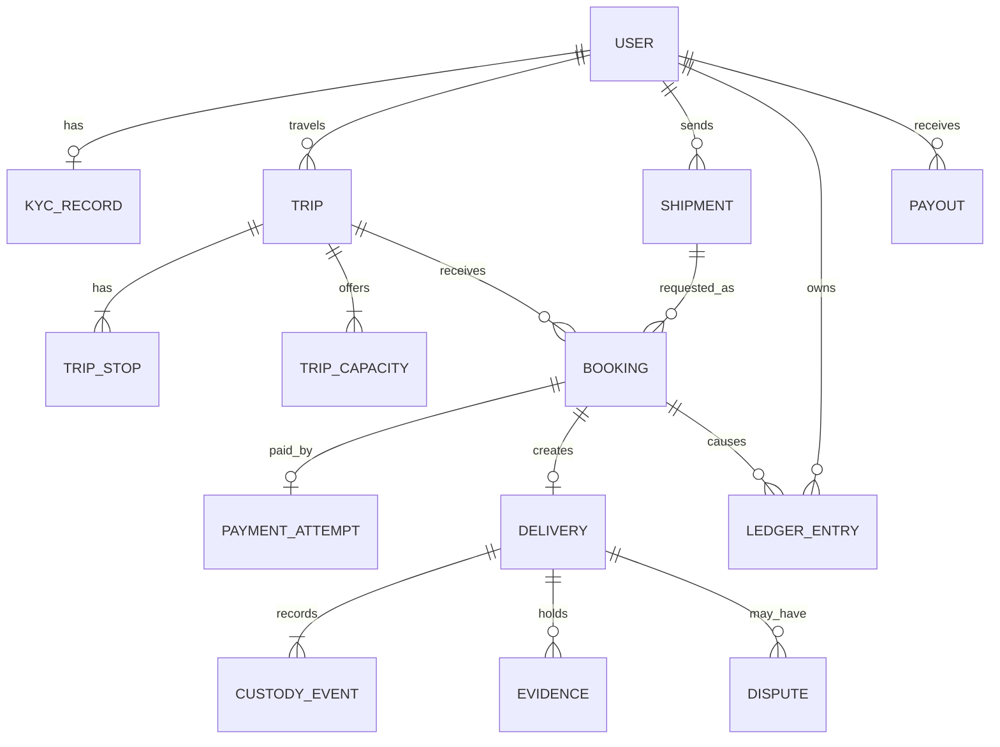

# GoParcel — Master Product Requirements Document

**"Send it with someone already going there."**

| Item | Value |
|---|---|
| Document | GoParcel Master PRD |
| Version | 2.1 — Draft; product-owner decisions PD-01..PD-20 recorded (22 November 2026) |
| Date | 22 November 2026 |
| Product owner | Shubham |
| Supersedes | GoParcel PRD v1.0 (Draft). v1.0 is preserved unchanged; this document does not overwrite it. |
| Structure | Single self-contained document. The decision register, open questions, requirements traceability and audit are Appendices C, D, E and F. There are no companion files. |
| Development status | **No development is authorised by this document.** Development starts only when the product owner says "START DEVELOPMENT". |

### Change log

| Version | Date | Change |
|---|---|---|
| 2.0 draft | 21 Nov 2026 | First full PRD from PRD v1.0, review decisions D-01..D-22 and Marketplace Policies v0.1 |
| 2.0 draft (consolidated) | 22 Nov 2026 | Decision register, open questions, traceability and audit merged into this document as Appendices C–F; separate companion files retired |
| 2.0 draft (reviewed) | 22 Nov 2026 | Review fixes: recipient may be the sender (SHIP-001); traveler compensation on cash bookings credited only when the sender pays (BOOK-005); payouts include all ledger credits (PAY-006); pickup decline for mismatch defined (HAND-004); analytics events added (NFR-OBS-03); four config keys made explicit (Appendix A) |
| 2.1 draft | 22 Nov 2026 | Product-owner decisions PD-01..PD-20 recorded after the architecture audit (Appendix C.7). D-15 and RV-01..RV-04 confirmed. OQ-02, 05, 06, 07, 08, 09, 11, 21 resolved (Appendix D). Config values updated (Appendix A). **Where Section 4 text conflicts with Appendix C.7, Appendix C.7 wins** until the body text is revised. |

---

## 0. How to read this document

### 0.1 Status labels

Every important statement carries one label.

| Label | Meaning |
|---|---|
| **[CONFIRMED]** | Explicitly approved by the product owner (decision IDs D-xx, DEC-xxx, ARCH-xx, PC-xx) or carried forward from PRD v1.0 without conflict. |
| **[PROVISIONAL]** | Recorded as a decision but explicitly marked provisional (DEC-052, DEC-057). Needs approval before it is final. |
| **[RECOMMENDED]** | The author's professional recommendation. Not approved. |
| **[PROPOSED]** | A suggested requirement or value awaiting approval. |
| **[TBD]** | Missing information. Must be decided before the affected feature ships. |
| **[DEFERRED]** | Intentionally excluded from the MVP. |

Where a number is not approved, it is written as a configuration key (for example `CFG-PAY-WINDOW`) and listed in **Appendix A** with a proposed value. Code and tests must read these from configuration, never hard-code them.

### 0.2 Sources actually reviewed

| Source | Used |
|---|---|
| GoParcel PRD v1.0 (Draft) | Yes, in full |
| PRD review conversation with the product owner (decisions D-01 to D-22) | Yes |
| GoParcel Marketplace Policies, Draft v0.1 (Claude Doc), including product-owner edits | Yes |
| Master prompt (architecture context, DEC-051, DEC-052, DEC-057) | Yes |
| Repository `Go_Parcel` (local) | Yes: contains only `README.md`; no code, ADRs or specifications |
| F1–F9 engineering specifications, ADRs, full DEC register, module specs | **Not available.** Anything that depends on them is marked unverified. See Appendix F. |

### 0.3 Release terminology

| Stage | Name | Meaning | Status |
|---|---|---|---|
| A | Staff alpha | Staff-only, simulated parcels, sandbox payments | [CONFIRMED] in PRD v1.0; retention [RECOMMENDED] (OQ-08) |
| P | Controlled pilot | First real parcels **and** real money together, limited cities and users | [CONFIRMED] PC-03: PRD v1.0 gates G and M merge because real money is used from the first real parcel |
| L | General launch | Open sign-up on approved routes | [RECOMMENDED] |

Passing one stage never automatically authorises the next. The product owner approves each stage in writing.

---

# SECTION 1 — PRODUCT OVERVIEW

## 1.1 Product introduction

GoParcel is an India-first, peer-to-peer intercity parcel marketplace. It connects **senders** who need a parcel moved between cities with **verified travelers** who are already making that journey by train, bus or car. The traveler carries the parcel as part of their existing trip and earns money. The sender gets a flexible, often faster alternative to a courier.

## 1.2 Product vision

Become India's most trusted way to send a parcel with someone already going there.

## 1.3 Product mission

- Turn unused travel capacity into a reliable delivery network.
- Make every handover verifiable: who held the parcel, when, and in what condition.
- Give travelers a simple, safe, guaranteed way to earn on trips they already make.
- Keep the experience as simple as booking a cab.

## 1.4 Problem statement

| Who | Problem |
|---|---|
| Senders | Courier pickup times, cut-offs and transit times do not suit urgent or small intercity parcels. Informal options ("send it with someone on the bus") have no accountability. |
| Travelers | No structured, safe way to find parcels on their route, no proof of what they carried, and no guarantee of payment. |
| Recipients | Uncertain arrival, no way to coordinate, no proof of handover. |

## 1.5 Existing market problem

People in India already send parcels informally with bus conductors, drivers and acquaintances. This works because the capacity exists, but it fails on trust: no identity verification, no evidence, no liability and no recourse when something goes wrong. Formal couriers solve trust but not flexibility.

## 1.6 Proposed solution

A marketplace in which:

1. Senders post parcels with size, weight, contents, declared value and a delivery window.
2. Travelers post trips with mode, stops, times, capacity and proof of travel.
3. A rule-based engine matches parcels to compatible trips and computes a platform-set price.
4. The sender requests a booking; the first traveler to accept wins.
5. Payment is taken online, in cash at pickup, or in cash on delivery.
6. Handover happens at the traveler's seat (train, bus) or a public meeting point (car), verified by a one-time code and photos.
7. The recipient confirms delivery with a code, without needing an account.
8. The traveler is paid after the dispute window. The platform keeps a commission.

## 1.7 Product positioning

GoParcel is **not a courier company**. It owns no vehicles, warehouses or delivery staff [CONFIRMED, PRD v1.0 §3.3]. It is a trust and coordination layer on top of journeys that are already happening.

## 1.8 Core value proposition

| Stakeholder | Value |
|---|---|
| Sender | Same-day or next-day intercity delivery on real journeys, a verified carrier, photo proof and a fixed price |
| Traveler | Guaranteed earnings on an existing trip, clear rules, protection against bad parcels (right to ask, right to refuse) |
| Recipient | Simple link, a code, and the chance to collect at a known seat or meeting point |
| GoParcel | Commission on every booking |

## 1.9 Target market

India, intercity routes. The pilot runs on a small set of city pairs chosen by the product owner [TBD, OQ-13].

## 1.10 Target users

- **Primary:** individuals sending documents, small goods, gifts and personal items between cities.
- **Primary:** individuals who travel intercity regularly or occasionally by train, bus or car.
- **Secondary:** small businesses [DEFERRED; out of scope until after the pilot, PC-01].

## 1.11 Stakeholders

Senders, travelers, recipients, GoParcel operations and support staff, GoParcel finance, GoParcel administrators, the payment provider, KYC provider, messaging providers, masked-calling provider, counsel and CA.

## 1.12 Business model overview

- Price is set by the platform from **size class × distance band** [CONFIRMED, D-04].
- GoParcel takes **the higher of 15% of the price or a minimum fee, plus GST on that commission**, deducted from the traveler's share [CONFIRMED, D-22]. The minimum amount is [TBD] (`CFG-MIN-COMMISSION`).
- Worked example at 18% GST on a ₹200 parcel: commission ₹30, GST ₹5.40, traveler earns ₹164.60. The GST rate and treatment must be confirmed by a CA.
- A subscription pass for frequent travelers is a later option [DEFERRED, D-21].

## 1.13 How the platform works

## 1.14 How GoParcel differs from a courier

| Aspect | Courier | GoParcel |
|---|---|---|
| Capacity | Owned fleet and hubs | Journeys already happening |
| Handover | Doorstep, hubs | Traveler's seat or a public meeting point |
| Carrier | Employee | KYC-verified individual |
| Speed | Fixed networks and cut-offs | As fast as the next suitable journey |
| Evidence | Scans at hubs | Code verification and photos at every custody change |
| Value limit | Higher, insured | Capped at ₹5,000 for the pilot [CONFIRMED, D-20] |

## 1.15 Product ecosystem

- **Web application** (`apps/web`): mobile-first website for senders and travelers; recipient delivery page; admin console [CONFIRMED, D-10; ARCH-02].
- **API** (`apps/api`): NestJS modular monolith under `/api/v1` [CONFIRMED, ARCH-03, ARCH-05].
- **Mobile app:** after the website [DEFERRED, D-10].
- **External providers:** WhatsApp, SMS, KYC, payments, masked calling, train running status, maps, object storage, behind provider ports [CONFIRMED pattern, ARCH-07].

---

# SECTION 2 — GOALS AND OBJECTIVES

## 2.1 Business goals

| ID | Goal | Type |
|---|---|---|
| BG-1 | Prove that travelers and senders will transact on a small set of routes | Business |
| BG-2 | Prove that verified, evidence-backed handovers keep loss and dispute rates acceptably low | Business |
| BG-3 | Reach positive contribution margin per parcel (commission covers per-parcel variable cost) | Financial |
| BG-4 | Build a repeat base of travelers on core routes | Business |

## 2.2 Product goals

- PG-1: A sender can go from sign-up to a confirmed booking without contacting support.
- PG-2: A traveler can go from sign-up to publishing a trip in one session, apart from KYC waiting time.
- PG-3: Every custody change is code-verified and photo-evidenced.
- PG-4: Every rupee is traceable through the ledger.

## 2.3 Customer (sender) goals

Send a parcel reliably, know where it is, know who has it, get compensated fairly when something goes wrong.

## 2.4 Traveler goals

Earn on trips already planned, get paid reliably, never be pressured into carrying something suspicious, and spend minimal time on coordination.

## 2.5 Operational goals

A small operations team handles verification, disputes and support through a controlled admin console. No direct database edits.

## 2.6 Financial goals

Commission plus GST on every booking, accurate GST records, a funded compensation reserve, and reconciliation between provider records and the ledger.

## 2.7 Technology goals

- Modular monolith, extraction-ready, without microservices, Kafka or Kubernetes [CONFIRMED, ARCH-08, ARCH-09].
- Server-authoritative state machines; idempotent commands; verified provider events.
- Low running cost suitable for a minimal budget.

## 2.8 MVP goals

1. Run Stage A with staff on simulated parcels and sandbox payments.
2. Run the controlled pilot on a small set of routes with real parcels and real money.
3. Measure match rate, completion rate, dispute rate and per-parcel cost.

## 2.9 Launch objectives

Pilot exit criteria are set by the product owner after baseline data [TBD, OQ-15]. This document does not invent targets.

## 2.10 Short-term objectives (0–6 months after pilot)

Mobile app, mutual ratings shown in matching, recipient-pays-online, more routes.

## 2.11 Long-term vision

India-wide coverage, bike and air modes after legal review, business accounts, insurance-backed protection, subscription pass for frequent travelers.

---

# SECTION 3 — USER PERSONAS, ROLES AND PERMISSIONS

## 3.1 Identity model

One person has **one account and one verified identity**, used for both the sender and traveler roles [CONFIRMED, D-01]. Roles are capabilities unlocked on that account, not separate accounts.

| Capability | Unlocked when | Source |
|---|---|---|
| Browse, see prices, draft parcels and trips | Phone verified by OTP | [CONFIRMED] D-02 |
| Publish a parcel (sender) | KYC = VERIFIED, account ACTIVE, no blocking dues | [CONFIRMED] D-02, D-11a |
| Publish a train or bus trip (traveler) | KYC = VERIFIED, account ACTIVE, valid ticket uploaded for that trip | [CONFIRMED] D-02, D-08 |
| Publish a car trip | Above, plus driving licence, vehicle registration and insurance verified | [CONFIRMED] D-19 |
| Accept cash bookings | Traveler opted in, ledger dues below `CFG-DUES-THROTTLE` | [CONFIRMED] D-21 |
| Receive a payout | Payout beneficiary (bank or UPI) verified | [CONFIRMED] PRD v1.0 FR-PAY-06 |

## 3.2 Account lifecycle

- **RESTRICTED:** can log in, view history, pay dues and contact support. Cannot publish, request or accept bookings. [RECOMMENDED]
- **SUSPENDED:** can log in only to view status, appeal and pay dues. Any active custody obligation is handled by the custody-resolution process (DISP-005). [CONFIRMED, PRD v1.0 WF-1]
- **Account status and KYC status are separate fields** [CONFIRMED, BR-01].

## 3.3 Personas

### Sender — "Priya, 29, Indore"
Sends documents and gifts to family in Bhopal twice a month. Wants a confirmed booking quickly and proof the parcel arrived. Comfortable with UPI. Some senders (for example older users) have no UPI and pay cash [CONFIRMED, D-11a].

### Traveler — "Rahul, 34, travels Indore–Bhopal weekly by train"
Wants extra income without extra effort. Will not carry anything suspicious. Wants to know who the sender is and to be paid reliably.

### Traveler (car) — "Amit, 41, drives Indore–Ujjain on weekends"
Can stop at a fuel station on the way. Must never be asked to use the app while driving [CONFIRMED, D-19].

### Recipient — "Sunita, 55, Bhopal"
Not a GoParcel user. Receives a WhatsApp link, comes to the station, gives a code. May pay cash on delivery [CONFIRMED, D-11a].

### Operations agent — "Neha"
Reviews KYC exceptions, tickets, disputes and flagged deliveries.

### Finance operator — "Vikram"
Monitors payouts, refunds, ledger dues and reconciliation.

## 3.4 Roles

| Role | Description | Key responsibilities | Verification |
|---|---|---|---|
| Sender | Account holder sending a parcel | Accurate declaration, honest packing, payment, reaching the seat on time | Phone OTP; KYC before first publish |
| Traveler | Account holder carrying a parcel | Real trip, safe custody, being at the stated seat or point, honest handover | Phone OTP; KYC; ticket per trip; car documents for car trips; beneficiary before payout |
| Recipient | Scoped actor, no account | Collect at the seat or point, give the code, pay cash if COD | Single-delivery link plus delivery code [CONFIRMED, PRD v1.0 §4.3; confirmation requested OQ-06] |
| Support agent | GoParcel staff | Answer cases, view limited data, escalate | Staff login with 2FA [RECOMMENDED] |
| Operations agent | GoParcel staff | KYC review, ticket review, dispute investigation, holds | As above |
| Finance operator | GoParcel staff | Refunds, payouts, reconciliation, ledger adjustments | As above |
| Senior administrator | GoParcel staff | Approve high-risk actions, appeals, configuration, role grants | As above; definition [TBD] (PRD v1.0 UD-06) |
| System | Background jobs | Timers, expiry, notifications, reconciliation | Service identity |

## 3.5 Role–permission matrix

Legend: ✅ allowed · 🔒 own records only · 👁 view only (masked) · ⚠ allowed with reason code and audit · ✋ needs second approver [RECOMMENDED] · — not allowed

| Action | Sender | Traveler | Recipient | Support | Ops | Finance | Senior admin |
|---|---|---|---|---|---|---|---|
| Create / edit draft parcel | 🔒 | 🔒 | — | — | — | — | — |
| Publish / withdraw parcel | 🔒 | 🔒 | — | — | — | — | — |
| Create / edit / cancel trip | — | 🔒 | — | — | ⚠ cancel only | — | ⚠ |
| Search trips for a parcel | 🔒 | 🔒 | — | 👁 | 👁 | — | 👁 |
| Request booking | 🔒 | 🔒 (as sender) | — | — | — | — | — |
| Accept / reject booking | — | 🔒 | — | — | — | — | — |
| Cancel booking (pre-pickup) | 🔒 | 🔒 | — | ⚠ | ⚠ | — | ⚠ |
| View delivery details | 🔒 | 🔒 | 🔒 (via link) | 👁 | 👁 | 👁 | 👁 |
| Enter pickup / delivery code | — | 🔒 | — | — | — | — | — |
| View evidence photos | 🔒 | 🔒 own handovers | 🔒 delivery photo | ⚠ investigation only | ⚠ | — | ⚠ |
| Raise dispute / claim | 🔒 | 🔒 | 🔒 (via link) | ⚠ on behalf | ⚠ | — | — |
| Decide dispute | — | — | — | — | ⚠ | — | ⚠ |
| Decide appeal | — | — | — | — | — | — | ✋ (not the original decider) |
| KYC approve / reject (manual) | — | — | — | — | ⚠ | — | ⚠ |
| Restrict / suspend account | — | — | — | — | ⚠ | — | ⚠ |
| Reinstate suspended account | — | — | — | — | — | — | ✋ |
| Issue refund (outside automatic rules) | — | — | — | — | — | ⚠ | ✋ above `CFG-REFUND-2P-LIMIT` |
| Ledger adjustment | — | — | — | — | — | ✋ | ✋ |
| Place / release payout hold | — | — | — | — | ⚠ | ⚠ | ⚠ |
| Change configuration values | — | — | — | — | — | — | ✋ |
| Grant staff roles | — | — | — | — | — | — | ✋ |
| View audit log | — | — | — | — | 👁 own area | 👁 finance | ✅ |

Rules for every staff action [CONFIRMED, PRD v1.0 BR-18, FR-ADM-08]:

1. Staff act only through defined commands. No direct state overwrite.
2. Every command passes through the same state-machine guards as user actions.
3. Every command records actor, reason code, free-text note, timestamp, before and after state.

---

# SECTION 4 — FUNCTIONAL REQUIREMENTS

## 4.0 Specification format

Each feature uses the same structure. Where a field does not apply it is omitted.

- **Header line:** ID · module · phase · status and decision references
- **Purpose and users**
- **Preconditions**
- **Inputs** (mandatory fields marked *)
- **Workflow** (user steps and system behaviour)
- **Business rules**
- **Validation**
- **Failures and edge cases**
- **Notifications**
- **Data and state changes**
- **Permissions**
- **Dependencies**
- **Acceptance criteria** (Given / When / Then)

Phase values: **A** = staff alpha, **P** = controlled pilot (MVP), **2** / **3** = later phases.

Module names follow the confirmed domain list (ARCH-10): Identity, Users, Travelers, KYC, Routes, Shipments, Booking, Matching, Pricing, Payments, Ledger, Tracking, Notifications, Courier, Disputes, Fraud, Operations, Admin. "Courier" is used here for **custody and handover** [RECOMMENDED; meaning to be confirmed, OQ-04].

## 4.1 Identity and authentication

### AUTH-001 — Request a login OTP
Identity · A, P · [CONFIRMED] D-03, PRD v1.0 FR-AUTH-01/02

**Purpose:** let any person start sign-up or login with only a phone number. There are no passwords [RECOMMENDED; confirm, OQ-05].

**Inputs:** mobile number* (Indian +91, 10 digits, starting 6–9); channel preference (WhatsApp default, SMS fallback); consent to terms and privacy notice* (first sign-up only).

**Workflow**
1. User enters a mobile number and taps "Send code".
2. System normalises the number to E.164 and validates the format.
3. System applies rate limits (per number, per device, per IP).
4. System creates an OTP challenge: 6 digits, hashed at rest, expiry `CFG-OTP-TTL`, max attempts `CFG-OTP-MAX-ATTEMPTS`.
5. System sends the code by WhatsApp authentication template. If WhatsApp delivery fails or the user taps "Send by SMS instead", system sends by SMS.
6. The screen shows "Code sent" and a resend timer (`CFG-OTP-RESEND-COOLDOWN`).

**Business rules**
- Known and unknown numbers receive the same response, so the endpoint cannot be used to check whether a number is registered [CONFIRMED, PRD v1.0 WF-1].
- A new challenge invalidates any older unused challenge for that number.
- SMS is mandatory (WhatsApp not allowed) for account recovery and payout-detail changes [CONFIRMED, D-03].

**Failures and edge cases**
- Rate limit hit: generic message "Too many attempts, try again in N minutes". No code sent.
- Both providers fail: show "We could not send a code right now", log an incident metric, do not reveal which provider failed.
- User has no WhatsApp: WhatsApp send fails, system offers SMS automatically.
- Number reassigned to a new person (Indian carriers recycle numbers): handled at AUTH-004.

**Data:** `otp_challenge` (id, phone hash, channel, code hash, expires_at, attempts, consumed_at, ip, device fingerprint).

**Dependencies:** WhatsApp Business provider (INT-01), SMS provider with DLT registration (INT-02).

**Acceptance criteria**
- Given a valid number, when the user requests a code, then exactly one active challenge exists and a code is sent on WhatsApp.
- Given WhatsApp delivery fails, when the provider reports failure, then the code is sent by SMS without the user retyping the number.
- Given `CFG-OTP-RATE-LIMIT` requests in the window, when another is made, then no code is sent and the same generic message is shown.
- Given a registered and an unregistered number, when each requests a code, then the HTTP response body and timing class are identical.

### AUTH-002 — Verify OTP, create account or log in
Identity · A, P · [CONFIRMED] PRD v1.0 FR-AUTH-03/04/05

**Inputs:** challenge ID*, 6-digit code*.

**Workflow**
1. User enters the code.
2. System checks expiry, attempt count and hash, using a single atomic update so two concurrent submissions cannot both succeed [CONFIRMED, PRD v1.0 WF-1 rule].
3. On success, the challenge is consumed. If no account exists for the number, the system creates one (status ACTIVE, KYC NOT_STARTED) and records consent version and time.
4. System creates a session (AUTH-003) and routes the user: new user → short profile step (USER-001); existing user → home.

**Failures and edge cases**
- Wrong code: attempts +1, message shows remaining attempts. At the limit, the challenge is locked; user must request a new code.
- Expired code: "Code expired, request a new one".
- Suspended account: login succeeds only into the restricted view (status, appeal, dues, support).
- Account in PENDING_DELETION: login offers "Cancel deletion".

**Acceptance criteria**
- Given two simultaneous correct submissions, when both are processed, then exactly one session is created and the other receives "code already used".
- Given an expired challenge, when the correct code is entered, then authentication fails.
- Given a first-time number, when verification succeeds, then one account is created with consent version recorded.

### AUTH-003 — Sessions and logout
Identity · A, P · [CONFIRMED] PRD v1.0 FR-AUTH-05/06

- Short-lived access token plus rotating refresh token in an HttpOnly, Secure, SameSite cookie [RECOMMENDED].
- Idle timeout `CFG-SESSION-IDLE`; absolute lifetime `CFG-SESSION-MAX`.
- "Log out" revokes the current session. "Log out of all devices" revokes all sessions.
- Suspension, phone change and recovery revoke all sessions.
- Refresh-token reuse is treated as theft: revoke the session family and raise a risk flag (FRAUD-001).

**Acceptance criteria**
- Given a revoked session, when any API call is made with it, then the call returns 401.
- Given a refresh token used twice, when the second use occurs, then all sessions in that family are revoked.

### AUTH-004 — Account recovery and phone-number change
Identity · P · [PROPOSED] policies §2 open item

**Purpose:** protect accounts when a user loses a number, or when a recycled number reaches a new person.

**Workflow (lost number, new number)**
1. User chooses "I changed my number" and enters the new number.
2. SMS OTP to the new number (WhatsApp not accepted).
3. Fresh selfie liveness, matched to the KYC photo on file.
4. On match, the phone number is changed, all sessions revoked, payouts held for `CFG-PAYOUT-HOLD-AFTER-PHONE-CHANGE`.
5. No KYC on file: route to support for manual review (SUP-001).

**Recycled number:** if a login comes from a number whose account was inactive for longer than `CFG-RECYCLED-NUMBER-DAYS`, and the selfie does not match, the system does not grant access to the old account. It offers to create a fresh account only after ops review.

**Acceptance criteria**
- Given a failed selfie match, when recovery is attempted, then the phone number is not changed and a support case is created.
- Given a successful phone change, then all sessions are revoked and the payout hold is applied.

### AUTH-005 — Restriction and suspension
Identity / Operations · A, P · [CONFIRMED] PRD v1.0 FR-AUTH-08, FR-ADM-05

- Triggers: ops command with reason code; automatic dues hard block (PAY-009); risk rules (FRAUD-001).
- Effects per §3.2. Published trips and parcels of a suspended user are withdrawn; pending requests are system-cancelled; **confirmed bookings are not silently cancelled**. Each one is routed to ops for custody resolution (DISP-005).
- User is notified with the reason category and how to appeal (DISP-004).

**Acceptance criteria**
- Given a suspended traveler with a confirmed, not-yet-picked-up booking, when suspension is applied, then the booking is flagged to ops and the sender is notified, and the booking is not auto-cancelled without an ops decision.
- Given a suspended user, when they try to publish or accept, then the action fails with `ACCOUNT_SUSPENDED`.

### AUTH-006 — Account deletion
Identity / Privacy · P · [CONFIRMED] PRD v1.0 FR-AUTH-09

1. User requests deletion and confirms by OTP.
2. System checks blockers: active bookings, open disputes, unpaid dues, ledger balance owed to the user, legal hold. Any blocker → explain and block until resolved.
3. Account moves to PENDING_DELETION for `CFG-DELETION-GRACE-DAYS`.
4. After the grace period: personal data is deleted or anonymised; records required by law (financial, tax, KYC references, evidence under legal hold) are retained for their retention periods (PRIV-003).

**Acceptance criteria**
- Given unpaid dues, when deletion is requested, then deletion is blocked with the amount shown.
- Given the grace period passes with no blockers, then the profile is anonymised and the phone number is released.

## 4.2 User profiles

### USER-001 — Profile
Users · A, P · [CONFIRMED] D-01; fields [RECOMMENDED]

| Field | Mandatory | Rule |
|---|---|---|
| Display first name | * | 2–40 chars; replaced by KYC first name after KYC |
| Legal name | Set by KYC | Read-only to user; used for ticket and licence matching |
| Profile photo | Optional before KYC | After KYC, the KYC selfie is used for internal matching only, never shown publicly |
| Preferred language | * | English or Hindi [PROPOSED] |
| Email | Optional | For receipts; verified by link |
| Emergency contact | Optional; required before first real handover [PROPOSED, policies §11] | Name and phone |
| WhatsApp notifications opt-in | * | Required for WhatsApp messages (USER-002) |

What others see: first name, last-name initial, "KYC verified" badge, rating and completed-delivery count [CONFIRMED, policies §11].

### USER-002 — Notification preferences and consent
Users / Notifications · A, P · [CONFIRMED] D-03, D-13

- WhatsApp opt-in captured explicitly and stored with time and text version.
- Transactional notifications cannot be switched off (booking, payment, handover, dispute). Marketing messages are off by default.
- Opt-out of WhatsApp switches transactional messages to SMS.

### USER-003 — Role dashboard switching
Users · A, P · [RECOMMENDED]

A single account shows "Send" and "Travel" tabs. The traveler tab shows onboarding steps until the traveler capabilities in §3.1 are unlocked.

## 4.3 KYC and traveler onboarding

### KYC-001 — Identity verification (one-time, both roles)
KYC · A (stub), P (real) · [CONFIRMED] D-01, D-02; method [PROPOSED, subject to counsel]

**Trigger:** the first time a user tries to publish a parcel or a trip [CONFIRMED, D-02].

**Methods**
1. Aadhaar through an approved route: DigiLocker, or Aadhaar offline e-KYC (XML or QR).
2. Alternatives that must also be accepted: driving licence, voter ID, passport [PROPOSED; counsel to confirm the exact rule].
3. Selfie liveness check matched to the ID photo [PROPOSED].

**Workflow**
1. User sees why KYC is needed and what is stored.
2. User picks a method and completes it through the KYC provider (INT-03).
3. User takes a selfie in the in-page camera with a liveness check.
4. Provider returns result. System stores: legal name, date of birth, document type, last four digits of the document number, provider reference, face-match score, outcome.
5. Outcome:
   - Auto-pass (all checks pass, name readable, age ≥ `CFG-MIN-AGE`) → KYC VERIFIED.
   - Inconclusive → IN_REVIEW, goes to the ops queue (KYC-002).
   - Fail → REJECTED with reason category; user may retry up to `CFG-KYC-MAX-RETRIES`.
6. The original action (publish) resumes automatically on VERIFIED.

**Business rules**
- The full Aadhaar number is never stored [PROPOSED, policies §2].
- One verified identity per person: the same document reference on two accounts raises a duplicate-identity flag (FRAUD-001) and blocks the second account's KYC.
- Minimum age `CFG-MIN-AGE` [PROPOSED 18; counsel].
- Stage A uses a manual stub; the real provider is required for Stage P [CONFIRMED, PRD v1.0 WF-2].

**Failures:** provider down → "Verification is temporarily unavailable, we will notify you"; the attempt is queued and retried; user can keep drafting.

**KYC states:** NOT_STARTED → PENDING → (VERIFIED | IN_REVIEW | REJECTED); VERIFIED → REVERIFY_REQUIRED (KYC-003).

**Acceptance criteria**
- Given a user with KYC NOT_STARTED, when they tap Publish, then they are routed into KYC and their draft is preserved.
- Given a document reference already linked to another verified account, when KYC completes, then the result is IN_REVIEW with a duplicate flag.
- Given KYC completes, then no full Aadhaar number exists anywhere in storage or logs.

### KYC-002 — Manual KYC review
KYC / Operations · A, P · [CONFIRMED] PRD v1.0 FR-VER-05

Ops queue showing provider result, face-match score, document images (where the provider returns them), and duplicate flags. Ops action: approve, reject (reason code), request resubmission. Decisions audited. SLA `CFG-KYC-REVIEW-SLA` [PROPOSED].

### KYC-003 — Re-verification
KYC · P · [RECOMMENDED]

Triggers: phone change (AUTH-004), risk flag, document expiry where known, ops request. Sets REVERIFY_REQUIRED; publishing and accepting are blocked until VERIFIED again. Existing confirmed bookings are not cancelled automatically; ops decides.

### KYC-004 — Payout beneficiary verification
KYC / Payments · P · [CONFIRMED] PRD v1.0 FR-PAY-06

Bank account (IFSC + number) or UPI ID. Verified through the payment provider's account-validation service (penny-drop or equivalent) [RECOMMENDED]. The account holder name must reasonably match the KYC legal name; mismatch → ops review. Changing the beneficiary requires SMS OTP and starts a payout hold `CFG-PAYOUT-HOLD-AFTER-BENEFICIARY-CHANGE`. PAN collection for tax purposes [TBD, CA].

### KYC-005 — Car traveler documents
KYC / Travelers · P · [CONFIRMED] D-19

Driving licence, vehicle registration certificate and valid motor insurance, checked once during car onboarding. Licence name must match KYC legal name. Insurance expiry date stored; a car trip cannot be published after expiry. Verification by provider where available, otherwise manual review.

**Acceptance criteria**
- Given expired insurance, when a car trip is published with a departure after the expiry date, then publishing fails with `VEHICLE_INSURANCE_EXPIRED`.

## 4.4 Trips and routes

### TRIP-001 — Create a trip
Routes / Travelers · A, P · [CONFIRMED] D-06, D-06a, D-08, D-09, D-19

**Preconditions:** account ACTIVE; KYC VERIFIED to publish (draft allowed earlier); for car, KYC-005 complete.

**Inputs**

| Field | Mandatory | Validation |
|---|---|---|
| Transport mode* | * | Train, bus or car at launch. Bike and air not selectable [CONFIRMED, D-06a] |
| Origin stop* | * | From the station / city master list (ROUTE-001) |
| Intermediate stops | Optional, ordered | From the master list; no duplicates; order must follow travel direction |
| Destination stop* | * | From the master list; differs from origin |
| Departure date and time* | * | Future; at least `CFG-TRIP-MIN-LEAD` ahead |
| Expected arrival time at each stop* | * | Increasing order; train: pre-filled from schedule data if available [TBD, INT-06] |
| Train number* (train) | * | Valid format; used for running status |
| Coach and seat* (train, bus) | * | Coach code (e.g. S4, B2, GEN) and seat/berth. GEN coach: position description instead of seat [CONFIRMED, D-07] |
| Ticket proof* (train, bus) | * | Upload of the ticket (image or PDF). Camera or file upload allowed for tickets; the camera-only rule (D-16) applies to evidence photos only |
| PNR* (train) | * | 10 digits; stored encrypted, **never shown to anyone except ops** [CONFIRMED, D-07] |
| Vehicle (car) | * | Selected from verified vehicles |
| Meeting point per stop (car)* | * | Chosen from public meeting points near the stop (ROUTE-002), or a home address if both parties later agree [CONFIRMED, D-19] |
| Capacity* | * | Number of S, M, L slots and total weight cap; limited by `CFG-MODE-SIZE-CLASSES` and `CFG-MODE-WEIGHT-CAP` [CONFIRMED structure; values TBD] |
| Accept cash bookings | * | Yes/No toggle, default No [PROPOSED] |

**Workflow**
1. Traveler fills the form; drafts are autosaved.
2. On Publish, the system validates fields, KYC, vehicle documents (car), and ticket presence (train, bus).
3. Ticket verification runs (TRIP-002). Trip status → PENDING_VERIFICATION, then PUBLISHED when verified.
4. Published trips become matchable (MATCH-001).

**Business rules**
- Train stops whose scheduled halt is shorter than `CFG-MIN-HALT-MINUTES` cannot be used as pickup or delivery stops [PROPOSED 5 minutes, policies §5]. They may still be listed for context.
- The ticket name must match the KYC legal name where the ticket shows a name [CONFIRMED, policies §3].
- One traveler cannot have two published trips whose times overlap.

**Failures:** ticket unreadable → manual review; departure too soon → `TRIP_TOO_SOON`; capacity above mode cap → field error.

**Acceptance criteria**
- Given a bus trip with no ticket uploaded, when Publish is tapped, then publishing fails with `TICKET_REQUIRED`.
- Given a train trip, when it is published, then the PNR is not returned by any sender- or recipient-facing API.
- Given a car trip, when a meeting point is not selected for a stop, then that stop cannot be used for pickup or delivery.

### TRIP-002 — Ticket verification
Routes / Operations · A (manual), P · [PROPOSED] policies §3

- Pilot: OCR extracts name, date, train/bus number, origin, destination; the system compares with the trip and KYC name. Clear match → verified. Any mismatch or low confidence → ops queue.
- Third-party PNR lookup only after its reliability and terms are vetted [TBD, INT-06].
- Ops can approve, reject (reason) or ask for a new upload.
- Rejected trip → traveler notified; trip returns to DRAFT.

### TRIP-003 — Edit a trip
Routes · A, P · [RECOMMENDED]

- Before any booking request is accepted: all fields editable; edits re-run validation and ticket verification if ticket-related fields change.
- After any booking is confirmed: only "delay" updates (TRIP-005) and adding capacity are allowed. Changing stops, seat or times that affect a confirmed booking requires cancelling the trip (TRIP-004) or contacting support.

### TRIP-004 — Cancel a trip
Routes / Booking · A, P · [CONFIRMED] policies §9 (traveler cancellation)

1. Traveler taps Cancel trip and selects a reason.
2. System lists affected bookings. Confirmed bookings → each becomes a traveler cancellation (BOOK-006): full refund to sender, reliability mark, rating impact [CONFIRMED, product-owner edit "degrade profile rating"]. Pending requests → system-cancelled.
3. Affected shipments return to OPEN and are re-matched (MATCH-004).
4. After pickup, a trip cannot be cancelled in-app. The traveler must contact support; ops runs custody resolution (DISP-005).

### TRIP-005 — Delay update
Routes / Tracking · A, P · [CONFIRMED] policies §9 (delay row)

- Traveler reports a delay (new departure or arrival estimate). Train running status may also update estimates automatically (HAND-002).
- If the new estimate breaks a booking's delivery window, the sender may cancel with a full refund **before pickup**; no reliability mark if the delay is outside the traveler's control (traveler selects a reason; ops may review).
- After pickup, the delivery continues; the recipient is notified of the new estimate.

### TRIP-006 — Trip lifecycle and completion
Routes · A, P · [CONFIRMED] PRD v1.0 FR-JRN-05/08, BR-11

States: DRAFT → PENDING_VERIFICATION → PUBLISHED → IN_PROGRESS (first departure time passed) → COMPLETED; DRAFT/PUBLISHED → CANCELLED; PUBLISHED with no bookings past departure → EXPIRED.

- A trip is COMPLETED only when every linked delivery is terminal (DELIVERED, RETURNED, LOST, ABANDONED, CANCELLED).
- A timer never marks a delivery complete. If a trip passes its final arrival time + `CFG-TRIP-OVERDUE-GRACE` with an undelivered parcel, the system escalates to ops; it does not complete anything [CONFIRMED, PRD v1.0 WF-4].

### ROUTE-001 — Station and city master list
Routes / Admin · A, P · [RECOMMENDED]

Admin-maintained list of railway stations (with station codes), bus stands and cities, each with coordinates (PostGIS point) and city. Used for trip stops, parcel origin/destination and distance bands. Initial data for pilot cities loaded by ops; source of station data [TBD].

### ROUTE-002 — Public meeting points (car)
Routes / Admin · P · [CONFIRMED] D-19; list management [RECOMMENDED]

Admin-curated list of public, well-lit points per city (fuel stations, bus stands, landmarks) with coordinates. Travelers choose from this list. Home addresses only if both parties agree in the booking (HAND-001).

## 4.5 Shipments

### SHIP-001 — Create a parcel (draft)
Shipments · A, P · [CONFIRMED] D-06, D-20, policies §4

**Inputs**

| Field | Mandatory | Validation |
|---|---|---|
| Origin stop* | * | Master list (ROUTE-001) |
| Destination stop* | * | Master list; differs from origin |
| Size class* | * | S, M or L; dimensions shown per class (`CFG-SIZE-DIMENSIONS`, TBD) |
| Weight (kg)* | * | > 0 and ≤ the class limit |
| Contents category* | * | From the category list; prohibited categories are not selectable (SHIP-002) |
| Contents description* | * | 5–200 chars |
| Declared value (₹)* | * | 1 to `CFG-DECLARED-VALUE-CAP` (₹5,000 pilot) [CONFIRMED, D-20] |
| Fragile | * | Yes/No. Fragile items are carried at sender's risk unless declared and accepted [CONFIRMED, policies §10] |
| Delivery window* | * | Earliest and latest acceptable delivery date-time |
| Recipient name* | * | 2–60 chars |
| Recipient mobile* | * | Valid Indian mobile. May be the sender's own number: sending a parcel to yourself in another city is allowed [RECOMMENDED] |
| Recipient consent confirmation* | * | Checkbox: "The recipient agreed to share their name and number" (pre-ticked and hidden when the recipient is the sender) [CONFIRMED, policies §4] |
| Preferred payment method | * | Online, cash at pickup, cash on delivery (PAY-001/003/004) |
| Parcel photo | At packing time | Taken during the packing sequence (HAND-003), not at draft time |

**Workflow:** autosave as DRAFT; user can leave and return. Price preview shown as soon as origin, destination and size are filled (PRICE-001).

**Edge cases:** abandoned drafts kept `CFG-DRAFT-RETENTION-DAYS` then deleted; a draft cannot be edited while its publish request is being processed.

### SHIP-002 — Eligibility check and content declaration
Shipments · A, P · [CONFIRMED] PRD v1.0 FR-SHP-04, policies §4

- The platform checks category, size, weight and declared-value cap. **It cannot verify what is inside** [CONFIRMED, policies §4].
- Prohibited categories [PROPOSED baseline; final list needs product owner and counsel]: narcotics and illegal substances; weapons, ammunition, explosives; flammable, corrosive or hazardous materials; cash, currency, cheques, negotiable instruments; jewellery, precious metals and stones; alcohol and tobacco; prescription medicines; live animals and plants; perishable food (pilot); anything above the value cap.
- The KYC-verified sender signs a content declaration (checkbox plus typed name, stored with timestamp and text version).

**Acceptance criteria**
- Given declared value ₹5,001, when publishing, then it fails with `DECLARED_VALUE_ABOVE_CAP`.
- Given a declaration not signed, then publishing fails.

### SHIP-003 — Publish a parcel
Shipments · A, P · [CONFIRMED] PRD v1.0 FR-SHP-05

Preconditions: KYC VERIFIED, account ACTIVE, no sender dues blocking (PAY-010), SHIP-002 passed. State DRAFT → OPEN. The sender is taken to matching results (MATCH-001).

### SHIP-004 — Withdraw or edit a published parcel
Shipments · A, P · [CONFIRMED] PRD v1.0 FR-SHP-06/07

- An OPEN parcel is never edited directly.
- Withdraw is allowed while no booking is ACCEPTED_AWAITING_PAYMENT or CONFIRMED (a "live booking"). Withdrawal system-cancels pending REQUESTED bookings and returns the parcel to DRAFT. After editing, it must pass SHIP-002 again to republish.
- With a live booking, the sender must cancel the booking first (BOOK-005).

### SHIP-005 — Parcel expiry
Shipments · A, P · [RECOMMENDED]

An OPEN parcel whose delivery window's latest time passes without a confirmed booking moves to EXPIRED; pending requests are cancelled; the sender is notified and can duplicate it as a new draft.

### SHIP-006 — Parcel lifecycle

States: DRAFT → OPEN → LOCKED (a traveler accepted; awaiting payment or confirmed) → IN_DELIVERY (picked up) → CLOSED (delivery terminal). OPEN → DRAFT (withdraw). OPEN → EXPIRED. DRAFT/OPEN → CANCELLED. LOCKED → OPEN (payment window missed, or booking cancelled before pickup). [RECOMMENDED; F3 state machine not available for verification]

Shipment state is separate from booking, payment, trip and delivery state [CONFIRMED, BR-04].

## 4.6 Matching

### MATCH-001 — Find matching trips for a parcel
Matching · A, P · [CONFIRMED] D-09, PRD v1.0 FR-MCH-01..07

A trip matches a parcel when **all** of these hold:

1. The parcel's origin and destination are both stops on the trip, origin before destination [CONFIRMED, D-09].
2. Neither stop is a train stop with halt below `CFG-MIN-HALT-MINUTES`.
3. The trip's expected arrival at the parcel's destination falls inside the parcel's delivery window.
4. The trip's departure from the parcel's origin is at least `CFG-BOOKING-CUTOFF` in the future [PROPOSED 2 h].
5. The trip has a free slot of the parcel's size class and remaining weight ≥ parcel weight.
6. The mode allows the parcel's size class.
7. The traveler is KYC VERIFIED, ACTIVE, not the sender, and (for cash parcels) has cash enabled and is below the dues throttle.
8. The trip is PUBLISHED.

Results show: traveler first name + initial, KYC badge, rating, completed deliveries, mode, departure and arrival times at the relevant stops, price, and estimated delivery time. **Never shown:** PNR, seat, phone, full name [CONFIRMED, policies §11].

**Performance:** see NFR-PERF-02.

### MATCH-002 — Ranking
Matching · A, P · [RECOMMENDED]; formula [TBD]

Default order: earliest arrival within the window; ties broken by reliability score, then rating, then earliest published. Sender can sort by earliest arrival or traveler rating. No paid placement.

### MATCH-003 — No match
Matching · A, P · [RECOMMENDED]

Show "No travelers on this route yet" and offer "Notify me when a trip appears" (MATCH-005) and editing the delivery window.

### MATCH-004 — Re-matching after cancellation
Matching · A, P · [RECOMMENDED]

When a booking is cancelled before pickup, the parcel returns to OPEN, the sender is notified and shown fresh results immediately.

### MATCH-005 — Trip alerts for waiting parcels
Matching / Notifications · 2 · [DEFERRED]

Notify a sender when a new trip matches their OPEN parcel; notify travelers of new parcels on their route.

## 4.7 Pricing

### PRICE-001 — Calculate price quote
Pricing · A, P · [CONFIRMED] D-04, PRD v1.0 FR-PAY-01

- Server-side only. Inputs: size class, distance band between origin and destination stops (PostGIS distance between master-list coordinates, mapped to `CFG-DISTANCE-BANDS`), payment method (cash rounding).
- Formula: `price = PRICE_TABLE[size_class][distance_band]` [CONFIRMED structure; table values TBD].
- Cash methods: price rounded up to the nearest ₹10 [PROPOSED, policies §6].
- Quote record: id, inputs, price, commission, GST on commission, traveler earning, valid until `CFG-QUOTE-TTL`.

### PRICE-002 — Commission and traveler earning
Pricing / Ledger · A, P · [CONFIRMED] D-22

- `commission = max(price × CFG-COMMISSION-PCT, CFG-MIN-COMMISSION)` where `CFG-COMMISSION-PCT` = 15%
- `gst_on_commission = commission × CFG-GST-RATE` (proposed 18%, to be confirmed by a CA)
- `traveler_earning = price − commission − gst_on_commission`
- Money is held as integer paise. Rounding: half-up to the paise [RECOMMENDED].
- If `traveler_earning` would be below `CFG-MIN-TRAVELER-EARNING`, the parcel is not offered at that price [RECOMMENDED; protects travelers on very cheap parcels].

### PRICE-003 — Price display and lock
Pricing · A, P · [CONFIRMED] policies §6

- Sender sees one total price before requesting. Traveler sees "You earn ₹X" before accepting [RECOMMENDED display].
- Price is locked when the traveler accepts. If the price table changes between request and acceptance, the quote on the request is honoured.

## 4.8 Booking

### BOOK-001 — Request a booking
Booking · A, P · [CONFIRMED] D-05; concurrency limit [PROPOSED]

**Preconditions:** parcel OPEN; sender ACTIVE, KYC VERIFIED, no blocking dues; selected trip still matches (re-checked server-side).

**Workflow**
1. Sender taps "Request" on up to `CFG-MAX-CONCURRENT-REQUESTS` trips (proposed 3).
2. Each request is created with an idempotency key; double taps create one request.
3. Booking state REQUESTED, with the locked quote. Traveler notified.
4. Request expires at the earlier of `CFG-REQUEST-TTL` (proposed 6 h) or the booking cutoff.

**Rules:** one request per parcel–trip pair; a sender cannot request their own trip.

**Acceptance criteria**
- Given 3 live requests, when a 4th is attempted, then it fails with `MAX_REQUESTS_REACHED`.
- Given the same idempotency key twice, then one booking exists.

### BOOK-002 — Traveler accepts or rejects
Booking · A, P · [CONFIRMED] D-05, DEC-051, PRD v1.0 BR-03, BR-07

**Workflow (accept)**
1. Traveler opens the request: parcel size, weight, category, description, declared value, fragile flag, pickup and delivery stops and times, payment method, "You earn ₹X". The sender's identity shown as first name + initial, KYC badge, rating.
2. Traveler taps Accept. In one database transaction the system:
   - re-checks traveler KYC, account status, and (for cash) cash opt-in and dues throttle [CONFIRMED, BR-03];
   - checks DEC-051 (below);
   - locks the parcel row and the trip capacity row in a fixed order [lock order itself TBD, PRD v1.0 DR-07];
   - confirms the parcel is still OPEN and capacity is still free;
   - reserves capacity;
   - sets this booking to ACCEPTED_AWAITING_PAYMENT (online) or CONFIRMED (cash methods);
   - sets every other REQUESTED booking for the parcel to CANCELLED_BY_SYSTEM ("another traveler accepted") [CONFIRMED, D-05];
   - sets the parcel to LOCKED.
3. Online: sender notified to pay within `CFG-PAY-WINDOW` (proposed 15 min). Cash: booking confirmed immediately (BOOK-003).

**DEC-051 — `JOURNEY_TOO_SOON`** [CONFIRMED rule; parameter TBD]
Acceptance is rejected with error `JOURNEY_TOO_SOON` when the minimum payment hold cannot be met. Recommended interpretation [RECOMMENDED, OQ-02]: reject when `departure_from_pickup_stop − now < CFG-MIN-PAYMENT-HOLD`, where `CFG-MIN-PAYMENT-HOLD` ≥ `CFG-PAY-WINDOW` + `CFG-BOOKING-CUTOFF`. Whether DEC-051 applies to cash bookings is [TBD, OQ-02].

**Reject:** booking → REJECTED; no penalty for rejecting [CONFIRMED, policies §9]. Sender notified.

**Failures and edge cases**
- Two travelers accept at the same instant: exactly one wins; the other gets "This parcel was just booked by another traveler" [CONFIRMED, BR-07].
- Capacity filled by another booking between request and accept: accept fails with `CAPACITY_UNAVAILABLE`.
- Traveler became suspended after the request: accept fails with `ACCOUNT_SUSPENDED`.

**Acceptance criteria**
- Given two concurrent accepts for the same parcel, then exactly one booking is ACCEPTED_AWAITING_PAYMENT or CONFIRMED and all others are CANCELLED_BY_SYSTEM.
- Given departure in less than `CFG-MIN-PAYMENT-HOLD`, when the traveler accepts an online booking, then it fails with `JOURNEY_TOO_SOON` and nothing changes.
- Given capacity of one S slot, when two different parcels' S bookings are accepted concurrently, then only one succeeds.

### BOOK-003 — Confirmation
Booking · A, P · [CONFIRMED] PRD v1.0 FR-BKG-04, BR-05, BR-08 with D-11a exception

- **Online:** CONFIRMED only after the payment provider's event is verified server-side (PAY-002). The client's "payment success" screen is never authoritative [CONFIRMED, BR-06].
- **Cash at pickup / cash on delivery:** CONFIRMED at acceptance without online payment. This is an approved exception to BR-08 [CONFIRMED, D-11a].
- On CONFIRMED the system creates the **delivery** record (state PENDING_PICKUP) with a pickup code and a delivery code, and opens masked calling between sender and traveler (NOTIF-003) [CONFIRMED, BR-05, D-13].

**Acceptance criteria**
- Given the client reports payment success but no verified provider event arrives, then the booking stays ACCEPTED_AWAITING_PAYMENT.
- Given a booking becomes CONFIRMED, then exactly one delivery record exists for it.

### BOOK-004 — Expiry
Booking · A, P · [CONFIRMED] policies §5

- REQUESTED not answered by expiry → EXPIRED.
- ACCEPTED_AWAITING_PAYMENT not paid within `CFG-PAY-WINDOW` → PAYMENT_EXPIRED; capacity released; parcel → OPEN; sender may request again.
- A payment success that arrives after PAYMENT_EXPIRED creates an automatic refund obligation (PAY-005) [CONFIRMED, PRD v1.0 FR-PAY rules].

### BOOK-005 — Sender cancels
Booking · A, P · [CONFIRMED] policies §9; amounts [TBD]

| When | Online booking | Cash booking |
|---|---|---|
| Before acceptance | Free; request withdrawn | Free |
| Confirmed, more than `CFG-SENDER-LATE-CANCEL-HOURS` (proposed 6 h) before pickup | Full refund minus `CFG-SENDER-CANCEL-FEE` | Cancellation fee recorded as sender dues |
| Within that window, or sender no-show at pickup, or sender refuses the traveler's inspection request | Partial refund (`CFG-SENDER-LATE-REFUND-PCT`); the traveler's compensation share (`CFG-TRAVELER-COMP-SHARE`) comes from the retained amount and is credited to the traveler ledger | Late fee recorded as sender dues; the traveler's compensation share is credited to the traveler ledger **only when the sender pays those dues**, so GoParcel never pays out money it has not collected |
| After pickup | Not allowed; exception, return or dispute only [CONFIRMED, BR-12] | Same |

Note: the policies say "full refund minus platform fee". Because commission is deducted from the traveler's share, the sender never pays a separate platform fee. This PRD therefore uses a named sender cancellation fee [RECOMMENDED, OQ-10].

### BOOK-006 — Traveler cancels or no-shows
Booking · A, P · [CONFIRMED] policies §9 incl. product-owner edit

- Sender gets a full refund (online) or owes nothing (cash).
- Traveler gets a reliability mark and a rating impact ("degrade profile rating") [CONFIRMED]; repeated cases (`CFG-RELIABILITY-SUSPEND-THRESHOLD` within `CFG-RELIABILITY-WINDOW-DAYS`) lead to suspension.
- Parcel returns to OPEN and is re-matched.
- No mark when the cause is a delay outside the traveler's control (TRIP-005).

### BOOK-007 — Concurrency and idempotency
Booking · A, P · [CONFIRMED] PRD v1.0 FR-BKG-07/08, BR-07, BR-16

- Every state-changing endpoint accepts an idempotency key; repeats return the original result.
- Capacity is reserved and released only inside the same transaction as the booking state change.
- Database constraints enforce: at most one booking per parcel in ACCEPTED_AWAITING_PAYMENT or CONFIRMED; capacity never negative.

### Booking state machine

States REQUESTED, ACCEPTED_AWAITING_PAYMENT, CONFIRMED, COMPLETED are [CONFIRMED, PRD v1.0]. The others and IN_FULFILMENT are [RECOMMENDED] (F3 not available).

## 4.9 Payments

### PAY-001 — Online checkout
Payments · A (sandbox), P · [CONFIRMED] D-11

1. After acceptance the sender sees amount, countdown and "Pay now".
2. System creates a payment attempt (idempotent per booking) and a provider order for the locked price.
3. Sender pays through the provider's checkout: UPI, cards, net banking, wallets [CONFIRMED, D-11a note].
4. Funds are held by the provider through an escrow or split-settlement product, never in GoParcel's own bank account [CONFIRMED, D-11; counsel].
5. Confirmation only on verified provider event (PAY-002).

**Failures:** sender closes the page → attempt stays PENDING; sender can resume until the window ends. Payment failure → retry allowed within the window. Provider down → message and retry; window does not extend automatically [RECOMMENDED; support may extend once, SUP-002].

**Payment attempt states:** CREATED → PENDING → SUCCEEDED | FAILED | EXPIRED.

### PAY-002 — Provider event verification and late events
Payments · A, P · [CONFIRMED] PRD v1.0 FR-PAY-03/08

- Webhook signature verified; event IDs deduplicated; events stored before processing.
- Amount and order ID must match the attempt; mismatch → reconciliation queue (PAY-008), no confirmation.
- If the webhook is missed, a polling job queries provider status for PENDING attempts every `CFG-PAY-POLL-INTERVAL`.
- SUCCEEDED after PAYMENT_EXPIRED → automatic full refund (PAY-005).

### PAY-003 — Cash at pickup
Payments · A (simulated), P · [CONFIRMED] D-11a; safeguards [PROPOSED]

1. Price shown rounded up to ₹10.
2. At the seat, before entering the pickup code, the traveler taps "Cash ₹X received".
3. The sender sees "Traveler confirmed ₹X received" and can dispute within `CFG-CASH-DISPUTE-MINUTES`.
4. Ledger debit to the traveler: commission + GST (LEDGER-001).
5. If the sender does not pay, the traveler declines pickup; booking ends as sender no-show (BOOK-005).

### PAY-004 — Cash on delivery (delivery price only)
Payments · A (simulated), P · [CONFIRMED] D-11a

- Collects only the delivery price, never the goods' value [CONFIRMED].
- Available only to senders with no unpaid dues [PROPOSED].
- Recipient page shows the amount due. At delivery, the traveler taps "Cash ₹X received" before entering the delivery code; ledger debit as above.
- Recipient refuses to pay → parcel not handed over; delivery → EXCEPTION (recipient refusal); return flow (HAND-010); sender owes price + return cost as dues (PAY-010) and cannot book until paid [CONFIRMED, policies §6]. The traveler's earning for the outbound leg is credited when the sender pays those dues.

### PAY-005 — Refunds
Payments · A, P · [CONFIRMED] PRD v1.0 FR-PAY-05; amounts per BOOK-005/006

- Online refunds go to the original payment method via the provider. Status tracked: REQUESTED → PROCESSING → SUCCEEDED | FAILED.
- Failed refunds retried `CFG-REFUND-RETRIES` times, then routed to finance.
- Refund for a cash booking (for example traveler fault after cash at pickup): refunded by GoParcel to the sender's UPI or bank account; amount debited to the at-fault traveler's ledger. Method for senders with no bank or UPI [TBD, OQ-11].
- Manual refunds outside the rules: finance only, reason code, second approver above `CFG-REFUND-2P-LIMIT`.

### PAY-006 — Payouts with netting
Payments / Ledger · P · [CONFIRMED] D-18, D-21

**Eligibility of an online earning (all required):** delivery DELIVERED; dispute window `CFG-DISPUTE-WINDOW` closed (proposed 48 h, within the confirmed 48–72 h range); no active hold or dispute; beneficiary verified [CONFIRMED, PRD v1.0 payout rule].

**Other credits:** compensation credits (BOOK-005, HAND-008) and earnings credited when sender dues are paid (PAY-004) are payable once credited, subject to the same hold and beneficiary checks [RECOMMENDED].

**Process**
1. Job finds the traveler's payable credits (eligible online earnings plus other credits).
2. Payout amount = payable credits − outstanding dues (never below zero).
3. System instructs the provider to release the traveler share to the beneficiary and the dues portion to GoParcel; ledger entries recorded.
4. Payout states: PENDING_WINDOW → ON_HOLD → ELIGIBLE → INITIATED → PAID | FAILED.
5. FAILED → retry; persistent failure → traveler asked to re-verify beneficiary.

Whether credits funded from GoParcel's own collections (for example sender dues paid by payment link) can be paid out through the same provider payout route is [TBD, counsel and provider capability].

### PAY-007 — Commission, GST and invoices
Payments / Ledger · P · [CONFIRMED] D-22; invoicing [TBD, CA]

Each booking records price, commission, GST on commission and traveler earning. Tax-invoice requirements (to whom, format, numbering) and any TDS/TCS obligations are [TBD] pending CA advice.

### PAY-008 — Reconciliation
Payments / Finance · P · [CONFIRMED] PRD v1.0 FR-PAY-07

Daily job compares provider settlement and payout reports with ledger entries. Each mismatch becomes a reconciliation item (amount, type, reference) for finance. Mismatched bookings are held from payout until resolved.

### PAY-009 — Traveler dues throttle, hard block and payment
Ledger / Matching · P · [CONFIRMED] D-21

| Dues owed | Effect |
|---|---|
| < `CFG-DUES-THROTTLE` (₹500) | Normal |
| ≥ ₹500 | Cash bookings hidden from the traveler; online bookings allowed; dues netted from payouts |
| ≥ `CFG-DUES-BLOCK` (₹1,000), or any dues older than `CFG-DUES-MAX-AGE-DAYS` (30) | Account RESTRICTED for bookings until dues cleared |

Traveler pays dues by UPI through the provider, **only up to the amount owed**. No positive spendable balance [CONFIRMED, D-21].

### PAY-010 — Sender dues
Ledger · P · [CONFIRMED] policies §6, §8

Sources: cash-booking cancellation fees, no-show fees, missed-handover fees, COD refusal (price + return cost). Paid by payment link. While unpaid, the sender cannot publish or request new bookings. The parcel itself is never held back to force payment [PROPOSED, policies §8].

## 4.10 Ledger

### LEDGER-001 — Party ledger
Ledger · P (A sandbox) · [CONFIRMED] D-21

- Append-only entries; never edited or deleted. Corrections are new adjustment entries.
- Balance always computed from entries (cached balances must be reproducible from entries).
- Accounts per party: traveler earnings/dues; sender dues; platform commission; GST payable; compensation reserve; refunds payable [account chart RECOMMENDED].

| Entry type | Traveler balance |
|---|---|
| Online earning released after dispute window | Credit |
| Commission + GST on a cash booking (at cash confirmation) | Debit |
| Compensation recovery after fault finding | Debit |
| Traveler compensation for sender no-show / late cancel (online: from retained amount; cash: when sender pays dues) | Credit |
| Dues paid by UPI | Credit (≤ owed) |
| Payout sent | Debit |
| Admin adjustment (reason, two approvers) | Either |

- Every entry references its cause (booking, dispute, payout, adjustment) and actor.
- "No wallet": users cannot hold or spend a positive stored balance [CONFIRMED, D-21; replaces PRD v1.0 non-goal wording]. Credits exist only until the next payout.
- Double-entry design and full account chart are [RECOMMENDED]; final ledger design partly resolves PRD v1.0 DR-04 and needs finance and CA review.

**Acceptance criteria**
- Given any ledger entry, when someone attempts an update or delete, then the operation is rejected at the database level.
- Given all entries for a traveler, when the balance is recomputed, then it equals the displayed balance.
- Given dues of ₹600 and an earning of ₹400 released, then the payout is ₹0, dues become ₹200, and both entries exist.
- Given a cash-booking sender no-show with unpaid dues, then no compensation credit exists for the traveler until the sender pays.

## 4.11 Handover and custody (Courier module)

### HAND-001 — Reveal handover location
Courier · A, P · [CONFIRMED] D-07, D-19

- Train and bus: coach and seat (or GEN coach + position description) revealed to the counterparty `CFG-SEAT-REVEAL-LEAD` before the relevant stop (proposed 2 h). The PNR is never revealed [CONFIRMED].
- Car: the chosen public meeting point is shown after confirmation. A home address only if both parties tick "agree to meet at address" in the booking [CONFIRMED, D-19].
- The sender or recipient is responsible for reaching the seat, including buying any platform ticket the station requires [CONFIRMED, policies §7].

### HAND-002 — Approach information
Courier / Tracking · A, P · [CONFIRMED] D-14

- Train: running status (delay, expected arrival) fetched by train number from a vetted third-party service [TBD provider, INT-06]. No location is taken from the traveler's phone.
- Bus and car: traveler taps "30 minutes away" and "Arrived". For car, the first alert is sent before driving or by a passenger; the car flow never asks for taps while moving [CONFIRMED, D-19].
- Location shared only in the final window, only with the counterparty, and it stops at handover. Website phase: location only while the page is open; mobile app phase: live location for the final stretch only [CONFIRMED, D-14].

### HAND-003 — Packing evidence (sender)
Courier · A (simulated), P · [CONFIRMED] D-12, D-16

1. Before pickup, the sender opens "Pack parcel".
2. In-page camera (no gallery) photographs the open contents.
3. Sender packs and seals, writes the booking code (shown on screen) across the tape seam with a marker.
4. In-page camera photographs the sealed parcel with the code visible.
5. Steps 2–4 are one session; each photo is timestamped on the server on receipt and on the device at capture. A gap above `CFG-PACKING-MAX-GAP-MINUTES` flags the delivery for review [CONFIRMED, D-12].

Photos are compressed in the browser (target `CFG-PHOTO-MAX-KB`), checksummed (SHA-256), uploaded with retry for up to `CFG-UPLOAD-RETRY-MINUTES` (10) [CONFIRMED, D-16].

### HAND-004 — Pickup verification
Courier · A (simulated), P · [CONFIRMED] D-07, D-12, D-16, PRD v1.0 FR-PKP

1. Sender reaches the seat or meeting point. Both open the booking.
2. Traveler checks: seal intact with booking code; size and weight roughly match [CONFIRMED, D-12].
3. Traveler may ask to see inside. Sender refuses → traveler taps "Decline pickup — sender refused inspection"; booking ends as sender cancellation with no penalty to the traveler [CONFIRMED].
4. Traveler may also decline for a visible mismatch (wrong size, broken seal, suspicious contents) with a reason and a photo. The booking is cancelled with no penalty to either party at that moment; ops reviews the evidence within `CFG-DISPUTE-SLA-DAYS` and decides whether it counts as a sender cancellation (fees apply) or a no-fault cancellation (full refund) [RECOMMENDED].
5. Cash at pickup: traveler confirms cash received (PAY-003).
6. Sender's screen shows the 6-digit pickup code; traveler enters it.
7. Server verifies the code (attempt-limited `CFG-HANDOVER-CODE-MAX-ATTEMPTS`), checks the traveler is the booked traveler, and records custody transfer: delivery → IN_TRANSIT; booking → IN_FULFILMENT; parcel → IN_DELIVERY.
8. Traveler takes a handover photo (upload may retry).

**Rules**
- Custody transfers on code verification, not on photo upload. A missing photo after the retry window flags the delivery for review but does not reverse custody [CONFIRMED, D-16; resolves UD-03].
- A timer never records a handover [CONFIRMED, BR-11].

**Acceptance criteria**
- Given a wrong code entered `CFG-HANDOVER-CODE-MAX-ATTEMPTS` times, then code entry locks and ops is alerted.
- Given an account other than the booked traveler, when it submits the code, then it is rejected.
- Given a correct code with no network for the photo, then custody is recorded and the photo upload retries for 10 minutes before flagging.
- Given a mismatch decline, then the booking is cancelled, an ops review item exists, and no fee is charged until ops decides.

### HAND-005 — In transit
Courier / Tracking · A, P · [CONFIRMED] PRD v1.0 WF-8

Sender and recipient see status, expected arrival (from running status or traveler updates), and traveler first name. Traveler sees the next handover stop and recipient first name.

### HAND-006 — Delivery verification
Courier · A (simulated), P · [CONFIRMED] D-07, D-16, PRD v1.0 FR-DLV

1. At confirmation the recipient receives a single-delivery link by WhatsApp (SMS fallback). No account needed. The link is a random, unguessable token scoped to one delivery, valid until `CFG-RECIPIENT-LINK-TTL` after the delivery is terminal [CONFIRMED, BR-14].
2. The link shows: sender first name, expected arrival, coach and seat or meeting point (when revealed), amount due if COD, the delivery code, masked-call button, and "Report a problem".
3. At handover: COD → traveler confirms cash (PAY-004). Recipient tells the traveler the delivery code; traveler enters it. Attempts rate-limited [CONFIRMED, PRD v1.0 WF-8].
4. Server verifies → delivery DELIVERED; dispute window starts; delivery photo taken (retry rules as HAND-004).
5. Sender and recipient notified "Delivered".

**Acceptance criteria**
- Given the recipient link, when used to fetch any other delivery, then access is denied.
- Given DELIVERED, then the dispute window timer starts from the server verification time.

### HAND-007 — Evidence storage and integrity
Courier / Disputes · A, P · [CONFIRMED] PRD v1.0 §6.8 evidence handling

- Private object storage; access only through short-lived signed URLs after authorisation.
- Routine access: sender and recipient to their own delivery's photos; traveler to their own handover photos. Ops, support and finance access only with an investigation reason, logged [CONFIRMED, BR-15].
- Checksums verified on read; mismatch recorded as an integrity failure.
- Retention per PRIV-003; legal hold overrides deletion.
- Export with originals, metadata and integrity manifest [CONFIRMED design; export key TBD, UD-36].

### HAND-008 — Recipient misses the delivery
Courier / Disputes · P · [PROPOSED] D-15 (fallback was recommended, not yet confirmed)

1. Departure happens with the parcel still with the traveler. Traveler taps "Recipient not here"; delivery → EXCEPTION (missed delivery). Sender and recipient notified.
2. Within `CFG-MISSED-CHOICE-WINDOW` (1 h) the recipient chooses:
   a. collect at a later stop on the route, if reachable; or
   b. collect at the traveler's final destination at a public point within `CFG-FINAL-DEST-COLLECTION-HOURS` (12–24 h, TBD).
3. Sender owes `CFG-MISSED-HANDOVER-FEE`; the traveler receives `CFG-MISSED-FEE-TRAVELER-SHARE` of it when it is paid.
4. A successful later collection resumes the delivery to DELIVERED [PROVISIONAL, DEC-052 resumable exceptions; text unverified].
5. Not collected in time → return to sender (HAND-010).
6. Traveler-caused miss (wrong seat, missed train, not at the point): no fee to sender, reliability mark, traveler arranges redelivery at own cost; repeated → suspension [CONFIRMED, policies §8].

### HAND-009 — Sender misses the pickup
Courier / Booking · P · [CONFIRMED] policies §8

If the sender has not completed pickup when the vehicle departs the pickup stop, the traveler taps "Sender did not come"; booking ends as sender no-show (BOOK-005); traveler compensated per BOOK-005.

### HAND-010 — Return to sender
Courier · P · [CONFIRMED] policies §8

- On the traveler's own return trip if they have one, otherwise as a new booking paid by the sender.
- Return delivery uses its own handover code given to the sender; delivery → RETURNED on verification.

### HAND-011 — Abandoned parcels
Courier / Operations · P · [TBD] counsel

Unclaimed after `CFG-ABANDON-DAYS` → ABANDONED and handled per terms of service (for example donation or disposal). Process must be approved by counsel before the pilot.

### HAND-012 — Lost or damaged parcel
Courier / Disputes · P · [CONFIRMED] PRD v1.0 FR-DLV-07, D-17

- Traveler reports loss or damage, or sender/recipient raises a claim (DISP-001).
- Delivery → EXCEPTION, then LOST or DELIVERED-with-claim after investigation.
- Liability and compensation per DISP-002.

### HAND-013 — Overdue delivery escalation
Courier / Operations · A, P · [CONFIRMED] PRD v1.0 BR-11

A delivery still IN_TRANSIT at expected arrival + `CFG-DELIVERY-OVERDUE-GRACE` alerts ops, sender and traveler. It is never auto-completed.

### Delivery state machine

PENDING_PICKUP, IN_TRANSIT, DELIVERED, EXCEPTION, RETURNED, LOST are [CONFIRMED, PRD v1.0]. CANCELLED, RETURN_IN_TRANSIT, ABANDONED and the resume transition are [RECOMMENDED / PROVISIONAL].

## 4.12 Tracking

### TRACK-001 — Status timeline
Tracking · A, P · [CONFIRMED] PRD v1.0 §7

Sender, traveler and recipient see a timeline of events with server timestamps: booked, paid/confirmed, packed, seat revealed, picked up, delays, approaching, delivered, exceptions, return. Tracking is **status-based**; there is no full-journey GPS [CONFIRMED, D-14].

### TRACK-002 — Event history (internal)
Tracking / Admin · A, P · [CONFIRMED] BR-19

Every state change of shipment, trip, booking, payment, delivery and payout is stored as an event with actor, before/after state and cause. Ops sees the full history.

## 4.13 Notifications and communication

### NOTIF-001 — Event notifications
Notifications · A, P · [CONFIRMED] D-03, D-13, PRD v1.0 WF-11

Channels: WhatsApp (opt-in, approved templates) → SMS fallback; on-screen notifications for minor updates [CONFIRMED]. Email for receipts only if the user added an email [RECOMMENDED]. Web push [DEFERRED].

| Event | Sender | Traveler | Recipient | Channel |
|---|---|---|---|---|
| Booking requested | — | ✅ | — | WhatsApp |
| Request accepted / rejected / expired | ✅ | — | — | WhatsApp |
| Payment due (with countdown) | ✅ | — | — | WhatsApp |
| Booking confirmed | ✅ | ✅ | ✅ link | WhatsApp |
| Seat / meeting point revealed | ✅ | — | ✅ | WhatsApp |
| Delay update | ✅ | — | ✅ | WhatsApp |
| 30 min away / arrived | ✅ (pickup) | — | ✅ (delivery) | WhatsApp |
| Picked up / delivered | ✅ | ✅ | ✅ | WhatsApp |
| Missed handover | ✅ | ✅ | ✅ | WhatsApp + SMS |
| Booking cancelled | ✅ | ✅ | ✅ | WhatsApp |
| Refund / payout status | ✅ refund | ✅ payout | — | WhatsApp |
| Dues threshold reached | ✅ | ✅ | — | WhatsApp |
| Dispute opened / decided | ✅ | ✅ | ✅ if raised | WhatsApp |
| KYC result | ✅ | ✅ | — | WhatsApp |

**Rules:** notifications are sent after the business transaction commits (outbox pattern) [RECOMMENDED]; a failed notification never rolls back or corrupts the transaction [CONFIRMED, PRD v1.0 WF-11]. Templates in English and Hindi [PROPOSED].

### NOTIF-002 — Delivery, retry and dead letters
Notifications / Jobs · A, P · [CONFIRMED] PRD v1.0 FR-NTF-03/04, FR-JOB-01..04

Bounded retries with backoff (`CFG-NOTIF-RETRIES`). After the last retry: switch channel (WhatsApp → SMS) for critical events, then dead-letter with an ops alert. All jobs idempotent.

### NOTIF-003 — Masked calling
Notifications · P · [CONFIRMED] D-13

- Calls between sender–traveler and recipient–traveler go through a masked number from a third-party provider (INT-05). Real numbers are never shown.
- Active from booking confirmation until `CFG-MASKED-CALL-WINDOW-HOURS` after the delivery is terminal (proposed 24 h).
- Call metadata (time, duration, parties) stored; recordings [TBD, counsel].

### NOTIF-004 — Template coordination messages
Notifications · A, P · [CONFIRMED] PRD v1.0 WF-11

In-booking quick messages from a fixed list ("Running 10 minutes late", "I am at the coach door", "Please call me"). No free-text chat in MVP [DEFERRED].

## 4.14 Disputes, claims and holds

### DISP-001 — Raise a claim or dispute
Disputes · A (minimal), P · [CONFIRMED] PRD v1.0 FR-ADM-01/02, D-17

- Who: sender, recipient (via link), traveler.
- When: within `CFG-DISPUTE-WINDOW` after DELIVERED; for a lost parcel, after the delivery deadline + `CFG-LOST-CLAIM-GRACE`; cash disputes within `CFG-CASH-DISPUTE-MINUTES`.
- Types: damaged, missing contents, not delivered, wrong parcel, cash dispute, misdeclared contents, behaviour/safety, other.
- Inputs: type*, description*, photos (in-page camera), amount claimed (≤ declared value).
- Effect: payout hold placed automatically on the related booking (DISP-003).

### DISP-002 — Investigation and decision
Disputes / Operations · P · [CONFIRMED] D-17

Ops reviews packing photos, seal photo, handover photos, codes, custody events, call metadata and statements. Fault table [CONFIRMED]:

| Situation | Responsible |
|---|---|
| Seal intact, contents damaged | Sender (packaging) |
| Seal broken or tampered | Traveler |
| Lost in traveler custody | Traveler |
| Fragile or perishable not declared | Sender |
| Contents differ from declaration | Sender; account action; possible report to authorities |

Outcomes: no fault found; sender at fault; traveler at fault. If the traveler is at fault, GoParcel pays the sender up to the declared value (max ₹5,000) from the compensation reserve, then debits the traveler's ledger (compensation recovery) [CONFIRMED, D-17]. Decision SLA `CFG-DISPUTE-SLA-DAYS` [PROPOSED]. Every decision has reason codes and is audited.

### DISP-003 — Holds
Disputes / Payments · P · [CONFIRMED] BR-17

Types: dispute hold (automatic), risk hold (FRAUD), reconciliation hold (PAY-008), ops manual hold. Any active hold blocks payout. Release only by resolution or authorised command.

### DISP-004 — Appeal
Disputes · P · [PROVISIONAL] DEC-057 (text not available)

Proposed shape [PROPOSED]: either party may appeal once within `CFG-APPEAL-WINDOW-DAYS`; decided by a senior administrator who did not make the original decision; outcome final in-platform. Reversal effects on ledger and refunds [TBD, PRD v1.0 UD-10]. Account-suspension appeals follow the same path.

### DISP-005 — Custody resolution
Disputes / Operations · P · [CONFIRMED] PRD v1.0 WF-1, WF-10

When a traveler holding a parcel is suspended, unreachable or cancels after pickup, ops opens a custody-resolution case with scoped authority to arrange handback, redelivery or return, using the normal handover codes. No state is forced without a verified handover.

## 4.15 Ratings and reliability

### RATE-001 — Mutual ratings
Users · P · [PROPOSED] policies §11

After DELIVERED (or terminal), sender and traveler rate each other 1–5 with optional tags. Ratings visible after both submit or after `CFG-RATING-WINDOW-DAYS`. Shown as an average with count on matching results.

### RATE-002 — Reliability record
Users / Fraud · P · [CONFIRMED] policies §8, §9 incl. "degrade profile rating"

Marks for traveler cancellation, traveler no-show and traveler-caused missed handover. Marks lower the displayed rating/reliability score and ranking; `CFG-RELIABILITY-SUSPEND-THRESHOLD` marks in `CFG-RELIABILITY-WINDOW-DAYS` → automatic restriction and ops review. Delay outside the traveler's control does not create a mark.

## 4.16 Fraud and risk

### FRAUD-001 — Risk rules and flags
Fraud · P · [RECOMMENDED] rule set; framework [CONFIRMED, PRD v1.0 WF-10]

Initial rules: duplicate identity document; many accounts per device; OTP abuse; refresh-token reuse; ticket name mismatch; repeated packing-time gaps; repeated cash disputes; repeated claims by the same sender; traveler with many exceptions; repeated mismatch declines; sender and traveler repeatedly paired with off-platform signs; recipient number equal to traveler number. Each flag has severity; high severity → automatic restriction pending review.

### FRAUD-002 — Manual review and restrictions
Fraud / Operations · P · [CONFIRMED] PRD v1.0 FR-ADM-03/05

Ops queue of flags; actions: dismiss, restrict, suspend, require re-KYC, hold payouts. All audited.

## 4.17 Support

### SUP-001 — Support cases
Support · A (minimal), P · [CONFIRMED] PRD v1.0 FR-SUP-01..06

Users open a case from any booking or from Help, with category and description. Case states: OPEN → IN_PROGRESS → WAITING_ON_USER → RESOLVED → CLOSED. Cases about custody, disputes, fraud or payments escalate to the matching workflow. Support hours [TBD, OQ-14].

### SUP-002 — Controlled intervention
Support / Admin · P · [CONFIRMED] PRD v1.0 FR-SUP-05/06

Support uses defined commands only (resend link, extend payment window once by up to `CFG-PAY-WINDOW-MAX-EXTENSION`, cancel pre-pickup with reason, open dispute on behalf). No workflow invariant can be bypassed.

## 4.18 Admin and operations

| ID | Feature | Phase | Status |
|---|---|---|---|
| ADMIN-001 | Staff authentication with 2FA, role-based access per §3.5, session timeout `CFG-STAFF-SESSION-IDLE` | A, P | [CONFIRMED] RBAC; 2FA [RECOMMENDED] |
| ADMIN-002 | Operations dashboard: today's pickups and deliveries, overdue, exceptions, queues (KYC, tickets, disputes, flags, mismatch declines, reconciliation) with counts and ageing | A, P | [CONFIRMED] |
| ADMIN-003 | User search and detail (masked personal data, reveal with reason and audit), restrict/suspend/reinstate commands | A, P | [CONFIRMED] |
| ADMIN-004 | KYC and ticket review queues (KYC-002, TRIP-002) | A, P | [CONFIRMED] |
| ADMIN-005 | Shipment, trip, booking and delivery monitoring with full event history (TRACK-002) | A, P | [CONFIRMED] |
| ADMIN-006 | Finance console: ledger by party, dues, payouts and holds, refunds, reconciliation items, compensation reserve balance | P | [CONFIRMED] |
| ADMIN-007 | Configuration: every `CFG-*` value in Appendix A, with change history; changes need two approvers | A, P | [RECOMMENDED] |
| ADMIN-008 | Audit log viewer: filter by actor, entity, action, date | A, P | [CONFIRMED] |
| ADMIN-009 | Reports: daily operations, KPIs (Section 11), finance summaries; CSV export | P | [RECOMMENDED] |
| ADMIN-010 | Master data: stations, cities, meeting points, distance bands, price table, prohibited categories | A, P | [RECOMMENDED] |

Acceptance criteria common to all admin features:
- Given a staff user without the role, when they call the command, then it returns 403 and the attempt is logged.
- Given any successful staff command, then an audit record exists with actor, reason code, before and after state.

## 4.19 Privacy and incidents

### PRIV-001 — Consent and notices
Privacy · A, P · [CONFIRMED] PRD v1.0 FR-PRV-01

Versioned terms and privacy notice accepted at sign-up; WhatsApp opt-in; recipient privacy notice on the delivery link; KYC purpose notice before KYC. Re-consent on material changes.

### PRIV-002 — Data access, correction and deletion requests
Privacy · P · [CONFIRMED] PRD v1.0 FR-PRV-02/03/04

User can download their data and request correction or deletion from Settings. Requests tracked with deadlines `CFG-PRIVACY-REQUEST-SLA-DAYS` [TBD, counsel under DPDP]. Deletion follows AUTH-006.

### PRIV-003 — Retention and legal hold
Privacy · P · [CONFIRMED] PRD v1.0 FR-PRV-04/05; periods [TBD, counsel/CA]

| Data | Proposed retention |
|---|---|
| OTP challenges | 30 days |
| Session records | 90 days after expiry |
| KYC outcome and references (not raw images unless required) | Life of account + period required by law [TBD] |
| Evidence photos | `CFG-EVIDENCE-RETENTION-DAYS` after delivery terminal, longer if disputed or under legal hold |
| Financial and ledger records | As required by tax law [TBD, CA] |
| Call metadata | 180 days [PROPOSED] |
| Audit logs | Minimum as required by law [TBD]; never shorter than financial records |

Legal hold prevents deletion of any linked record.

### INC-001 — Security incident record
Privacy / Admin · P · [CONFIRMED] PRD v1.0 FR-INC-01..03

Incident log with severity, timeline, affected data, actions, notifications made. Reporting obligations to authorities and affected users [TBD, counsel: DPDP and CERT-In timelines].

---

# SECTION 5 — USER EXPERIENCE AND JOURNEYS

This section defines functional UX requirements. Visual design is not finalised and needs a separate design pass [TBD].

## 5.1 Platform principles

- Mobile-first responsive website; every handover screen must work one-handed on a phone [CONFIRMED, D-10].
- Supported browsers: current and previous major versions of Chrome on Android and Safari on iOS; desktop Chrome, Edge, Safari [PROPOSED].
- English and Hindi [PROPOSED].
- Accessibility target WCAG 2.1 AA [PROPOSED].
- Handover screens: large code display, large buttons, works in bright light, minimal typing.

## 5.2 Sender journey

| Step | User action | Screen | Shown | System response | Failure → recovery |
|---|---|---|---|---|---|
| 1 | Opens site, enters phone | Login | Phone field, WhatsApp/SMS choice | Sends OTP | Not received → resend / SMS |
| 2 | Enters code | OTP | Code boxes, timer | Creates account / session | Wrong code → attempts left |
| 3 | Taps Send | New parcel | Form (SHIP-001), live price | Autosaves draft | Validation errors inline |
| 4 | Taps Publish | KYC (first time) | Why KYC, methods | Runs KYC | In review → "We'll notify you"; draft kept |
| 5 | Reviews matches | Matches | Trip cards (MATCH-001) | Ranked list | No match → alert option |
| 6 | Requests up to 3 | Requests | Status per request | Notifies travelers | Expired → request others |
| 7 | Traveler accepts; pays (online) | Pay | Amount, countdown | Provider checkout | Failure → retry; window missed → back to matches |
| 8 | Packs parcel | Pack | Camera steps, booking code | Uploads photos | Upload fails → retries 10 min |
| 9 | Goes to seat / point | Handover | Coach & seat, running status, call button, pickup code | Verifies code | Late / missed → no-show rules |
| 10 | Tracks | Tracking | Timeline, ETA | Updates | Delay → cancel option only before pickup |
| 11 | Delivered | Done | Photo, rate traveler, claim button | Starts dispute window | Problem → DISP-001 |

## 5.3 Traveler journey

| Step | User action | Screen | Shown | System response | Failure → recovery |
|---|---|---|---|---|---|
| 1 | Login | Login/OTP | — | Session | As above |
| 2 | Taps Travel | Onboarding | Checklist: KYC, (car docs), payout account | Runs checks | Rejected → reason, retry |
| 3 | Creates trip | New trip | Form (TRIP-001) | Validates; ticket check | Ticket mismatch → ops review |
| 4 | Receives request | Request detail | Parcel facts, earnings, payment method | — | — |
| 5 | Accepts | Confirm | Summary | Atomic accept (BOOK-002) | Already booked / too soon → message |
| 6 | Day of travel | Handover list | Next pickup, sender first name, call | Approach alerts | Sender no-show → HAND-009 |
| 7 | Pickup | Pickup | Checklist: seal, size, inspect option, cash, code entry | Custody transfer | Refuse → decline with reason |
| 8 | Delivery | Delivery | Recipient first name, COD amount, code entry | Delivered | Recipient absent → HAND-008 |
| 9 | Earnings | Earnings | Pending, on hold, paid, dues | Payout after window | Hold → reason shown |

## 5.4 Recipient journey

Receives WhatsApp link → opens delivery page (no login) → sees ETA, seat or point, COD amount, delivery code, call button → meets traveler → gives code → sees "Delivered" and photo → may report a problem within the window.

## 5.5 Admin journey

Login with 2FA → dashboard queues → open item (KYC, ticket, dispute, flag, mismatch decline, overdue delivery, reconciliation) → review evidence and history → execute command with reason → affected users notified → item closed → audit trail visible.

## 5.6 Navigation structure

- **User:** Home (Send / Travel tabs) · My parcels · My trips · Bookings · Earnings & dues · Notifications · Help · Profile & settings.
- **Recipient:** single delivery page.
- **Admin:** Dashboard · Users · KYC · Tickets · Trips · Parcels · Bookings · Deliveries · Disputes · Risk · Finance · Reports · Config · Master data · Audit.

## 5.7 States every screen must handle

| State | Requirement |
|---|---|
| Loading | Skeleton or spinner within 300 ms; no blank screens |
| Empty | Explain what goes here and the next action ("Post your first parcel") |
| Error | Plain-language message, error code for support, retry where safe |
| Offline | Banner; handover screens keep captured photos in memory and retry |
| Confirmation dialogs | Required for: publish, accept, cancel, decline pickup, cash received, raise dispute, delete account |
| Session expiry | Return to the same screen after re-login; drafts preserved |

## 5.8 Design decisions still needed [TBD]

Visual identity, illustration of seat/coach finding, Hindi copy, the in-page camera UX on low-end Android, and the accessible pattern for 6-digit code entry.

---

# SECTION 6 — BUSINESS RULES AND SYSTEM WORKFLOWS

## 6.1 Authoritative business rules

| ID | Rule | Status |
|---|---|---|
| BR-01 | Account status and KYC status are separate. | [CONFIRMED] PRD v1.0 |
| BR-02 | Only KYC-verified, active users with eligible trips appear in matching. | [CONFIRMED] |
| BR-03 | Traveler eligibility is re-checked at acceptance. | [CONFIRMED] |
| BR-04 | Shipment, trip, booking, payment, delivery and payout have separate state machines. | [CONFIRMED] |
| BR-05 | A confirmed booking creates exactly one delivery. | [CONFIRMED] |
| BR-06 | No client-side action can confirm a booking or payment. | [CONFIRMED] |
| BR-07 | Capacity reservation is concurrency-safe. | [CONFIRMED] |
| BR-08 | Online payment must be verified before confirmation. **Exception:** cash-at-pickup and COD bookings confirm at acceptance. | [CONFIRMED] PRD v1.0 + D-11a |
| BR-09 | Pickup and delivery require code verification by the booked traveler. | [CONFIRMED] |
| BR-10 | Packing (contents + sealed with booking code), handover and delivery photos are mandatory. | [CONFIRMED] PQ-1, D-12 |
| BR-11 | A timer never marks physical fulfilment complete. | [CONFIRMED] |
| BR-12 | Cancellation exists only before pickup; afterwards only exception, return or dispute. | [CONFIRMED] |
| BR-13 | A post-custody failure enters EXCEPTION. | [CONFIRMED] |
| BR-14 | Recipient access is scoped to one delivery. | [CONFIRMED] |
| BR-15 | Evidence access requires authorisation and is logged. | [CONFIRMED] |
| BR-16 | All state-changing commands and provider events are idempotent. | [CONFIRMED] |
| BR-17 | Any active hold blocks payout. | [CONFIRMED] |
| BR-18 | Staff actions cannot bypass state-machine rules. | [CONFIRMED] |
| BR-19 | Important actions are auditable. | [CONFIRMED] |
| BR-20 | One person, one account, one verified identity. | [CONFIRMED] D-01 |
| BR-21 | KYC is required before the first publish of a parcel or trip. | [CONFIRMED] D-02 |
| BR-22 | Declared value ≤ ₹5,000 (pilot). | [CONFIRMED] D-20 |
| BR-23 | Price is platform-set from size class × distance band. | [CONFIRMED] D-04 |
| BR-24 | Commission = max(15%, minimum) + GST, deducted from the traveler's share, online and cash. | [CONFIRMED] D-22 |
| BR-25 | First acceptance locks the parcel and cancels other requests. | [CONFIRMED] D-05 |
| BR-26 | Acceptance is rejected with `JOURNEY_TOO_SOON` if the minimum payment hold cannot be met. | [CONFIRMED] DEC-051 (parameter TBD) |
| BR-27 | PNR and phone numbers are never shown to other users. | [CONFIRMED] D-07, D-13 |
| BR-28 | Traveler may ask to see inside; sender refusal ends the booking as sender cancellation. | [CONFIRMED] D-12 |
| BR-29 | Custody transfers on code verification; photo upload may follow within the retry window. | [CONFIRMED] D-16 |
| BR-30 | Car handovers only while parked; no in-app actions while driving. | [CONFIRMED] D-19 |
| BR-31 | Online funds are held by the payment provider, never in GoParcel's bank account. | [CONFIRMED] D-11 |
| BR-32 | Ledger is append-only; no positive spendable balance. | [CONFIRMED] D-21 |
| BR-33 | Traveler dues ≥ ₹500 hide cash bookings; ≥ ₹1,000 or 30 days old restricts bookings. | [CONFIRMED] D-21 |
| BR-34 | Liability follows the seal-based fault table; GoParcel compensates the sender first, then recovers. | [CONFIRMED] D-17 |
| BR-35 | Payout per delivery after the dispute window (48–72 h). | [CONFIRMED] D-18 |
| BR-36 | COD collects only the delivery price. | [CONFIRMED] D-11a |
| BR-37 | Transport modes at launch: train, bus, car. | [CONFIRMED] D-06a |
| BR-38 | GoParcel never credits a traveler with money it has not collected (compensation and earnings funded by sender dues are credited when the dues are paid). | [CONFIRMED] RV-02, PD-06 |

## 6.2 Key workflows

### WF-A — Accept booking
1. **Trigger:** traveler taps Accept. 2. **Preconditions:** booking REQUESTED, parcel OPEN, traveler eligible. 3. **Logic:** BOOK-002 transaction. 4. **Transitions:** booking → ACCEPTED_AWAITING_PAYMENT / CONFIRMED; siblings → CANCELLED_BY_SYSTEM; parcel → LOCKED; capacity reserved. 5. **Success:** sender notified. 6. **Failure:** `JOURNEY_TOO_SOON`, `CAPACITY_UNAVAILABLE`, `ALREADY_BOOKED`, `ACCOUNT_SUSPENDED`; no change. 7. **Recovery:** traveler sees reason; sender unaffected. 8. **Audit:** booking events, capacity change.

### WF-B — Online payment confirmation
1. **Trigger:** verified provider event or poll result. 2. **Preconditions:** attempt PENDING, booking ACCEPTED_AWAITING_PAYMENT. 3. **Logic:** verify signature, amount, order; within window → confirm; after window → refund. 4. **Transitions:** attempt → SUCCEEDED; booking → CONFIRMED; delivery created. 5. **Failure:** mismatch → reconciliation item. 6. **Recovery:** finance resolves. 7. **Audit:** raw event stored.

### WF-C — Pickup (custody transfer)
Per HAND-004. Transitions: delivery PENDING_PICKUP → IN_TRANSIT; booking → IN_FULFILMENT; parcel → IN_DELIVERY; cash ledger entry if applicable. Failure: code lockout, decline, no-show. Audit: custody event, code attempts, photos.

### WF-D — Delivery
Per HAND-006. Transition IN_TRANSIT → DELIVERED; dispute window starts; payout state PENDING_WINDOW.

### WF-E — Payout
Per PAY-006. Trigger: dispute window closed or a new payable credit. Transition PENDING_WINDOW → ELIGIBLE → INITIATED → PAID. Failure: hold, beneficiary failure. Audit: ledger entries, provider references.

### WF-F — Dispute
Per DISP-001/002. Hold placed → investigation → decision → ledger/refund effects → optional appeal → booking COMPLETED.

## 6.3 Payout state machine

## 6.4 Exception handling summary

| Exception | Handling | Ref |
|---|---|---|
| Payment window missed | Booking PAYMENT_EXPIRED, parcel OPEN | BOOK-004 |
| Late payment success | Automatic refund | PAY-002 |
| Traveler cancels before pickup | Full refund, mark, re-match | BOOK-006 |
| Sender no-show | Late-cancel rules, traveler compensated | HAND-009 |
| Sender refuses inspection | Sender cancellation | HAND-004 |
| Traveler declines for mismatch | No-fee cancellation, ops decides fault | HAND-004 |
| Recipient misses delivery | Missed-handover flow | HAND-008 |
| COD refusal | Return, sender dues | PAY-004 |
| Lost / damaged | Claim and fault table | DISP-002 |
| Traveler suspended with parcel | Custody resolution | DISP-005 |
| Delivery overdue | Escalation, never auto-complete | HAND-013 |
| Provider outage | Retry, fallback channel, user message | Section 8 |

---

# SECTION 7 — NON-FUNCTIONAL REQUIREMENTS

All numbers below are **[PROPOSED]** targets for the controlled pilot, to be confirmed by the product owner and revised after load testing.

| ID | Category | Requirement |
|---|---|---|
| NFR-PERF-01 | Performance | API p95 latency ≤ 500 ms for reads, ≤ 1 s for writes, measured server-side |
| NFR-PERF-02 | Performance | Matching search p95 ≤ 1.5 s for a city pair with up to 500 published trips |
| NFR-PERF-03 | Performance | First contentful paint ≤ 2.5 s on a mid-range Android over 4G |
| NFR-PERF-04 | Performance | OTP delivered within 30 s for 95% of requests |
| NFR-SCALE-01 | Scalability | Pilot sizing: 5,000 users, 500 bookings/day, 50 concurrent handovers; scale vertically first, then extract modules only with evidence [CONFIRMED approach, ARCH-08] |
| NFR-AVAIL-01 | Availability | 99.5% monthly for user-facing APIs during pilot; planned maintenance outside 06:00–23:00 IST |
| NFR-REL-01 | Reliability | No lost state transitions: every command either commits fully or not at all |
| NFR-REL-02 | Reliability | Background jobs at-least-once with idempotent handlers; dead-letter after bounded retries |
| NFR-SEC-01 | Security | TLS 1.2+ everywhere; HSTS |
| NFR-SEC-02 | Security | Encryption at rest for database and object storage; field-level encryption for PNR, document numbers, phone numbers |
| NFR-SEC-03 | Security | OWASP ASVS Level 2 as the verification baseline |
| NFR-SEC-04 | Security | Secrets in a managed secret store; never in the repository |
| NFR-SEC-05 | Security | Rate limiting on OTP, code entry, recipient link and all write endpoints |
| NFR-PRIV-01 | Privacy | Personal data visible only per §3.5; staff reveals logged |
| NFR-PRIV-02 | Privacy | No personal data in logs, URLs or analytics events |
| NFR-DATA-01 | Data integrity | Money as integer paise; database constraints for state uniqueness and non-negative capacity |
| NFR-DATA-02 | Data integrity | Ledger immutability enforced at database level |
| NFR-BACKUP-01 | Backup | Daily backups with point-in-time recovery; RPO ≤ 1 h, RTO ≤ 8 h; restore tested before pilot |
| NFR-OBS-01 | Observability | Structured logs with request ID; metrics for latency, errors, queue depth, provider failures; alerts on payment-webhook failures, notification failure rate, overdue deliveries |
| NFR-OBS-02 | Observability | Error tracking with release tagging |
| NFR-OBS-03 | Observability | Product analytics events for every funnel step and state change needed by Section 11 KPIs, using pseudonymous IDs and no personal data |
| NFR-MAINT-01 | Maintainability | Business rules inside domain modules, separate from controllers and UI; modules expose contracts only [CONFIRMED, ARCH-06] |
| NFR-MAINT-02 | Maintainability | Unit tests for every state transition and pricing/ledger calculation; integration tests for concurrency (BOOK-007) |
| NFR-COMPAT-01 | Compatibility | Browsers per §5.1; minimum screen width 320 px |
| NFR-ACC-01 | Accessibility | WCAG 2.1 AA for user-facing screens |
| NFR-EXT-01 | Extensibility | New transport modes, payment providers and notification channels added through configuration and adapters without changing domain rules |
| NFR-COST-01 | Cost | Infrastructure sized for minimal budget; no additional infrastructure (for example Redis, queues) without a measured need [RECOMMENDED] |

---

# SECTION 8 — INTEGRATIONS AND EXTERNAL DEPENDENCIES

All integrations sit behind provider ports with adapters [CONFIRMED, ARCH-07]. **No specific vendor is confirmed.**

| ID | Integration | Purpose | Data exchanged | Failure handling | Status |
|---|---|---|---|---|---|
| INT-01 | WhatsApp Business Platform (via a BSP) | OTP and notifications | Phone, template ID, parameters | Fall back to SMS for OTP and critical events; retry; dead-letter | [CONFIRMED channel] vendor [TBD] |
| INT-02 | SMS gateway with DLT registration | OTP fallback, recovery, critical notifications | Phone, registered template | Retry; alternate route if supported; incident if both channels fail | [CONFIRMED channel] vendor [TBD]; DLT registration lead time is a pilot dependency |
| INT-03 | KYC provider (DigiLocker / offline e-KYC, document checks, liveness, face match) | KYC-001, KYC-005 | Consent, document data, selfie, results | Queue and retry; manual review fallback | [PROPOSED]; method subject to counsel |
| INT-04 | Payment provider with escrow / split settlement, payouts, account validation | PAY-001..008, KYC-004 | Orders, payments, webhooks, refunds, transfers, beneficiary checks | Webhook + polling; reconciliation; no confirmation on mismatch | [CONFIRMED model] vendor [TBD] |
| INT-05 | Masked calling provider | NOTIF-003 | Party numbers, virtual number, call metadata | Show "Calling unavailable"; template messages remain | [CONFIRMED] vendor [TBD] |
| INT-06 | Train running status / schedule data | HAND-002, TRIP-001 | Train number, date, station, ETA | Hide ETA, rely on traveler updates | [CONFIRMED need] vendor and terms [TBD] |
| INT-07 | Maps / geocoding | Meeting points, station coordinates | Coordinates, place names | Cached master data; manual entry by ops | [RECOMMENDED] |
| INT-08 | Object storage | Evidence photos, tickets | Encrypted files | Upload retry; integrity check on read | [RECOMMENDED] Supabase Storage (fits ARCH-04) |
| INT-09 | OCR for tickets | TRIP-002 | Ticket image → text | Manual review | [PROPOSED] |
| INT-10 | Error tracking and monitoring | NFR-OBS | Errors, metrics (no personal data) | Non-blocking | [RECOMMENDED] |

Security for all integrations: credentials in the secret store, webhook signature verification, IP allow-listing where offered, least-privilege API keys, timeouts on every call, circuit breaking on repeated failure [RECOMMENDED].

---

# SECTION 9 — DATA AND INFORMATION REQUIREMENTS

Conceptual model only. Physical schema, Prisma models and migrations are out of scope for this document.

## 9.1 Core entities

| Entity | Key attributes | Owner module |
|---|---|---|
| User | id, phone (encrypted), status, consent versions, language, created_at | Identity / Users |
| OtpChallenge | phone hash, channel, code hash, expiry, attempts, consumed_at | Identity |
| Session | user, device, refresh family, expiry, revoked_at | Identity |
| KycRecord | user, status, method, legal name, DOB, doc type, doc last4, provider ref, face score, decided_by | KYC |
| Vehicle | user, registration no. (encrypted), licence ref, insurance expiry, status | Travelers / KYC |
| Beneficiary | user, type (bank/UPI), masked details, provider ref, verified_at | Payments |
| Station / City / MeetingPoint | name, code, type, PostGIS point, city | Routes |
| Trip | traveler, mode, train no., coach/seat (encrypted), PNR (encrypted), vehicle, status, cash_enabled | Routes |
| TripStop | trip, station/meeting point, order, scheduled arrival/departure, halt minutes | Routes |
| TripCapacity | trip, size class, slots total/used, weight cap/used | Routes |
| TicketProof | trip, file ref, OCR result, verification status | Routes |
| Shipment | sender, origin, destination, size, weight, category, description, declared value, fragile, window, recipient name/phone (encrypted), consent flag, status | Shipments |
| Declaration | shipment, text version, signed_at, typed name | Shipments |
| Quote | inputs, price, commission, GST, traveler earning, valid_until | Pricing |
| Booking | shipment, trip, quote, payment method, status, idempotency key | Booking |
| PaymentAttempt | booking, provider order, amount, status, raw events | Payments |
| Delivery | booking, status, pickup code hash, delivery code hash, recipient token hash, dispute window end | Courier |
| CustodyEvent | delivery, type, actor, time, location reference | Courier |
| Evidence | delivery, stage, storage key, checksum, captured_at, uploaded_at | Courier |
| CashConfirmation | delivery, stage, amount, confirmed_by, disputed | Payments |
| LedgerEntry | party, account, amount (paise), direction, cause type/id, actor, created_at | Ledger |
| Payout | traveler, credits included, dues netted, amount, status, provider ref | Payments |
| Refund | payment, amount, reason, status | Payments |
| Dispute / Appeal | delivery, raised_by, type, claim amount, status, decision, decided_by | Disputes |
| Hold | target, type, reason, placed_by, released_at | Disputes |
| Rating / ReliabilityMark | rater, ratee, booking, score, tags / type | Users |
| RiskFlag | subject, rule, severity, status | Fraud |
| SupportCase | user, booking, category, status | Support |
| Notification | recipient, channel, template, status, attempts | Notifications |
| AuditLog | actor, action, entity, before, after, reason, time | Admin |
| ConfigValue | key, value, changed_by, approved_by, history | Admin |
| Incident / PrivacyRequest | type, status, timeline | Privacy |

## 9.2 Key relationships

## 9.3 Data rules

- **Ownership:** each entity is written only by its owner module; other modules read through contracts [CONFIRMED, ARCH-06].
- **Sensitive data:** phone numbers, PNR, seat, document numbers, recipient details, KYC data, beneficiary details. Encrypted at field level and masked in admin by default.
- **Never stored:** full Aadhaar number; OTP or handover codes in plain text.
- **Lifecycle and retention:** per PRIV-003.
- **Audit:** every state change and staff action (TRACK-002, ADMIN-008).
- **Deletion:** anonymise personal fields, keep financial, ledger, tax and legally held records (AUTH-006).

---

# SECTION 10 — SECURITY, COMPLIANCE AND LEGAL

**This section is not legal or tax advice.** It lists areas for review by counsel and a CA, which the product owner has agreed to arrange (PC-02). Nothing here is a confirmed legal requirement unless counsel confirms it.

## 10.1 Laws that apply to most Indian digital businesses (counsel to confirm specifics)

| Area | Why it matters to GoParcel |
|---|---|
| Digital Personal Data Protection Act, 2023 and its Rules | Consent, notices, purpose limitation, data-principal rights, breach notification; recipients are data principals whose data the sender provides |
| Information Technology Act, 2000 and intermediary rules | Grievance officer, user terms, takedown and cooperation obligations, reasonable security practices |
| CERT-In directions | Incident reporting timelines and log retention |
| GST law | GST on commission; invoicing; possible e-commerce operator obligations |
| Income-tax law | Possible TDS on payments to travelers through an e-commerce operator |

## 10.2 Requirements that depend on GoParcel's exact model

| Topic | Question for counsel / CA | Affects |
|---|---|---|
| Aadhaar use | Permitted verification routes for a private platform; alternatives that must be offered; storage limits | KYC-001 |
| Payments | Whether provider-held split settlement keeps GoParcel outside payment-aggregator authorisation; whether dues payments raise prepaid-instrument issues | PAY-001..010, LEDGER-001 |
| Cash collection | Tax treatment of cash collected by travelers and commission recovered later | PAY-003/004 |
| Car carriage | Whether carrying parcels for payment in a private car needs permits under motor vehicle law | TRIP-001 car, R-01 |
| Train and bus carriage | Railway and bus operator rules on carrying goods for others as personal luggage | TRIP-001 |
| Consumer protection / e-commerce rules | Whether GoParcel is a marketplace e-commerce entity with obligations (grievance redressal, disclosures) | Terms, SUP-001 |
| Prohibited goods | Final prohibited list, reporting duties if contraband is found | SHIP-002, DISP-002 |
| Abandoned parcels | Lawful disposal or donation process | HAND-011 |
| Liability allocation | Enforceability of fault-based liability and value cap in terms of service | DISP-002 |
| Call recording | Whether masked calls may be recorded and with what notice | NOTIF-003 |
| Subscription pass (future) | Tax treatment versus commission | Phase 3 |

## 10.3 Security practices [RECOMMENDED]

Threat model per release; least-privilege staff roles with 2FA; field encryption for sensitive data; signed short-lived URLs for evidence; webhook signature checks; rate limits; dependency scanning; secrets management; audit logs protected from modification; pre-pilot penetration test focused on authentication, booking concurrency, payment webhooks, recipient links and admin access.

## 10.4 Threats and mitigations

| Threat | Mitigation |
|---|---|
| OTP abuse / account takeover | Rate limits, equal responses, SMS for recovery, selfie re-match, session revocation |
| Fake traveler / fake trip | KYC, ticket verification with name match, car document checks |
| Contraband | Sender KYC, declaration, contents and seal photos, traveler right to ask and refuse, reporting process |
| Content swap after photo | One camera session, booking code on seal, weight check (accepted risk R-02) |
| Payment manipulation | Server-side price, verified webhooks, amount match, reconciliation |
| Cash fraud | Cash confirmation with immediate dispute, ledger dues limits |
| Recipient link leakage | Unguessable token, single delivery, rate-limited code entry, expiry |
| Staff misuse | RBAC, reasons, two-person approval for high-risk actions, immutable audit |
| Off-platform deals | Masked numbers, ratings and protection only on-platform, risk rules |

---

# SECTION 11 — SUCCESS METRICS AND KPIs

Targets are **not set**; the product owner sets them after baseline data [TBD, OQ-15]. Source for all metrics: application database events and analytics events (NFR-OBS-03) unless stated.

| KPI | Formula | Frequency | Why it matters |
|---|---|---|---|
| Active senders | Senders with ≥1 published parcel in period | Weekly | Demand |
| Active travelers | Travelers with ≥1 published trip in period | Weekly | Supply |
| Parcels published | Count DRAFT → OPEN | Daily | Demand volume |
| Trips published | Count → PUBLISHED | Daily | Supply volume |
| Match rate | Parcels with ≥1 match ÷ parcels published | Weekly | Liquidity |
| Booking conversion | Parcels reaching CONFIRMED ÷ parcels published | Weekly | Funnel health |
| Acceptance rate | Accepted ÷ requests answered | Weekly | Traveler appetite |
| Time to match | Median publish → first acceptance | Weekly | Speed |
| Successful delivery rate | DELIVERED ÷ picked up | Weekly | Reliability |
| Cancellation rate (by party) | Cancelled ÷ confirmed, split sender/traveler | Weekly | Trust |
| Missed handover rate | Missed deliveries ÷ deliveries attempted | Weekly | Seat-handover viability |
| Dispute rate | Disputes ÷ delivered | Weekly | Quality |
| Loss / damage rate | Fault-confirmed loss or damage ÷ delivered | Monthly | Trust, reserve sizing |
| Support resolution time | Median case open → resolved | Weekly | Ops quality |
| GTV | Sum of booking prices for delivered parcels | Weekly | Scale |
| Commission revenue | Sum of commission (ex GST) | Weekly | Revenue |
| Average order value | GTV ÷ delivered parcels | Monthly | Pricing |
| Payment success rate | Succeeded ÷ attempts | Daily | Checkout health |
| Refund rate | Refunded amount ÷ collected online | Monthly | Policy cost |
| Contribution margin per parcel | Commission − per-parcel variable cost (messaging, calls, KYC share, payment fees, compensation paid) | Monthly | Sustainability; sets the minimum fee |
| Cash share | Cash bookings ÷ all bookings | Monthly | Collection risk |
| Dues outstanding | Sum of traveler and sender dues | Weekly | Collection risk |
| KYC completion rate | VERIFIED ÷ started | Weekly | Onboarding friction |
| Fraud flags | Flags by rule per 1,000 bookings | Weekly | Risk |
| Verified delivery rate | Deliveries with code + photo ÷ delivered | Weekly | Evidence quality |

---

# SECTION 12 — MVP SCOPE AND ROADMAP

Team size is not yet known; scope assumes a small team on a minimal budget [assumption A-03]. Nothing previously approved as MVP has been moved later.

## 12.1 Stage A — staff alpha (simulated)

All MVP features with: KYC stub, manual ticket checks, sandbox payments, simulated cash, simulated handovers (guards prevent real use), WhatsApp/SMS in test mode. **Purpose:** prove state machines, concurrency, ledger and admin flows.

## 12.2 MVP — controlled pilot

| Area | Included | Why | Risk if deferred |
|---|---|---|---|
| AUTH-001..006, USER-001..003 | Yes | Access and consent | Cannot operate |
| KYC-001..005 | Yes | Trust model depends on it | Contraband and fraud exposure |
| TRIP-001..006, ROUTE-001/002 | Yes | Supply | No marketplace |
| SHIP-001..006 | Yes | Demand | No marketplace |
| MATCH-001..004 | Yes | Core loop | No marketplace |
| PRICE-001..003 | Yes | Revenue | — |
| BOOK-001..007 | Yes | Core loop | — |
| PAY-001..010, LEDGER-001 | Yes | Real money from first parcel | Financial loss |
| HAND-001..013 | Yes (HAND-008 pending D-15 approval; HAND-011 pending counsel) | Custody evidence | Liability disputes |
| TRACK-001/002 | Yes | Visibility, audit | — |
| NOTIF-001..004 | Yes | Coordination | Missed handovers |
| DISP-001..005 | Yes (DISP-004 provisional) | Claims | Unresolvable losses |
| RATE-001/002 | Yes (RATE-001 proposed) | Trust | Bad actors persist |
| FRAUD-001/002 | Yes (basic rules) | Risk | Abuse |
| SUP-001/002 | Yes | Support | — |
| ADMIN-001..010 | Yes (reports minimal) | Operations | Unmanageable ops |
| PRIV-001..003, INC-001 | Yes | Legal baseline | Regulatory exposure |

## 12.3 Phase 2

Mobile app (live final-stretch location, push), MATCH-005 alerts, recipient pays online, free-text chat with moderation, richer reports, traveler-initiated offers, more cities.

## 12.4 Phase 3

Bike and air modes after legal review, business accounts and bulk shipments, transit insurance, subscription pass for frequent travelers, smarter ranking.

## 12.5 Pilot readiness gate (all required)

1. Counsel and CA review items in §10.2 answered or risks explicitly accepted.
2. Payment provider integration tested end to end, including refunds, payouts, netting and reconciliation.
3. DLT registration and WhatsApp templates approved.
4. Concurrency and idempotency tests pass.
5. High-severity penetration-test findings fixed.
6. Ops runbooks for missed handover, custody resolution, disputes and incidents.
7. Compensation reserve funded (amount TBD, OQ-17).
8. Product owner's written approval.

---

# SECTION 13 — ASSUMPTIONS, RISKS AND DEPENDENCIES

## 13.1 Assumptions

| ID | Assumption | Status |
|---|---|---|
| A-01 | Most users have a smartphone with a camera and mobile data | Unverified |
| A-02 | Most users have WhatsApp | Unverified |
| A-03 | Small team, minimal budget, short timeline | Confirmed (product owner) |
| A-04 | F1–F9 and ADRs, if they exist, do not contradict this PRD | **Unverified** (not available; repository contains only README) |
| A-05 | A payment provider offering split settlement and payouts is available to GoParcel | Unverified |
| A-06 | Train running-status data can be obtained on acceptable terms | Unverified |

## 13.2 Risk register

| ID | Risk | Type | Impact | Mitigation |
|---|---|---|---|---|
| R-01 | Car carriage before legal review | Legal | High | Counsel before first real car parcel; car can be switched off |
| R-02 | Content swap after photo (no routine inspection) | Safety/Legal | High | Camera session, seal code, weight check, right to ask, KYC, declaration |
| R-03 | GoParcel funds compensation before recovery | Financial | Medium | ₹5,000 cap, reserve, ledger recovery, insurance later |
| R-04 | Recipient misses short train halt | Operational | Medium | Running status, alerts, minimum halt, fallback |
| R-05 | Cash: unpaid fees, cash disputes, COD refusals | Financial | Medium | Opt-in, dues limits, cash confirmation, sender pays refusals, BR-38 |
| R-06 | Low liquidity on pilot routes | Product | High | Few dense routes, seed travelers, alerts in Phase 2 |
| R-07 | Off-platform deals between repeat pairs | Business | Medium | Masked numbers, on-platform protection, risk rules |
| R-08 | WhatsApp or SMS outage blocks login | Technical | High | Dual channels, monitoring |
| R-09 | Ticket fraud (edited images) | Fraud | Medium | Name match, OCR, ops review, PNR check once vetted |
| R-10 | Ledger or reconciliation errors | Financial | High | Append-only design, daily reconciliation, tests |
| R-11 | Personal safety at handover | Safety | High | Public places, share trip, emergency contact, ratings |
| R-12 | Unverified upstream decisions conflict with this PRD | Delivery | Medium | Share F1–F9/ADRs if they exist; audit file lists unverified items |
| R-13 | Minimum fee set too low | Financial | Medium | Measure contribution margin; config value |

## 13.3 External dependencies

Payment provider, KYC provider, WhatsApp BSP, SMS gateway + DLT, masked calling provider, train data source, Supabase (database, storage), counsel, CA.

## 13.4 Unresolved decisions

See Appendix D (OQ-01 to OQ-21) and Appendix A.

---

# SECTION 14 — ACCEPTANCE CRITERIA AND TRACEABILITY

- Every feature in Section 4 carries its acceptance criteria in Given/When/Then form.
- Full mapping of requirement → source → decision → journey → phase is in Appendix E.
- PRD v1.0 requirement IDs (FR-AUTH-01 etc.) map to the new IDs in Appendix E; no v1.0 requirement was removed.

## 14.1 Product-level acceptance (pilot)

- Given a new sender, when they sign up, pass KYC, publish, request and pay, then a confirmed booking with a delivery record exists and both parties are notified.
- Given a confirmed booking, when pickup and delivery codes are verified with photos, then the delivery is DELIVERED, the dispute window runs, and the traveler's payout (net of dues) is paid after it closes.
- Given any money movement, then matching ledger entries exist and reconciliation shows no unexplained difference.
- Given any staff action, then an audit record exists.
- Given Stage A, then no real handover or real payment can be executed.

---

# APPENDIX A — CONFIGURABLE PARAMETERS

All values are configuration (ADMIN-007). "PROPOSED" values need product-owner approval.

| Key | Proposed value | Status |
|---|---|---|
| CFG-OTP-TTL | 5 min | PROPOSED |
| CFG-OTP-MAX-ATTEMPTS | 5 | PROPOSED |
| CFG-OTP-RESEND-COOLDOWN | 30 s | PROPOSED |
| CFG-OTP-RATE-LIMIT | 5 per number per hour | PROPOSED |
| CFG-SESSION-IDLE | 30 days | PROPOSED |
| CFG-SESSION-MAX | 90 days | PROPOSED |
| CFG-STAFF-SESSION-IDLE | 30 min | PROPOSED |
| CFG-MIN-AGE | 18 | PROPOSED (counsel) |
| CFG-KYC-MAX-RETRIES | 3 | PROPOSED |
| CFG-KYC-REVIEW-SLA | 24 h | PROPOSED |
| CFG-PAYOUT-HOLD-AFTER-PHONE-CHANGE | 72 h | PROPOSED |
| CFG-PAYOUT-HOLD-AFTER-BENEFICIARY-CHANGE | 72 h | PROPOSED |
| CFG-RECYCLED-NUMBER-DAYS | 90 | CONFIRMED (PD-13; carrier period to verify) |
| CFG-DELETION-GRACE-DAYS | 15 | PROPOSED |
| CFG-DRAFT-RETENTION-DAYS | 30 | PROPOSED |
| CFG-SIZE-DIMENSIONS | S / M / L dimensions | **TBD** |
| CFG-MODE-SIZE-CLASSES | Train/bus: S, M; car: S, M, L | PROPOSED |
| CFG-MODE-WEIGHT-CAP | Per mode | **TBD** |
| CFG-DECLARED-VALUE-CAP | ₹5,000 | CONFIRMED (D-20) |
| CFG-TRIP-MIN-LEAD | 3 h | PROPOSED |
| CFG-MIN-HALT-MINUTES | 5 | PROPOSED |
| CFG-TRIP-OVERDUE-GRACE | 2 h | PROPOSED |
| CFG-DELIVERY-OVERDUE-GRACE | 2 h | PROPOSED |
| CFG-DISTANCE-BANDS | e.g. 0–100, 100–250, 250–500, 500+ km | **TBD** |
| PRICE_TABLE | Size × band | **TBD** |
| CFG-QUOTE-TTL | 30 min | PROPOSED |
| CFG-COMMISSION-PCT | 15% | CONFIRMED (D-22) |
| CFG-MIN-COMMISSION | — | **TBD** (from per-parcel costs) |
| CFG-GST-RATE | 18% | PROPOSED (CA to confirm) |
| CFG-MIN-TRAVELER-EARNING | — | TBD |
| CFG-MAX-CONCURRENT-REQUESTS | 3 | PROPOSED |
| CFG-REQUEST-TTL | 6 h | PROPOSED |
| CFG-BOOKING-CUTOFF | 2 h before departure | PROPOSED |
| CFG-PAY-WINDOW | 15 min | PROPOSED |
| CFG-PAY-WINDOW-MAX-EXTENSION | 10 min, once | PROPOSED |
| CFG-MIN-PAYMENT-HOLD (DEC-051) | = CFG-PAY-WINDOW + CFG-BOOKING-CUTOFF (online); cash uses CFG-BOOKING-CUTOFF only | CONFIRMED (PD-01) |
| CFG-PAY-POLL-INTERVAL | 2 min | PROPOSED |
| CFG-SENDER-LATE-CANCEL-HOURS | 6 h | PROPOSED |
| CFG-SENDER-CANCEL-FEE | — | **TBD** |
| CFG-SENDER-LATE-REFUND-PCT | — | **TBD** |
| CFG-TRAVELER-COMP-SHARE | — | **TBD** |
| CFG-CASH-DISPUTE-MINUTES | 30 | PROPOSED |
| CFG-REFUND-RETRIES | 3 | PROPOSED |
| CFG-REFUND-2P-LIMIT | ₹1,000 | PROPOSED |
| CFG-DISPUTE-WINDOW | 48 h (within confirmed 48–72 h) | PROPOSED |
| CFG-LOST-CLAIM-GRACE | 24 h after delivery deadline | PROPOSED |
| CFG-DUES-THROTTLE | ₹500 | CONFIRMED (D-21) |
| CFG-DUES-BLOCK | ₹1,000 | CONFIRMED (D-21) |
| CFG-DUES-MAX-AGE-DAYS | 30 | CONFIRMED (D-21) |
| CFG-SEAT-REVEAL-LEAD | 2 h | PROPOSED |
| CFG-PACKING-MAX-GAP-MINUTES | 15 | PROPOSED |
| CFG-PHOTO-MAX-KB | 800 KB after compression | PROPOSED |
| CFG-UPLOAD-RETRY-MINUTES | 10 | CONFIRMED (D-16) |
| CFG-HANDOVER-CODE-MAX-ATTEMPTS | 5 | PROPOSED |
| CFG-RECIPIENT-LINK-TTL | 7 days after terminal | PROPOSED |
| CFG-MISSED-CHOICE-WINDOW | 1 h | PROPOSED (D-15) |
| CFG-FINAL-DEST-COLLECTION-HOURS | 12 h | CONFIRMED (PD-05) |
| CFG-MISSED-HANDOVER-FEE | — | **TBD** |
| CFG-MISSED-FEE-TRAVELER-SHARE | — | **TBD** |
| CFG-ABANDON-DAYS | — | **TBD** (counsel) |
| CFG-MASKED-CALL-WINDOW-HOURS | 24 | PROPOSED |
| CFG-NOTIF-RETRIES | 3 | PROPOSED |
| CFG-DISPUTE-SLA-DAYS | 5 | PROPOSED |
| CFG-APPEAL-WINDOW-DAYS | 7 | PROPOSED (DEC-057 provisional) |
| CFG-RATING-WINDOW-DAYS | 7 | PROPOSED |
| CFG-RELIABILITY-SUSPEND-THRESHOLD | 3 marks | PROPOSED |
| CFG-RELIABILITY-WINDOW-DAYS | 90 days | PROPOSED |
| CFG-EVIDENCE-RETENTION-DAYS | 180 | PROPOSED (counsel) |
| CFG-PRIVACY-REQUEST-SLA-DAYS | — | TBD (counsel) |
| CFG-TRAVELER-CUSTODY-VALUE-CAP | e.g. ₹5,000 total in custody for new travelers, rising with completed deliveries | Structure CONFIRMED (PD-10); values TBD |
| CFG-HANDOVER-SYNC-MINUTES | 30 | PROPOSED (PD-11) |
| CFG-PAYOUT-RUN-SCHEDULE | Daily | CONFIRMED (PD-09); time of day TBD |

# APPENDIX B — GLOSSARY

| Term | Meaning |
|---|---|
| Booking | Commercial commitment between a parcel and a trip |
| Delivery | Physical fulfilment record created when a booking is confirmed |
| Custody | Who physically holds the parcel |
| Handover code | One-time code proving the right parties met (pickup, delivery, return) |
| Dispute window | Period after delivery in which claims can be raised and payout is held |
| Dues | Money a user owes GoParcel, recorded in the ledger |
| Netting | Deducting dues from a payout before release |
| Seat handover | Pickup or delivery at the traveler's coach and seat |
| GEN coach | Unreserved general coach with no seat numbers |
| PNR | Railway passenger booking reference; never shown to other users |
| DLT | Telecom registration required for commercial SMS in India |

---

# APPENDIX C — DECISION REGISTER

Status values: **Confirmed** · **Provisional** · **Proposed** · **Superseded**. Only the product owner changes a status.

## C.1 Product decisions (PRD review, Nov 2026)

| ID | Decision | Status | Notes |
|---|---|---|---|
| D-01 | One person, one account, one verified identity for both sender and traveler roles | Confirmed | |
| D-02 | KYC once, before the first publish of a parcel or trip (not at signup) | Confirmed | Method subject to counsel |
| D-03 | WhatsApp OTP primary; SMS fallback; SMS required for recovery and payout changes | Confirmed | |
| D-04 | Platform-set price from size class × distance band | Confirmed | Table values TBD |
| D-05 | Sender may request several travelers; first acceptance locks the parcel and cancels the rest | Confirmed | Limit of 3 proposed |
| D-06 | S/M/L size classes plus weight cap per mode | Confirmed | Dimensions and caps TBD |
| D-06a | Train, bus and car at launch; bike and air later | Confirmed | Car is accepted risk R-01 |
| D-07 | Handover at the traveler's seat (train/bus); coach and seat shared, never PNR | Confirmed | Sender/recipient responsible for reaching seat |
| D-08 | Ticket proof (PNR, seat) required for train and bus trips | Confirmed | |
| D-09 | Intermediate-stop route matching | Confirmed | |
| D-10 | Mobile-first website first; mobile app after | Confirmed | Funding constraint |
| D-11 | Online prepaid at acceptance; funds held by payment provider; payout after delivery | Confirmed | |
| D-11a | Cash at pickup and cash on delivery (delivery price only) added | Confirmed (revised) | Supersedes earlier "no cash" recommendation; safeguards Proposed |
| D-12 | Contents photo + sealed photo with booking code; weight check; traveler right to ask; refusal = sender cancellation | Confirmed | No routine inspection (R-02) |
| D-13 | Masked calling; real numbers never shown | Confirmed | Supersedes PRD v1.0 "template-only, no phone sharing" |
| D-14 | Train running status; "30 min away / arrived" alerts; live location only in app, final stretch only | Confirmed | |
| D-15 | Missed-handover fallback (later stop or final destination collection, fee, return, abandonment) | Confirmed | Approved 22 Nov 2026 with a 12 h final-destination window (PD-05) |
| D-16 | In-page camera only; custody on code verification; photo upload retry 10 min | Confirmed | Resolves PRD v1.0 UD-03 |
| D-17 | Fault-based liability by seal; GoParcel compensates sender first, then recovers | Confirmed for initial launch | |
| D-18 | Payout per delivery, 48–72 h after delivery | Confirmed | Clarified by PD-09: timing per delivery, one netted transfer per traveler per daily run |
| D-19 | Car trips: public meeting points; licence, registration, insurance checks; no app use while driving | Confirmed | |
| D-20 | Declared-value cap ₹5,000 for pilot | Confirmed | |
| D-21 | Traveler ledger: commission debits on cash, throttle ₹500, block ₹1,000 or 30 days, provider netting, no spendable balance; subscription pass later | Confirmed | Supersedes PRD v1.0 "no wallet / no ledger" |
| D-22 | Commission: higher of 15% or minimum fee, plus GST, deducted from traveler share; online and cash | Confirmed | Minimum amount TBD; GST to CA |
| PC-01 | Small businesses out of scope until after pilot | Confirmed | |
| PC-02 | Legal counsel consultation to be arranged | Confirmed | Topics in §10.2 |
| PC-03 | Real money from first real parcel: PRD v1.0 gates G and M merge into one controlled pilot | Confirmed | Stage A retention: OQ-08 |

## C.2 Review recommendations (22 Nov 2026)

| ID | Recommendation | Status | PRD location |
|---|---|---|---|
| RV-01 | Recipient may be the sender (sending to yourself is allowed) | Confirmed (PD-06) | SHIP-001 |
| RV-02 | GoParcel never credits a traveler with money it has not collected (BR-38) | Confirmed (PD-06) | BOOK-005, PAY-004, PAY-006, LEDGER-001 |
| RV-03 | Traveler mismatch decline: no-fee cancellation, ops decides fault | Confirmed (PD-06) | HAND-004 |
| RV-04 | Payouts include compensation credits as well as online earnings | Confirmed (PD-06) | PAY-006 |

## C.3 Recorded decisions from the master prompt

| ID | Decision | Status | Notes |
|---|---|---|---|
| DEC-051 | Reject acceptance with `JOURNEY_TOO_SOON` when the minimum payment hold cannot be met | Confirmed | Meaning and cash applicability resolved by PD-01 |
| DEC-052 | Resumable exceptions | Provisional | Text not available; PRD models EXCEPTION → IN_TRANSIT resume (OQ-03) |
| DEC-057 | Dispute appeal | Provisional | Text not available; PRD proposes one appeal to a different senior admin (OQ-03) |

The full DEC register was not available. Other DEC entries may exist and are **unverified**.

## C.4 Architecture decisions (from master prompt)

| ID | Decision | Status |
|---|---|---|
| ARCH-01 | Monorepo with pnpm and Turborepo | Confirmed |
| ARCH-02 | `apps/api` and `apps/web` with shared packages | Confirmed |
| ARCH-03 | NestJS modular monolith | Confirmed |
| ARCH-04 | Supabase-hosted PostgreSQL with Prisma and PostGIS | Confirmed (supersedes PRD v1.0 "hosting unresolved") |
| ARCH-05 | Versioned API under `/api/v1` | Confirmed |
| ARCH-06 | Domain modules with contracts-only public boundaries | Confirmed |
| ARCH-07 | Provider ports and adapters for external integrations | Confirmed |
| ARCH-08 | Extraction-ready; no premature microservices | Confirmed |
| ARCH-09 | No Kafka or Kubernetes without demonstrated need | Confirmed |
| ARCH-10 | Domains: Identity, Users, Travelers, KYC, Routes, Shipments, Booking, Matching, Pricing, Payments, Ledger, Tracking, Notifications, Courier, Disputes, Fraud, Operations, Admin | Confirmed (Courier meaning OQ-04) |
| ARCH-11 | Swagger API documentation | Confirmed |
| ARCH-12 | Rule-based matching and pricing engines | Confirmed |

## C.5 Carried from PRD v1.0

| ID | Decision | Status |
|---|---|---|
| PQ-1 | Photos mandatory at sealing, handover and delivery | Confirmed |
| v1.0 BR-01..BR-20 | Core business rules | Confirmed; BR-08 amended by D-11a |

## C.6 Superseded

| Earlier position | Superseded by |
|---|---|
| PRD v1.0 non-goal "no wallet"; "98-table design has no ledger" | D-21 (ledger, no spendable balance) |
| PRD v1.0 separate gates G and M | PC-03 |
| PRD v1.0 "template messages only, no phone sharing" | D-13 masked calling (templates retained) |
| PRD v1.0 OTP and hosting providers unresolved | D-03, ARCH-04 |
| Review recommendation "prepaid only, no cash" | D-11a |
| Review recommendation "launch train and bus only" | D-06a (car included) |
| Initial proposal of monthly traveler settlement | D-18 per-delivery payout |
| PRD v1.0 "verification for travelers only" | D-01/D-02 KYC for all users |
| OQ-09 recommendation "24 h final-destination window" | PD-05 (12 h) |
| `CFG-RECYCLED-NUMBER-DAYS` = 180 | PD-13 (90) |

## C.7 Product-owner decisions after the architecture audit (22 Nov 2026)

Approved by the product owner on 22 November 2026 ("accept all"), from the decision sheet based on `docs/architecture/audit/GOPARCEL_AUDIT_DECISION_LOG.md`. All are **Confirmed**. Where Section 4 text conflicts with this table, this table wins until the body text is revised.

| ID | Decision | Resolves | Sections affected |
|---|---|---|---|
| PD-01 | "Minimum payment hold" (DEC-051) means minimum time before departure. Online: reject acceptance unless departure from the pickup stop ≥ `CFG-PAY-WINDOW` + `CFG-BOOKING-CUTOFF` away. Cash: only `CFG-BOOKING-CUTOFF` applies. | OQ-02 | BOOK-002, BR-26, Appendix A |
| PD-02 | Users log in by phone OTP only (no passwords, no email login). Staff log in with OTP plus TOTP 2FA. | OQ-05 | AUTH-001..003, ADMIN-001 |
| PD-03 | The recipient has no account: single-delivery link plus a recipient OTP (PD-12). | OQ-06 | §3.4, HAND-006 |
| PD-04 | Team: 1–2 engineers. Admin console cut to essential queues and commands for the pilot; Stage A runs for about 2 weeks. Timeline not stated. | OQ-07, OQ-08 | §12, ADMIN-001..010 |
| PD-05 | D-15 missed-handover fallback approved; `CFG-FINAL-DEST-COLLECTION-HOURS` = 12 (configurable; ops may extend case by case). | OQ-09 | HAND-008 |
| PD-06 | RV-01..RV-04 approved; BR-38 confirmed. | OQ-21 | SHIP-001, BOOK-005, HAND-004, PAY-004, PAY-006, LEDGER-001 |
| PD-07 | Compensation and cash-booking refunds are funded from **GoParcel's own reserve account** and paid through the payment provider's payout product to the sender's validated UPI or bank account, collected at claim time. BR-31 applies only to senders' prepaid booking money, not GoParcel's own funds. A sender without UPI or bank must add one to receive a refund. Subject to counsel before the pilot. | Audit AUD-001, OQ-11 | PAY-005, PAY-006, DISP-002, BR-31, LEDGER-001 |
| PD-08 | Late payment: before expiring an unpaid booking, the system asks the provider for status. Captured before the deadline → booking confirmed. Any payment after a booking has really expired → automatic refund. | Audit Q-07 | BOOK-004, PAY-002 |
| PD-09 | Payouts: one daily run, one transfer per traveler, netting all payable credits against dues; each delivery appears as its own payout line. D-18's 48–72 h timing still applies per delivery. | Audit Q-09 | PAY-006, D-18 |
| PD-10 | Compensation exposure caps: new travelers have a limit on total declared value in custody at once (`CFG-TRAVELER-CUSTODY-VALUE-CAP`, rising with completed deliveries); repeat claims between the same sender–traveler pair trigger review; failed recovery is written off against the reserve, the traveler is suspended and recovery is pursued offline. | Audit Q-12 | MATCH-001, BOOK-002, DISP-002, FRAUD-001 |
| PD-11 | Handover without network: either phone can complete it. The sender shows a code the traveler enters, **or** the traveler shows a code the sender enters. If neither phone has signal, the entry is queued on the device and verified by the server on reconnect with the same attempt limits; the delivery shows "verification pending" and is flagged if not confirmed within `CFG-HANDOVER-SYNC-MINUTES`. Offline verification on the device is not allowed. | Audit Q-01 | HAND-004, HAND-006, §5.7 |
| PD-12 | Recipient OTP: always. One OTP to the recipient's phone the first time the link is opened on a device, before the delivery code is shown. | Audit Q-04 | HAND-006, BR-14 |
| PD-13 | `CFG-RECYCLED-NUMBER-DAYS` = 90 (carrier reissue period to be verified); a selfie re-match is required for every payout-account change. | Audit Q-08 | AUTH-004, KYC-004 |
| PD-14 | Matching is city-level: the sender picks origin and destination cities; results show each trip's exact station or meeting point, which the sender accepts when requesting. | Audit Q-03 | SHIP-001, MATCH-001, PRICE-001 |
| PD-15 | The quote attached to a booking request is honoured until the request ends; `CFG-QUOTE-TTL` only limits creating requests. | Audit Q-05 | PRICE-001, PRICE-003, BOOK-001/002 |
| PD-16 | Trip edits that change stops, times or seat, or reduce capacity below what is reserved, system-cancel the affected pending requests and notify the senders. Harmless edits (for example adding capacity) are allowed. | Audit Q-06 | TRIP-003 |
| PD-17 | State-machine endings: RETURNED, LOST and ABANDONED become explicit booking end states with fees/compensation per the fault rules; EXCEPTION → DELIVERED allowed with a claim attached; a traveler may withdraw while a booking is awaiting payment, counted as a traveler cancellation with a reliability mark. | Audit Q-10 | Booking and delivery state machines, HAND-012, BOOK-006 |
| PD-18 | Capacity counts for the whole trip in the pilot (no reuse of a slot freed at an intermediate stop). | Audit Q-11 | TRIP-001, MATCH-001 |
| PD-19 | Cash acceptance: per-traveler opt-in plus a per-trip switch that defaults to the opt-in. | Audit Q-13 | TRIP-001, PAY-003 |
| PD-20 | The separate PRD companion files are superseded by Appendices C–F of this document. Approving the architecture does not by itself answer any open question; only recorded product-owner decisions do. | Audit Q-14, PA-02 | Documentation |

---

# APPENDIX D — OPEN QUESTIONS

Priority: **P1** blocks the pilot or core build · **P2** needed before the affected feature ships · **P3** can wait.

| ID | Pri | Question | Why it matters | Options | Recommendation | Status |
|---|---|---|---|---|---|---|
| OQ-01 | P2 | Do F1–F9, ADRs or a full DEC register exist anywhere? The repository contains only `README.md`. | Without them, other earlier decisions cannot be checked | Copy into repo / confirm they do not exist | If they exist, copy them into `docs/`; otherwise this PRD is the baseline | Open |
| OQ-02 | P1 | What does "minimum payment hold" in DEC-051 mean, and does it apply to cash bookings? | Shapes the acceptance rule and `CFG-MIN-PAYMENT-HOLD` | (a) minimum time for payment before departure; (b) provider fund hold; (c) card auth hold | (a): pay window + booking cutoff; for cash, apply booking cutoff only | Resolved: PD-01 |
| OQ-03 | P2 | Current text of DEC-052 (resumable exceptions) and DEC-057 (dispute appeal) | Both are provisional; PRD modelled them as assumptions | Provide text / approve PRD's model | Approve PRD model or send text | Open |
| OQ-04 | P2 | What does the "Courier" domain module mean? | Module boundaries | Custody and handover / something else | Custody and handover, separate from Travelers | Open |
| OQ-05 | P1 | Confirm OTP-only login (no passwords, no email login) | Master prompt mentions password recovery and email; D-03 is OTP | OTP only / add passwords | OTP only | Resolved: PD-02 |
| OQ-06 | P1 | Confirm the recipient is a scoped role without an account | Master prompt omits recipient | Scoped link / require account | Scoped link (PRD v1.0) | Resolved: PD-03 |
| OQ-07 | P1 | Team size and timeline | MVP sizing and sequencing | — | Even a rough answer | Resolved: PD-04 (1–2 engineers; timeline not stated) |
| OQ-08 | P2 | Keep Stage A (staff simulated alpha) before the pilot? | Cheap insurance against state and money bugs | Keep / skip | Keep | Resolved: PD-04 (keep Stage A, about 2 weeks) |
| OQ-09 | P1 | Approve D-15 missed-handover fallback; choose 12 h or 24 h final-destination window | HAND-008 is MVP but still Proposed | Approve / change | Approve with 24 h | Resolved: PD-05 (12 h) |
| OQ-10 | P2 | Sender cancellation fee: policies say "minus platform fee", but commission is borne by the traveler | Refund calculation would be ambiguous | Fixed fee / % of price / none | Fixed fee, set in config | Open |
| OQ-11 | P2 | How are refunds paid to cash-paying senders with no UPI or bank account? | Traveler-fault refunds on cash bookings | Require UPI/bank for claims / cash via ops | Require a UPI or bank account to receive refunds | Resolved: PD-07 |
| OQ-12 | P1 | Values: S/M/L dimensions, weight caps per mode, distance bands, price table, minimum commission | Pricing and matching cannot run without them | — | Set after per-parcel cost estimate | Open |
| OQ-13 | P2 | Pilot cities and routes | Master data, ops staffing, liquidity | — | 1–3 dense city pairs with frequent trains and buses | Open |
| OQ-14 | P2 | Support hours and channels | Handover issues happen early morning and late night | Business hours / extended / 24×7 | Extended hours covering train arrival peaks | Open |
| OQ-15 | P3 | Pilot success targets | Exit criteria | — | Set after 4 weeks of baseline | Open |
| OQ-16 | P2 | Late-cancel refund %, traveler compensation share, missed-handover fee and traveler share | Cancellation and fallback flows | — | — | Open |
| OQ-17 | P1 | Compensation reserve amount for the pilot | GoParcel pays senders before recovery | — | Size from expected parcels × loss rate × ₹5,000 cap | Open |
| OQ-18 | P1 | Final prohibited-items list | Legal exposure | — | Use PRD baseline, confirm with counsel | Open |
| OQ-19 | P1 | Vendor choices: payment, KYC, WhatsApp BSP, SMS, masked calling, train data | Integrations and cost | — | Shortlist and compare on capability, cost and terms | Open |
| OQ-20 | P1 | Counsel and CA review of §10.2 topics | Legal and tax viability | — | Single consultation covering all topics | Open |
| OQ-21 | P2 | Approve review recommendations RV-01 to RV-04 (Appendix C.2) | Affect shipments, cancellations, payouts and pickup declines | Approve / change | Approve all four | Resolved: PD-06 |

---

# APPENDIX E — REQUIREMENTS TRACEABILITY

Acceptance criteria live with each feature in Section 4. Journeys: S = sender (§5.2), T = traveler (§5.3), R = recipient (§5.4), O = admin/ops (§5.5). Phase: A = staff alpha, P = pilot/MVP, 2/3 = later.

## E.1 Requirement → source → decision

| Req ID | Feature | PRD v1.0 source | Decisions | Journey | Phase | Status |
|---|---|---|---|---|---|---|
| AUTH-001 | Request OTP | FR-AUTH-01/02 | D-03 | S, T | A, P | Confirmed |
| AUTH-002 | Verify OTP / create account | FR-AUTH-03/04/05 | D-03 | S, T | A, P | Confirmed |
| AUTH-003 | Sessions, logout | FR-AUTH-05/06 | — | S, T | A, P | Confirmed |
| AUTH-004 | Recovery, phone change | FR-AUTH-07 | D-03 | S, T | P | Proposed |
| AUTH-005 | Restriction, suspension | FR-AUTH-08, FR-ADM-05 | — | O | A, P | Confirmed |
| AUTH-006 | Account deletion | FR-AUTH-09 | — | S, T | P | Confirmed |
| USER-001 | Profile | — | D-01 | S, T | A, P | Confirmed / Recommended fields |
| USER-002 | Notification consent | FR-PRV-01 | D-03, D-13 | S, T | A, P | Confirmed |
| USER-003 | Role tabs | — | D-01 | S, T | A, P | Recommended |
| KYC-001 | Identity verification | FR-VER-01..04 | D-01, D-02 | S, T | A, P | Confirmed; method Proposed |
| KYC-002 | Manual KYC review | FR-VER-05/06 | — | O | A, P | Confirmed |
| KYC-003 | Re-verification | — | — | T | P | Recommended |
| KYC-004 | Payout beneficiary | FR-PAY-06 | D-18 | T | P | Confirmed |
| KYC-005 | Car documents | — | D-19 | T | P | Confirmed |
| TRIP-001 | Create trip | FR-JRN-01..04 | D-06, D-06a, D-08, D-09, D-19 | T | A, P | Confirmed |
| TRIP-002 | Ticket verification | — | D-08 | T, O | A, P | Proposed |
| TRIP-003 | Edit trip | FR-JRN-05 | — | T | A, P | Recommended |
| TRIP-004 | Cancel trip | — | Policies §9 | T | A, P | Confirmed |
| TRIP-005 | Delay update | — | Policies §9 | T | A, P | Confirmed |
| TRIP-006 | Trip lifecycle | FR-JRN-05/07/08 | BR-11 | T | A, P | Confirmed |
| ROUTE-001 | Station/city master | — | D-09 | O | A, P | Recommended |
| ROUTE-002 | Meeting points | — | D-19 | O, T | P | Confirmed |
| SHIP-001 | Create parcel | FR-SHP-01..03 | D-06, D-20, RV-01 | S | A, P | Confirmed; RV-01 Proposed |
| SHIP-002 | Eligibility, declaration | FR-SHP-04 | D-20 | S | A, P | Confirmed; list Proposed |
| SHIP-003 | Publish | FR-SHP-05 | D-02 | S | A, P | Confirmed |
| SHIP-004 | Withdraw/edit | FR-SHP-06/07 | — | S | A, P | Confirmed |
| SHIP-005 | Expiry | — | — | S | A, P | Recommended |
| SHIP-006 | Lifecycle | FR-SHP-08 | BR-04 | — | A, P | Recommended |
| MATCH-001 | Find matches | FR-MCH-01..07 | D-09 | S | A, P | Confirmed |
| MATCH-002 | Ranking | — | ARCH-12 | S | A, P | Recommended |
| MATCH-003 | No match | — | — | S | A, P | Recommended |
| MATCH-004 | Re-match | — | — | S | A, P | Recommended |
| MATCH-005 | Trip alerts | — | — | S, T | 2 | Deferred |
| PRICE-001 | Quote | FR-PAY-01 | D-04 | S | A, P | Confirmed |
| PRICE-002 | Commission, GST | — | D-22 | T | A, P | Confirmed |
| PRICE-003 | Display, lock | — | D-04 | S, T | A, P | Confirmed |
| BOOK-001 | Request | FR-BKG-01 | D-05 | S | A, P | Confirmed |
| BOOK-002 | Accept/reject | FR-BKG-02/08 | D-05, DEC-051 | T | A, P | Confirmed |
| BOOK-003 | Confirmation | FR-BKG-04/05 | D-11, D-11a | S, T | A, P | Confirmed |
| BOOK-004 | Expiry | — | — | S | A, P | Confirmed |
| BOOK-005 | Sender cancel | FR-BKG-06 | Policies §9, RV-02 | S | A, P | Confirmed; amounts TBD |
| BOOK-006 | Traveler cancel | FR-BKG-06 | Policies §9 | T | A, P | Confirmed |
| BOOK-007 | Concurrency | FR-BKG-07/08 | BR-07, BR-16 | — | A, P | Confirmed |
| PAY-001 | Online checkout | FR-PAY-02/04 | D-11 | S | A, P | Confirmed |
| PAY-002 | Event verification | FR-PAY-03/08 | — | — | A, P | Confirmed |
| PAY-003 | Cash at pickup | — | D-11a | S, T | A, P | Confirmed; safeguards Proposed |
| PAY-004 | Cash on delivery | — | D-11a, RV-02 | R, T | A, P | Confirmed |
| PAY-005 | Refunds | FR-PAY-05 | — | S | A, P | Confirmed |
| PAY-006 | Payouts, netting | FR-PAY-06 | D-18, D-21, RV-04 | T | P | Confirmed; RV-04 Proposed |
| PAY-007 | Commission, invoices | — | D-22 | O | P | Confirmed; invoicing TBD |
| PAY-008 | Reconciliation | FR-PAY-07 | — | O | P | Confirmed |
| PAY-009 | Dues throttle/block | — | D-21 | T | P | Confirmed |
| PAY-010 | Sender dues | — | Policies §6, §8 | S | P | Confirmed |
| LEDGER-001 | Party ledger | (new) | D-21, RV-02 | T, O | A, P | Confirmed |
| HAND-001 | Reveal location | FR-PKP-01 | D-07, D-19 | S, T, R | A, P | Confirmed |
| HAND-002 | Approach info | — | D-14 | S, R | A, P | Confirmed |
| HAND-003 | Packing evidence | FR-PKP-04 | D-12, D-16, PQ-1 | S | A, P | Confirmed |
| HAND-004 | Pickup verification | FR-PKP-02/03/05/06 | D-12, D-16, RV-03 | S, T | A, P | Confirmed; RV-03 Proposed |
| HAND-005 | In transit | FR-DLV-02 | — | S, R | A, P | Confirmed |
| HAND-006 | Delivery verification | FR-DLV-03/04/05 | D-16 | R, T | A, P | Confirmed |
| HAND-007 | Evidence integrity | FR-DLV-08 | — | O | A, P | Confirmed |
| HAND-008 | Missed delivery | FR-DLV-06 | D-15, DEC-052 | R, T | P | Proposed / Provisional |
| HAND-009 | Sender missed pickup | FR-PKP-07 | Policies §8 | S, T | P | Confirmed |
| HAND-010 | Return to sender | FR-DLV-07 | Policies §8 | S, T | P | Confirmed |
| HAND-011 | Abandonment | — | Policies §8 | O | P | TBD (counsel) |
| HAND-012 | Lost/damaged | FR-DLV-07 | D-17 | S, T | P | Confirmed |
| HAND-013 | Overdue escalation | FR-JRN-08 | BR-11 | O | A, P | Confirmed |
| TRACK-001 | Status timeline | — | D-14 | S, T, R | A, P | Confirmed |
| TRACK-002 | Event history | FR-SHP-08, BR-19 | — | O | A, P | Confirmed |
| NOTIF-001 | Event notifications | FR-NTF-01/02 | D-03, D-13 | All | A, P | Confirmed |
| NOTIF-002 | Retry, dead letters | FR-NTF-03/04, FR-JOB-01..04 | — | — | A, P | Confirmed |
| NOTIF-003 | Masked calling | — | D-13 | S, T, R | P | Confirmed |
| NOTIF-004 | Template messages | WF-11 | — | S, T, R | A, P | Confirmed |
| DISP-001 | Raise claim | FR-ADM-01/02 | D-17 | S, T, R | A, P | Confirmed |
| DISP-002 | Decide | — | D-17 | O | P | Confirmed |
| DISP-003 | Holds | FR-ADM-03 | BR-17 | O | P | Confirmed |
| DISP-004 | Appeal | FR-ADM-06 | DEC-057 | S, T, O | P | Provisional |
| DISP-005 | Custody resolution | WF-1, WF-10 | — | O | P | Confirmed |
| RATE-001 | Mutual ratings | — | Policies §11 | S, T | P | Proposed |
| RATE-002 | Reliability record | — | Policies §8, §9 | T | P | Confirmed |
| FRAUD-001 | Risk rules | WF-10 | — | O | P | Recommended |
| FRAUD-002 | Manual review | FR-ADM-03/05 | — | O | P | Confirmed |
| SUP-001 | Support cases | FR-SUP-01..04 | — | All | A, P | Confirmed |
| SUP-002 | Controlled intervention | FR-SUP-05/06 | BR-18 | O | P | Confirmed |
| ADMIN-001..010 | Admin console | FR-ADM-04/07/08, v1.0 §12.4 | BR-18, BR-19 | O | A, P | Confirmed / Recommended |
| PRIV-001 | Consent, notices | FR-PRV-01 | — | All | A, P | Confirmed |
| PRIV-002 | Data rights requests | FR-PRV-02/03 | — | S, T | P | Confirmed |
| PRIV-003 | Retention, legal hold | FR-PRV-04/05 | — | O | P | Confirmed; periods TBD |
| INC-001 | Incidents | FR-INC-01..03 | — | O | P | Confirmed |
| NFR-OBS-03 | Analytics events | v1.0 §14 metrics | — | — | A, P | Recommended (review 22 Nov) |

## E.2 PRD v1.0 requirement coverage

Every PRD v1.0 functional requirement is carried forward; none was removed.

| PRD v1.0 | Now covered by |
|---|---|
| FR-AUTH-01..10 | AUTH-001..006, TRACK-002 (audit) |
| FR-VER-01..06 | KYC-001..002 |
| FR-SHP-01..08 | SHIP-001..006 |
| FR-JRN-01..08 | TRIP-001..006 |
| FR-MCH-01..07 | MATCH-001..002 |
| FR-BKG-01..08 | BOOK-001..007 |
| FR-PKP-01..07 | HAND-001, HAND-003, HAND-004, HAND-009 |
| FR-DLV-01..08 | HAND-005..008, HAND-010, HAND-012, HAND-007 |
| FR-PAY-01..08 | PRICE-001, PAY-001..008 |
| FR-ADM-01..08 | DISP-001..004, AUTH-005, ADMIN-001..010 |
| FR-NTF-01..04, FR-JOB-01..04 | NOTIF-001..002 |
| FR-PRV-01..05, FR-INC-01..03 | PRIV-001..003, INC-001 |
| FR-SUP-01..06 | SUP-001..002 |
| BR-01..BR-20 | §6.1 BR-01..BR-20 (BR-08 amended by D-11a) |

## E.3 Decision → requirements

| Decision | Requirements |
|---|---|
| D-01 | USER-001, USER-003, KYC-001, BR-20 |
| D-02 | KYC-001, SHIP-003, TRIP-001, BR-21 |
| D-03 | AUTH-001, AUTH-002, AUTH-004, USER-002, NOTIF-001 |
| D-04 | PRICE-001, PRICE-003, BR-23 |
| D-05 | BOOK-001, BOOK-002, BR-25 |
| D-06 / D-06a | TRIP-001, SHIP-001, MATCH-001, BR-37 |
| D-07 | TRIP-001, HAND-001, BR-27 |
| D-08 | TRIP-001, TRIP-002 |
| D-09 | MATCH-001, ROUTE-001 |
| D-10 | §5.1, NFR-COMPAT-01 |
| D-11 / D-11a | BOOK-003, PAY-001..004, BR-08, BR-31, BR-36 |
| D-12 | HAND-003, HAND-004, BR-10, BR-28 |
| D-13 | NOTIF-003, BR-27 |
| D-14 | HAND-002, TRACK-001 |
| D-15 | HAND-008 |
| D-16 | HAND-003, HAND-004, HAND-006, BR-29 |
| D-17 | DISP-002, HAND-012, BR-34 |
| D-18 | PAY-006, BR-35 |
| D-19 | KYC-005, TRIP-001, ROUTE-002, HAND-002, BR-30 |
| D-20 | SHIP-001, SHIP-002, BR-22 |
| D-21 | LEDGER-001, PAY-006, PAY-009, BR-32, BR-33 |
| D-22 | PRICE-002, PAY-007, BR-24 |
| DEC-051 | BOOK-002, BR-26 |
| DEC-052 | HAND-008, delivery state machine |
| DEC-057 | DISP-004 |
| RV-01 | SHIP-001 |
| RV-02 | BOOK-005, PAY-004, PAY-006, LEDGER-001, BR-38 |
| RV-03 | HAND-004 |
| RV-04 | PAY-006 |

---

# APPENDIX F — AUDIT REPORT

Written as if by a reviewer who did not author the PRD. It does **not** claim the PRD is error-free, legally cleared or complete against documents the author could not see.

## F.1 Sources reviewed

PRD v1.0; the PRD review conversation (D-01 to D-22); Marketplace Policies Draft v0.1; master prompt (ARCH context, DEC-051/052/057); the local `Go_Parcel` repository (contains only `README.md`).

**Not available:** F1–F9, ADRs, full DEC register, module specs, the 98-table design. Cross-document verification is therefore partial (OQ-01).

## F.2 Decisions correctly preserved

All 24 product decisions (D-01..D-22, D-06a, D-11a), PC-01..03, ARCH-01..12, DEC-051 (as confirmed rule), PQ-1 and PRD v1.0 BR-01..20 appear with matching status. DEC-052 and DEC-057 are Provisional. D-15 and RV-01..04 are Proposed, not Confirmed.

## F.3 Conflicts found and how they are handled

| # | Conflict | Handling |
|---|---|---|
| 1 | Master prompt lists password recovery and email; D-03 is OTP-only | OTP-only kept; confirmation requested (OQ-05) |
| 2 | Master prompt omits recipient role; PRD v1.0 has scoped recipient | Scoped recipient kept (OQ-06) |
| 3 | Master prompt's "pickup locations" implies addresses; D-07/D-19 seat and meeting points | D-07/D-19 kept |
| 4 | Master prompt's "authorisation/holds/capture"; D-11 provider-held prepaid | D-11 kept; DEC-051 "hold" meaning asked (OQ-02) |
| 5 | Master prompt's "route overlap" matching; D-09 stop-list matching | D-09 kept; PostGIS used for distance bands and coordinates |
| 6 | PRD v1.0 "no ledger / no wallet"; D-21 ledger | D-21 supersedes (Appendix C.6) |
| 7 | PRD v1.0 separate G and M gates; PC-03 merges them | Merged; Stage A retained pending OQ-08 |
| 8 | PRD v1.0 "no phone sharing / templates only"; D-13 masked calling | D-13 supersedes; templates retained |
| 9 | Policies "full refund minus platform fee"; commission is borne by traveler | Replaced with named sender cancellation fee (OQ-10) |

## F.4 Review of 22 November 2026: findings fixed

| # | Finding | Fix | Approval |
|---|---|---|---|
| F-1 | Four config keys were only implied by combined Appendix A rows | Split into explicit rows | Editorial |
| F-2 | SHIP-001 blocked "send to myself" | Allowed | RV-01 (OQ-21) |
| F-3 | Cash bookings: traveler compensation credited before GoParcel collected the sender's dues | Credited only when the sender pays; BR-38 | RV-02 (OQ-21) |
| F-4 | PAY-006 paid out only online earnings | Payouts include all payable credits | RV-04 (OQ-21) |
| F-5 | HAND-004 had no outcome for a mismatch decline | No-fee cancellation; ops decides fault | RV-03 (OQ-21) |
| F-6 | KPIs had no instrumentation requirement | NFR-OBS-03 added | Recommended |
| F-7 | Five separate PRD files risked confusion | Consolidated into this single document | Product owner request |

An automated check confirmed every requirement ID, integration ID and open-question reference is defined.

## F.5 Consistency checks performed

| Check | Result |
|---|---|
| Booking rules vs payment rules (BR-08 and D-11a cash exception) | Consistent |
| Matching vs eligibility (KYC, size per mode, dues throttle) | Consistent |
| Traveler eligibility vs KYC (one KYC for both roles) | Consistent |
| Cancellation vs refund (BOOK-005/006 vs PAY-005) | Consistent; amounts TBD |
| Delivery lifecycle vs tracking events | Consistent |
| Admin permissions vs authorisation (§3.5 vs ADMIN-001 and BR-18) | Consistent |
| Ledger entries vs cash, payouts, disputes, compensation | Consistent after F-3/F-4 |
| Payout timing vs dispute window | Consistent: proposed 48 h within confirmed 48–72 h |
| Phone/PNR exposure across features | Consistent: never exposed to users |

## F.6 Issues still open

| # | Severity | Issue | Recommendation |
|---|---|---|---|
| 1 | High | DEC-051 applicability to cash bookings undefined | OQ-02 |
| 2 | High | HAND-008 is MVP-critical but D-15 is still Proposed | OQ-09 |
| 3 | High | Core numbers missing: sizes, weight caps, price table, minimum commission, cancellation amounts | OQ-12, OQ-16 |
| 4 | High | Legal viability (car carriage, Aadhaar route, payment structure, abandoned parcels) unconfirmed | OQ-20 |
| 5 | Medium | Whether provider payouts can carry credits funded by sender dues collected by GoParcel | Counsel and provider capability (PAY-006) |
| 6 | Medium | Refund route for cash-paying senders without UPI/bank | OQ-11 |
| 7 | Medium | Booking states beyond v1.0's four, shipment and trip state machines not verified against F3 | OQ-01 |
| 8 | Medium | Lock order for accept (PRD v1.0 DR-07) undecided | Technical design |
| 9 | Medium | Proposed capacity per mode not approved | OQ-12 |
| 10 | Medium | Compensation reserve size unknown | OQ-17 |
| 11 | Low | Hindi support proposed, not confirmed | Confirm |
| 12 | Low | NFR numbers are proposals | Validate in load testing |
| 13 | Low | PRD v1.0 open items UD-01 (TD-23 missing text), UD-02, UD-06, UD-36, UD-41, PA-15, DR-01..03 remain open | Track after OQ-01 |

## F.7 Requirements that could not be verified

Anything depending on F1–F9, ADRs and the full DEC register. If those documents do not exist, this PRD is the baseline and these items become design work for the next phase.

## F.8 Overall assessment

The PRD is complete enough to start **architecture and technical design** once OQ-02, OQ-05, OQ-06, OQ-07, OQ-09 and OQ-21 are answered. It is **not** ready for the controlled pilot until numeric values (OQ-12, OQ-16, OQ-17), vendor choices (OQ-19) and counsel/CA review (OQ-20) are done. No development should begin until the product owner says "START DEVELOPMENT".

---

**End of GoParcel Master PRD v2.0 (Draft, consolidated 22 Nov 2026).** This is the single source of truth for product requirements. It defines what to build. It does not authorise development, legal clearance or launch.

